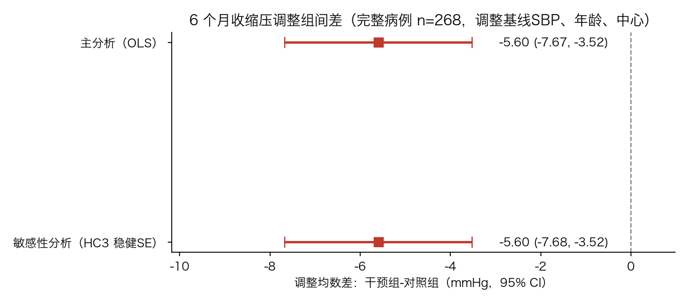
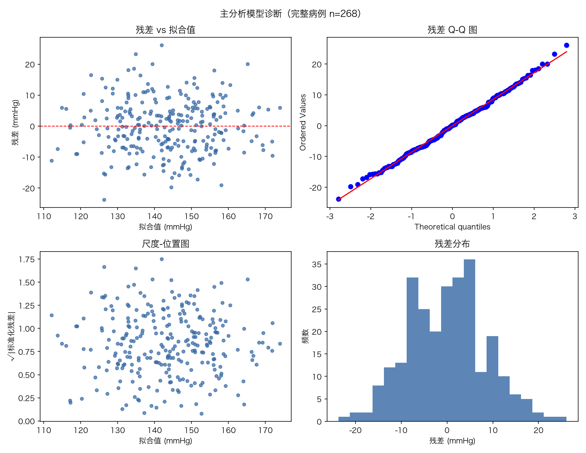

# R1 Manuscript Section Package（英文新拟稿 · 供作者合并）

> **Status declaration.** The original manuscript was not provided to the writing workflow. Every section below is a **newly drafted proposal (PROPOSED)** for the author to merge into the manuscript. Nothing here has been applied to an existing manuscript, and no "before" text is quoted or reconstructed. Paragraph positions cited in the reply letter refer to the Section/paragraph numbering of this package, because the manuscript has no fixed pagination; page-based references are not invented.
>
> **Data statement.** The dataset is program-generated synthetic data (300 simulated participants, 303 records). All estimates in this package describe the synthetic dataset and the analysis pipeline only. They are not evidence of clinical effectiveness and are not generalizable to any real population.
>
> 语言：本包为英文正文，供合并入英文稿件；配套说明文件（处理表、修改对照表、数字核对表）为中文。

---

## Section 1. Introduction（新拟稿 · 对应意见 1、7）

**1.1（第 1 段）Background and rationale.** Hypertension is one of the major modifiable cardiovascular risk factors in older adults, and strengthening the awareness–treatment–control cascade in older community-dwelling residents is the central practical concern that motivates this project. Home blood pressure monitoring (HBPM) is the approach this project examines: repeated home measurement is logistically practicable in community settings, while advantages sometimes assumed for it—low cost and avoidance of the white-coat effect—are treated here as assumptions to be verified, not as established advantages. As one point of reference, a systematic review of self-measured blood pressure monitoring reported a net reduction of approximately 3.9 mm Hg in systolic blood pressure at 6 months with self-monitoring alone [1], although the difference was no longer significant at 12 months. The question this project focuses on is whether measurement support *without* physician-led or patient-led drug titration can lower blood pressure in older Chinese community residents, measured as office systolic blood pressure at 6 months. Whether direct evidence for this question already exists has not been established by the present searches; it would require systematic verification before any claim of an evidence gap is made.

**1.2（第 2 段）Evidence from randomised trials.** One directly relevant randomised trial is TASMINH4, an unmasked randomised controlled trial in UK general practice that randomised 1,182 patients with poorly controlled hypertension from 142 general practices (138 of which enrolled participants) in a 1:1:1 design to usual care, self-monitoring, or self-monitoring with telemonitoring, with drug titration guided by the readings [2]. Its primary endpoint was office systolic blood pressure at 12 months. The main analysis included 1,003 participants (85% of those randomised) as an available-case analysis; the adjusted mean differences versus usual care were −3.5 mm Hg (95% CI −5.8 to −1.2) for self-monitoring and −4.7 mm Hg (95% CI −7.0 to −2.4) for self-monitoring with telemonitoring. The trial recorded cardiovascular events but was not powered to detect differences in cardiovascular outcomes, and it reported no finding on cardiovascular mortality; the reported reductions of roughly 20% in stroke risk and 10% in coronary heart disease risk were model-based projections from the blood pressure difference, not observed endpoints. Direct comparison of telemonitoring with self-monitoring alone showed no significant difference at 12 months (−1.2 mm Hg, 95% CI −3.5 to 1.2). Two features of TASMINH4 deserve emphasis for our question: its effect estimates combine measurement with medication titration, so they cannot be attributed to measurement alone, and its endpoint was measured at 12 months.

**1.3（第 3 段）Gap and objective.** Whether a "measurement-support" intervention—standardised home measurement with records reviewed at routine clinic visits, without steering medication changes—produces a measurable 6-month blood pressure difference in older community-dwelling patients is unknown, and the analytic requirements (prespecified outcomes, transparent handling of missing data, reproducible estimation) are demanding for small community studies. **This report does not answer that clinical question.** It uses a program-generated synthetic dataset, constructed to emulate 300 older hypertensive participants in two communities, to exercise and document the full prespecified analysis pipeline for such a study: data cleaning with an audit trail, a complete-case primary analysis of 6-month systolic blood pressure, prespecified sensitivity analyses, and reproducible reporting. All estimates below quantify the behaviour of this pipeline on synthetic data; they are not estimates of clinical effect (see Section 4.1 and 4.4).

---

## Section 2. Methods（新拟稿 · 对应意见 2、3、4、6、8）

**2.1（第 1 段）Data source and design.** The dataset contains 303 records for 300 simulated participants (identifiers SIM001–SIM300) with 15 variables, generated programmatically to emulate a two-arm study in two communities (site A/B). Group assignment alternates with the participant identifier (odd = control, even = intervention); this is a pseudo-randomised grouping constructed for pipeline testing, **not a real randomised allocation**, and no causal interpretation is warranted. The synthetic data were generated without reference to any real patient, institution, or study; generation parameters are not evidence about real-world effect sizes.

**2.2（第 2 段）Outcomes.** The **primary outcome** was systolic blood pressure at 6 months (mm Hg). The **secondary outcome**, prespecified as descriptive only, was the proportion of participants below the 140/90 mm Hg threshold at 6 months as defined within this dataset; this threshold is a property of the synthetic dataset, not a clinical treatment target adopted by this report. Adherence to home measurement records, number of completed visits, and missingness of 6-month variables were summarised as process and follow-up descriptors, listed separately and not treated as confirmatory endpoints. No subgroup analyses were prespecified.

**2.3（第 3 段）Data cleaning.** Cleaning followed rules fixed before analysis. Three implausible sentinel values (age = 999 in SIM019, BMI = 99 in SIM213, and 6-month systolic blood pressure = 18 mm Hg in SIM098) were set to missing with participants retained. Sex was recorded in six mixed codings (男/M/1, 女/F/0) and recoded to a binary variable (207 rows changed; rows already coded 1/0 unchanged). Only records identical on all 15 fields were removed after field-by-field verification: three duplicate rows at the end of the file (copies of SIM004, SIM107, and SIM255); no conflicting duplicates were found. No mean or any other imputation was performed. Every change was logged (213 log entries recording participant ID, field, original value, new value, and rule); the original file was not modified.

**2.4（第 4 段）Statistical analysis.** The primary analysis was a complete-case linear regression of 6-month systolic blood pressure on group, baseline systolic blood pressure, age, and site (reference = control). We report the adjusted mean difference (intervention − control) with a 95% confidence interval and a two-sided P value (α = 0.05). Model fit was examined with residual-versus-fitted plots, quantile–quantile plots, the Breusch–Pagan test, the Shapiro–Wilk test on residuals, and Cook's distance. Two prespecified analyses accompany the primary model: (i) a sensitivity analysis refitting the model with HC3 heteroskedasticity-robust standard errors (a robustness check of the standard-error estimator, not a missing-data method); and (ii) a comparison of baseline characteristics between participants included in and excluded from the primary analysis, as a description of the missingness pattern (this comparison cannot determine the missingness mechanism or the direction of any bias). Standardised (g-computation) group means were computed as an interpretation of the adjusted model estimate, not as an independent sensitivity test. Participants missing the 6-month outcome or any model covariate were excluded from the primary analysis; this is a complete-case analysis and is explicitly **not** described as a complete intention-to-treat analysis. The secondary outcome was summarised descriptively without hypothesis testing. No post hoc subgroup analyses were performed, and none are presented. All analyses were run in Python (pandas/statsmodels) with a single script (`analysis.py`) that regenerates the cleaned dataset, all tables, all figures, and the summary workbook from the raw file in one run; the console output of the most recent full run is archived.

---

## Section 3. Results（完整英文新拟稿 · 对应意见 3、4、5）

**3.1（第 1 段）Participant flow.** The raw file contained 303 data records. Three records were exact duplicates on all 15 fields (copies of SIM004, SIM107, and SIM255) and were removed after field-by-field verification, leaving **300 unique participants** (150 intervention, 150 control); no conflicting duplicates were identified. Three sentinel values (one each for age, BMI, and 6-month systolic blood pressure) were set to missing with participants retained. The primary analysis required complete data on the 6-month outcome, group, baseline systolic blood pressure, age, and site; **32 participants were excluded** (30 with missing 6-month blood pressure readings, SIM098 whose implausible 6-month systolic value was set to missing, and SIM019 with missing age), leaving **n = 268 (129 intervention, 139 control)** for the primary analysis. One participant (SIM213) had missing BMI only; BMI is not a covariate in the primary model, so this participant was retained.

**3.2（第 2 段）Baseline characteristics.** Baseline characteristics of all 300 participants are shown in Table 1. The two groups were similar: mean age 72.0 ± 7.4 versus 72.1 ± 6.7 years, men 49.3% versus 52.0%, BMI 24.7 ± 2.9 versus 25.4 ± 3.1 kg/m², hypertension duration 10.7 ± 5.2 versus 11.0 ± 6.3 years, diabetes 52.0% versus 47.3%, and baseline blood pressure 150.3 ± 12.3 versus 151.1 ± 11.9 mm Hg systolic and 87.7 ± 7.4 versus 88.2 ± 6.8 mm Hg diastolic (intervention vs control; site B 50.7% vs 46.7%). Age and BMI each had one missing value (n = 299). Process and follow-up descriptors (separate from baseline): adherence to home measurement records 0.69 ± 0.18 versus 0.69 ± 0.17 (scale 0–1), completed visits 4.0 ± 1.4 versus 3.7 ± 1.4. The 6-month outcome was missing for 21 intervention participants (14.0%) and 10 control participants (6.7%).

**3.3（第 3 段）Primary outcome.** In the complete-case primary analysis (n = 268), 6-month systolic blood pressure was **5.60 mm Hg lower (95% CI −7.67 to −3.52; P < 0.001)** in the intervention group than in the control group, adjusted for baseline systolic blood pressure, age, and site (Table 2, Figure 1). Baseline systolic blood pressure was strongly predictive (β = 0.97 per mm Hg, 95% CI 0.89 to 1.06, P < 0.001), whereas age (β = −0.01 per year, P = 0.91) and site B (β = −0.53, P = 0.62) were not associated with the outcome; R² = 0.676. Standardising the whole analytic sample to each group by g-computation gave means of 140.31 mm Hg (intervention) versus 145.91 mm Hg (control), a difference of −5.60 mm Hg, identical to the model coefficient. Model diagnostics showed no material violations: Breusch–Pagan P = 0.752, Shapiro–Wilk P = 0.921, maximum Cook's distance 0.038, and no funnel pattern in the residual plot (Figure 2). The residual standard deviation was 8.54 mm Hg (sample standard deviation of residuals; the model-based residual standard error was 8.61 mm Hg).

**3.4（第 4 段）Sensitivity analysis and missingness comparison.** Refitting the primary model with HC3 heteroskedasticity-robust standard errors gave an essentially identical estimate, −5.60 mm Hg (95% CI −7.68 to −3.52; P < 0.001), indicating that the primary conclusion did not depend on the standard-error estimator. Comparing participants included in the primary analysis (n = 268) with those excluded (n = 32) showed no statistically significant differences in age (72.2 ± 7.0 vs 70.1 ± 7.6 years, P = 0.141), baseline systolic blood pressure (150.9 ± 12.2 vs 149.5 ± 11.4 mm Hg, P = 0.533), BMI (25.0 ± 3.0 vs 25.2 ± 3.3 kg/m², P = 0.800), sex (51.9% vs 40.6% men, P = 0.310), or diabetes (50.7% vs 40.6%, P = 0.371). However, the intervention group accounted for a larger share of excluded participants (65.6% vs 48.1% of included participants, P = 0.092), consistent with the higher 6-month missingness in the intervention group (14.0% vs 6.7%). This comparison describes the missingness pattern; it cannot determine the mechanism of missingness or the direction of any bias that differential missingness may introduce into the complete-case estimate.

**3.5（第 5 段）Secondary outcome.** The proportion of participants below the dataset's predefined 140/90 mm Hg threshold at 6 months was 65 of 129 (50.4%) in the intervention group and 46 of 140 (32.9%) in the control group, among the 269 participants with an observed 6-month control status. In accordance with the prespecified analysis plan this outcome is reported descriptively, without hypothesis testing and without method selection.

**3.6（第 6 段）Data and code availability.** The cleaning audit log (213 entries), the cleaned dataset, all result tables and figures, and a single analysis script that reproduces every number in this section from the raw file are provided as supplementary files; the archived console output of the most recent full run documents reproducibility.

### Table 1. Baseline characteristics of the synthetic cohort (N = 300; descriptive, no between-group tests)

| Variable | Intervention (n = 150) | Control (n = 150) | All (N = 300) |
|---|---|---|---|
| Age, years, mean ± SD | 72.0 ± 7.4 | 72.1 ± 6.7 | 72.0 ± 7.1 (n = 299) |
| BMI, kg/m², mean ± SD | 24.7 ± 2.9 | 25.4 ± 3.1 | 25.1 ± 3.0 (n = 299) |
| Hypertension duration, years, mean ± SD | 10.7 ± 5.2 | 11.0 ± 6.3 | 10.8 ± 5.8 |
| Baseline SBP, mm Hg, mean ± SD | 150.3 ± 12.3 | 151.1 ± 11.9 | 150.7 ± 12.1 |
| Baseline DBP, mm Hg, mean ± SD | 87.7 ± 7.4 | 88.2 ± 6.8 | 88.0 ± 7.1 |
| Men, n (%) | 74 (49.3%) | 78 (52.0%) | 152 (50.7%) |
| Diabetes, n (%) | 78 (52.0%) | 71 (47.3%) | 149 (49.7%) |
| Site B, n (%) | 76 (50.7%) | 70 (46.7%) | 146 (48.7%) |

### Table 2. Primary analysis: linear regression for 6-month systolic blood pressure (n = 268)

| Term | β (mm Hg) | 95% CI | P |
|---|---|---|---|
| Intervention (vs control) | −5.60 | −7.67 to −3.52 | < 0.001 |
| Baseline SBP, per mm Hg | 0.97 | 0.89 to 1.06 | < 0.001 |
| Age, per year | −0.01 | −0.16 to 0.14 | 0.91 |
| Site B (vs A) | −0.53 | −2.61 to 1.55 | 0.62 |

R² = 0.676. Sensitivity analysis with HC3 robust standard errors: intervention β = −5.60 (95% CI −7.68 to −3.52). Standardised means (g-computation; an interpretation of the adjusted model estimate, not an independent sensitivity test): 140.31 vs 145.91 mm Hg.

---

## Section 4. Discussion（修改段 · 新拟稿 · 对应意见 1、6、7）

**4.1（第 1 段）Principal findings, with scope.** On synthetic data constructed to exercise the analysis pipeline, the complete-case adjusted difference in 6-month systolic blood pressure was −5.60 mm Hg (95% CI −7.67 to −3.52), with a descriptive difference in the prespecified secondary outcome (50.4% vs 32.9% below the dataset's threshold). **These numbers quantify the behaviour of a prespecified analysis pipeline on simulated data.** They are not estimates of a clinical effect, and this report makes no claim of clinical value, usefulness, or benefit for any real population.

**4.2（第 2 段）Relation to trial evidence.** The trial evidence that bears on the substantive question is as follows, stated on the trial's own terms; agreement or disagreement between estimates from synthetic data and published trial results would not constitute external validation of either, and this Discussion therefore limits itself to describing the cited evidence and the applicability of the present methods. In TASMINH4, self-monitoring with or without telemonitoring, used to guide medication titration in UK general practice, lowered 12-month office systolic blood pressure by 3.5 and 4.7 mm Hg respectively versus usual care, in an available-case primary analysis of 1,003 (85%) of 1,182 randomised participants; the trial was not powered to detect differences in cardiovascular outcomes and reported no cardiovascular-mortality finding, and its stroke and coronary risk projections were model-based, not observed. Direct comparison found no significant 12-month difference between telemonitoring and self-monitoring alone. Because that trial's intervention embedded medication titration, its effect estimates cannot be attributed to measurement alone—precisely the component our measurement-support question isolates. No cited trial supports a claim that home blood pressure monitoring reduces hard endpoints such as cardiovascular death, and this report makes no such claim.

**4.3（第 3 段）Limitations.** Four limitations bound what these results mean. First, the data are synthetic: they were generated by a program, group assignment alternates with participant identifier rather than arising from a real randomisation, and no causal or clinical interpretation is warranted. Second, the primary analysis is complete-case: 32 of 300 participants (10.7%) were excluded, missingness was higher in the intervention group (14.0% vs 6.7%), and excluded participants contained a larger intervention share (65.6% vs 48.1%, P = 0.092); the included-versus-excluded comparison describes the missingness pattern but cannot determine the mechanism of missingness or the direction of any bias, which therefore cannot be ruled out for the complete-case estimate. No imputation was performed. Third, no subgroup analyses were prespecified in the analysis plan, and none were performed; unplanned subgroup comparisons would raise multiplicity concerns and selecting a significant subgroup for emphasis would constitute selective reporting. Fourth, the secondary-outcome threshold is a property of this dataset, not a clinical treatment target.

**4.4（第 4 段）Conclusion.** This report documents a transparent, reproducible analysis pipeline—prespecified outcomes, audited cleaning, complete-case primary analysis with robustness checks and missingness comparison, and descriptive-only secondary reporting—applied to synthetic data. The estimates it produces characterise the pipeline, not a therapy; they should not be quoted as clinical effectiveness evidence, and the substantive clinical question (whether measurement support without titration lowers blood pressure in older community residents) awaits real data collected under the prespecified protocol.

### Figure 1（图片文件：成果/数据分析/主结果图.png；Word 版已插入实际图片）

**Figure 1.** Adjusted mean difference (intervention − control) in 6-month systolic blood pressure with 95% confidence intervals, from the complete-case primary analysis (OLS) and the HC3 robust-standard-error sensitivity refit (n = 268; adjusted for baseline systolic blood pressure, age, and site).

### Figure 2（图片文件：成果/数据分析/模型诊断图.png；Word 版已插入实际图片）

**Figure 2.** Diagnostic plots for the primary regression model (complete cases, n = 268): residuals versus fitted values (mm Hg), quantile–quantile plot of residuals, scale–location plot, and histogram of residuals (mm Hg).

---

## Section 5. References（新拟稿 · 完整条目与可访问链接）

**[1]** Uhlig K, et al. Self-measured blood pressure monitoring in the management of hypertension: a systematic review and meta-analysis. *Annals of Internal Medicine*, 2013. PMID 23922064. Link: https://pubmed.ncbi.nlm.nih.gov/23922064/ (verification level in this project: abstract; paywalled full text not obtained — see 成果/研究方案/样本量参数来源表.md)

**[2]** McManus RJ, et al. Efficacy of self-monitored blood pressure, with or without telemonitoring, for titration of antihypertensive medication (TASMINH4): an unmasked randomised controlled trial. *The Lancet*, 2018. PMID 29499873; PMCID PMC5854463; DOI 10.1016/S0140-6736(18)30309-X; ISRCTN 83571366. Links: https://pubmed.ncbi.nlm.nih.gov/29499873/ ｜ https://pmc.ncbi.nlm.nih.gov/articles/PMC5854463/ (verification level in this project: abstract + full text, checked 2026-11-01 — see 成果/证据核对/)

---

*End of package. All sections: PROPOSED (newly drafted; original manuscript not provided). No APPLIED items. Figures 1–2 reproduced from 成果/数据分析/ without modification.*
