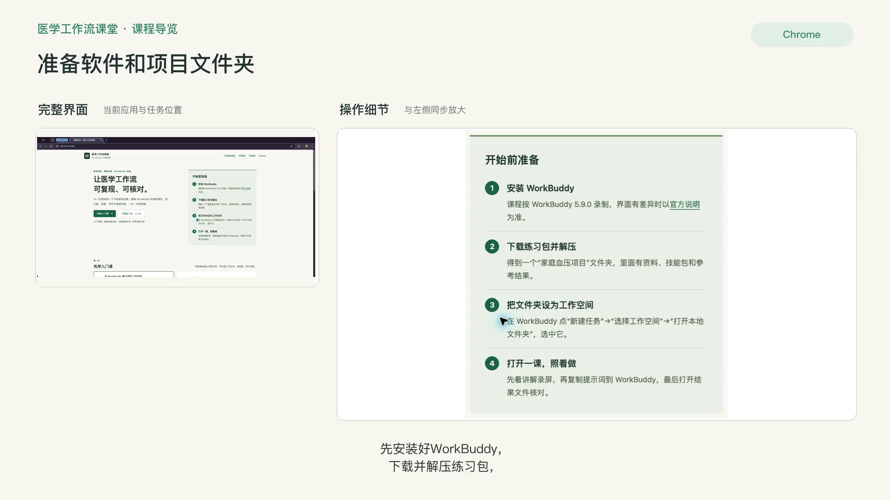
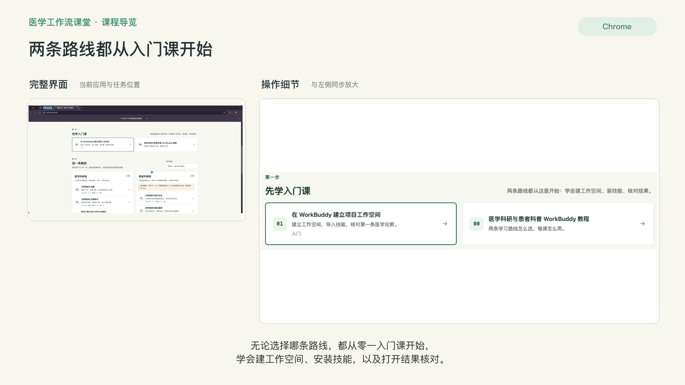
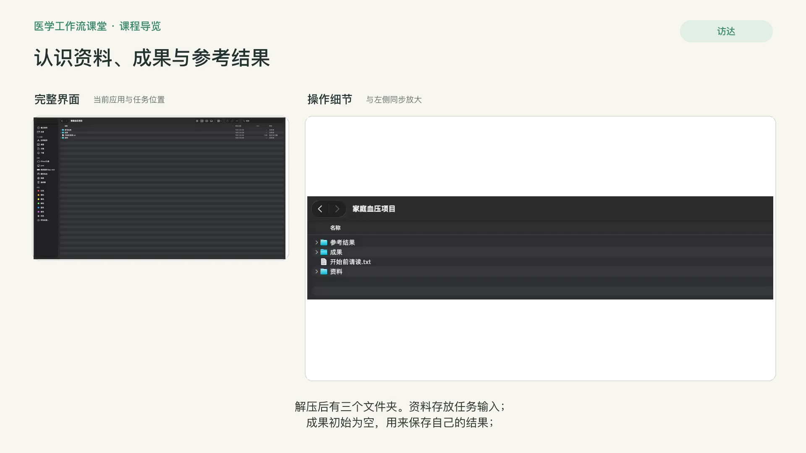
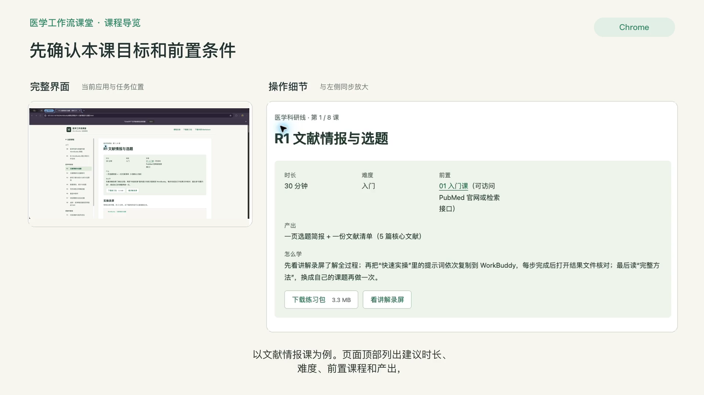
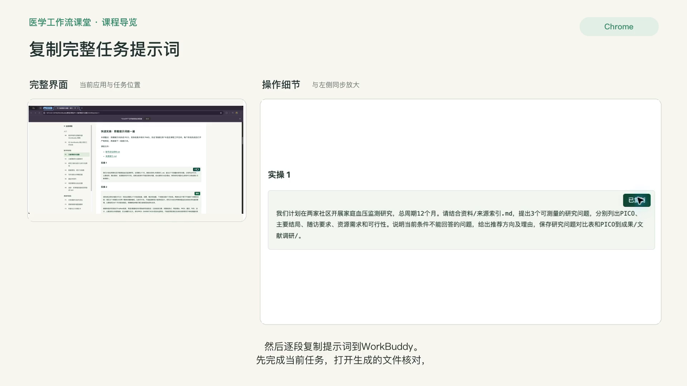
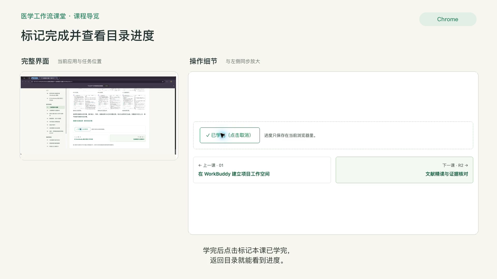

# 医学科研与患者科普 WorkBuddy 教程

这套课程以家庭血压监测为贯穿主题，学习把任务交给 WorkBuddy 执行，再依据来源、数据和实际产物逐步核对。先完成入门课，再进入科研线或患者科普线。

## 学习路线

| 阶段 | 科研线 | 患者科普线 |
| --- | --- | --- |
| 入门 | 工作空间、技能、连接器与结果核验 | 同左 |
| 找问题 | R1 文献情报与选题 | P1 对标定位、P2 问题选题库 |
| 核实来源 | R2 文献精读与引用核对 | P3 事实卡与科普文章 |
| 执行任务 | R3 方案与SAP、R4 清洗统计、R5 写作回复、R6 基金、R7 项目管理 | P4 脚本分镜、P5 图文海报、P6 数字人口播、P7 患教随访 |
| 固化方法 | R8 科研写作Skill | P8 同源内容链路、P9 科普风格与检查Skill |

## 如何使用一课

先看学习目标与素材，再观看讲解录屏，按顺序复制提示词到 WorkBuddy。每得到一个结果，先完成核对动作再进入下一步。截图用于定位界面和比较结果；录屏用于观察输入、操作和修改过程；讲义保留完整提示词与练习。

## 公共素材

“资料”包含模拟临床数据、数据字典与SAP、虚构审稿意见、虚构基金指南、虚构组会转写、模拟对标表和问题库，以及有公开来源的医学事实卡。模拟统计结果只能说明操作方法，不能作为临床有效性证据。事实卡的来源核对与医生审核是两个不同状态。

## 课程贯穿的核对方法

科研论断需要对应文献标识与原文位置；数字需要对应数据表或脚本输出；患者科普中的医学句需要对应事实卡编号。没有拿到全文时不编页码，没完成的实验不写成已经完成，没有医生审核不宣称可直接用于临床或公开发布。

## 从哪里开始

从“01 入门”开始。科研线按 R1 到 R8 学习；患者线先完成 P1、P2，再理解 R1、R2 的检索核对方法，进入 P3 到 P9。每课都可以改用自己的合规素材重做一次。

## 练习包怎么用

下载并解压练习包，将“家庭血压项目”整个文件夹设为 WorkBuddy 工作空间。

- **资料**：任务输入，包括模拟数据、项目背景、审稿意见及附来源的事实卡。
- **成果**：保存自己完成的文件，初始为空。
- **参考结果**：课程任务的实际结果，可在自己完成后对照；跳过前置课程时，把需要的对应文件夹复制到“成果”后继续。

## 每课完成后检查什么

阅读课程中的“本次任务结果与核对”，查看发现的问题和修订依据。打开交付文件检查正文、表格、图片或脚本，确认它们与来源和任务要求一致。未完成的外部审核、实际患者回授或新对话触发测试，按文件记录的真实状态处理。

完成一课后点击“标记本课已学完”，目录会显示学习进度。进度只保存在当前浏览器中。

## 操作画面

[观看课程导览](../录屏/00-WorkBuddy实操.mp4) · [字幕](../录屏/00-WorkBuddy实操.vtt)
