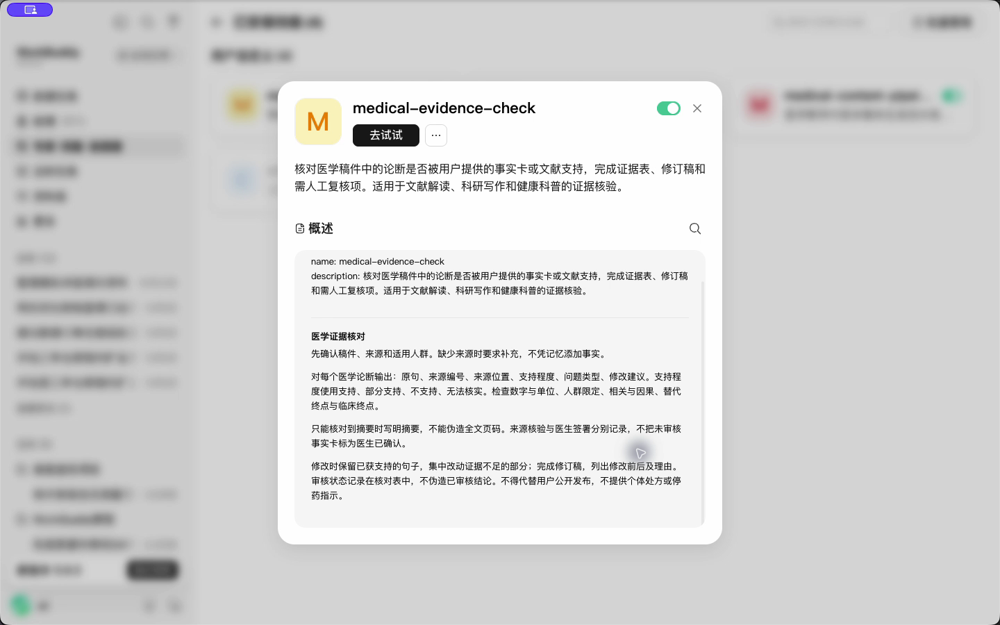
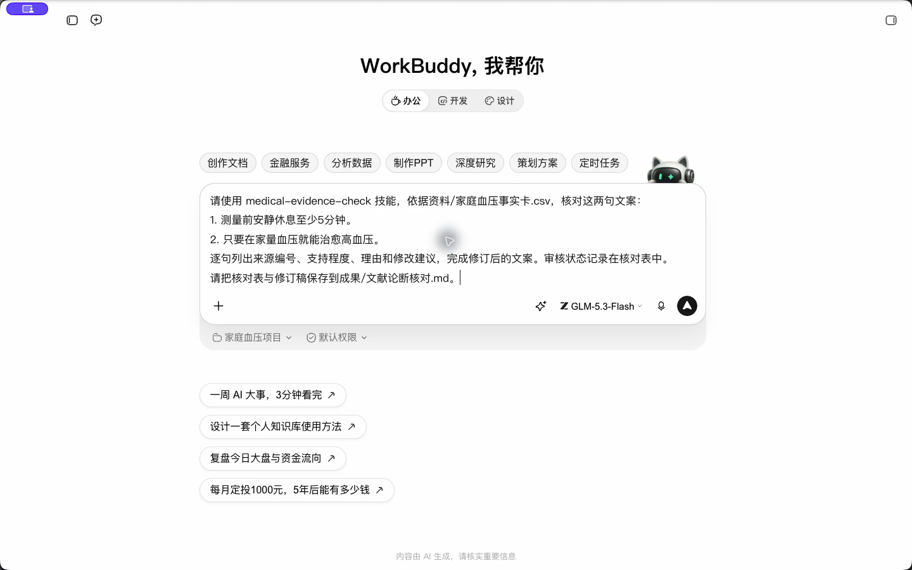
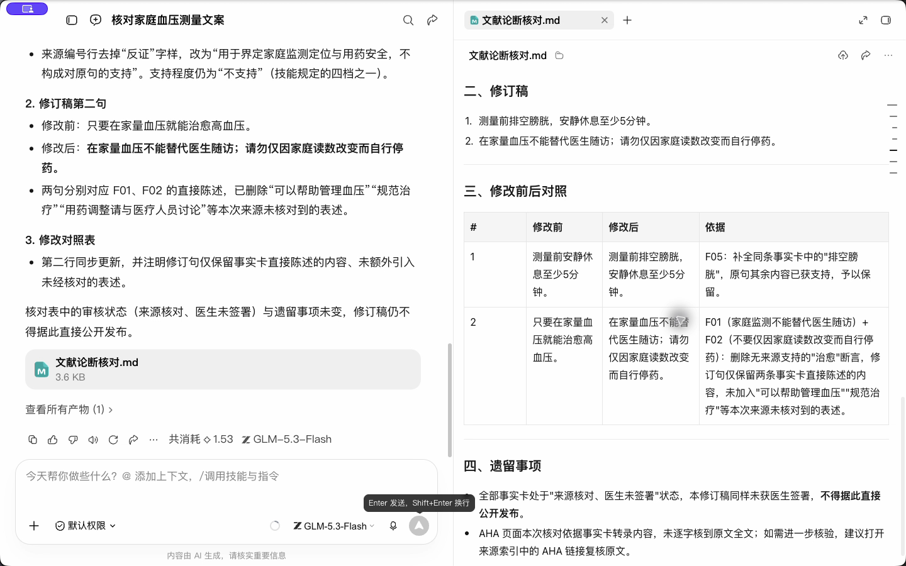
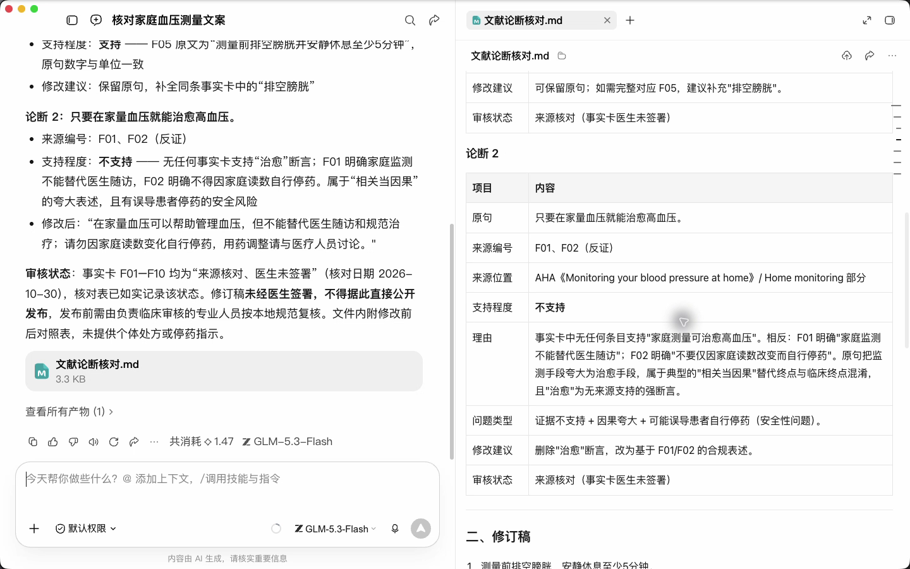

# 入门课：在 WorkBuddy 建立项目工作空间

这一课完成一次可复现的小任务：选择本地资料夹，读懂 Skill 的结构，导入证据核对技能，再让 WorkBuddy 基于给定来源做一次证据核对。

课前文件：

- [medical-evidence-check/SKILL.md](../资料/medical-evidence-check/SKILL.md)：第 2 步要读的技能文件
- [medical-evidence-check.zip](../资料/medical-evidence-check.zip)：第 3 步要上传的技能包
- [家庭血压事实卡.csv](../资料/家庭血压事实卡.csv)：第 4 步核对用的来源

这些文件都已包含在首页的练习包里。解压练习包后，按第 1 步把 家庭血压项目 文件夹选为工作空间即可。

## 五个概念

| 概念 | 作用 | 本课程中的例子 |
| --- | --- | --- |
| Agent | 解释任务、使用工具、组织结果 | WorkBuddy 执行一次文献核对 |
| Skill | 保存某类任务的操作方法 | 先列论断，再核对来源，最后改写 |
| 连接器 | 连接特定外部服务与数据 | 已配置并验证的资料库或检索服务 |
| 工作空间 | 放置任务输入和输出 | 资料与成果文件夹 |
| 代码执行 | 真正运行计算与文件处理 | 对 CSV 计数，计算均数与置信区间 |

Skill 不会自动赋予账号权限，也不能把未经核对的答案变成事实。本地工作空间也不等于模型请求中的数据不会外传。

## 1 选择工作空间

在 WorkBuddy 点击“新建任务”，在输入框下面点“选择工作空间”，再选“打开本地文件夹”。选择本教程的 家庭血压项目 文件夹。输入框下方出现该文件夹名后，再提交任务。

原始数据放在“资料”；生成结果放在“成果”。让每次任务写明输入文件与输出位置，便于找到结果并核对它是否真的生成了文件。

## 2 读一遍技能文件

打开随课的 medical-evidence-check/SKILL.md。最上面的 name 是技能名称，description 说明何时使用；正文规定核对流程。这个技能只含文本规则，没有脚本、账号凭证和自动发布动作。

重点读三处：何时触发、证据不足如何处理、结果保存和发布边界。对于其他技能，还应检查它附带的脚本、第三方接口和费用。

## 3 导入技能

点击“专家·技能·连接器”，选择“技能”。右上角“添加技能 → 上传技能”，再选择本课的 medical-evidence-check.zip。查看检测结果，确认内容与预期一致后继续安装。进入“已安装”检查技能名称和开关。如果提示同名技能已存在，返回已安装列表查看现有规则，不需要重复导入。

界面入口依据 WorkBuddy 5.9.0 实操；后续版本有差异时，查阅[官方技能说明](https://www.workbuddy.cn/docs/workbuddy/From-Beginner-to-Expert-Guide/Function-Description/Skills-Market)。

## 4 点名调用并检查结果

新建任务并选同一工作空间，提交：

```text
请使用 medical-evidence-check 技能，依据资料/家庭血压事实卡.csv，核对这两句文案：
1. 测量前安静休息至少5分钟。
2. 只要在家量血压就能治愈高血压。
逐句列出来源编号、支持程度、理由和修改建议，完成修订后的文案。审核状态记录在核对表中。请把核对表与修订稿保存到成果/文献论断核对.md。
```

观察 WorkBuddy 是否实际读取了技能，结果是否把第二句识别为无依据。文件卡出现后打开预览，核对内容，再到工作空间确认文件存在。不能只依据模型口头说“已保存”。

## 5 理解连接器的边界

在“专家·技能·连接器 → 连接器”中查看当前账号实际提供的项目。没有 PubMed 专用连接器时，R1 使用 PubMed 官网和题录文件完成检索，不照搬其他产品的专属连接器地址。

## 6 写清楚四件事

每个任务写出背景、任务、输入、输出约束。医学任务再加来源范围、数字核对和待人工确认项。与其一次要求“帮我做完科研”，不如按课程顺序拆成能核验的结果。

## 自查与练习

- 任务绑定到正确工作空间，输出文件可打开。
- 可以说清 Skill 与连接器的区别。
- 证据核对能抓出没有依据的疗效句。
- 医生审核状态未被 AI 擅自改写。

练习：把错误句换成一个事实卡没有覆盖的数字，观察结果是否仍要求补来源。


## 本次实操复盘

本次账号已有同名技能，导入检测通过后系统提示不能重复安装；在已安装列表确认了规则和启用状态。

第一轮核对把“来源未支持治愈”解释得过强。追问核对后，结果改为“给定来源不能支持该疗效承诺”，并区分来源不足与直接反证。安装了 Skill 仍然需要检查这类推理边界。


## 配套结果文件

- [文献论断核对.md](../成果/文献论断核对.md)


## 操作画面


人工复核纠正。



已安装技能开关与规则。



技能调用输入。



技能输出及审核状态。



无依据疗效句核对。

录屏带讲解旁白和字幕，展示输入、等待、查看结果与纠正的完整过程，较长生成等待已加速。完整提示词见上文；章节按钮可跳到对应步骤。

[观看01实操录屏](../录屏/01-WorkBuddy实操.mp4) · [操作阶段字幕](../录屏/01-WorkBuddy实操.vtt)
