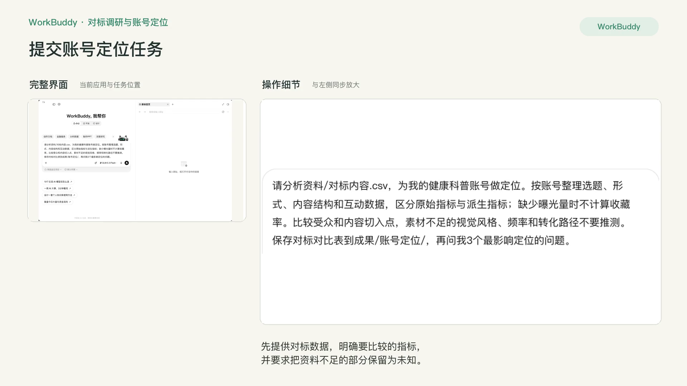
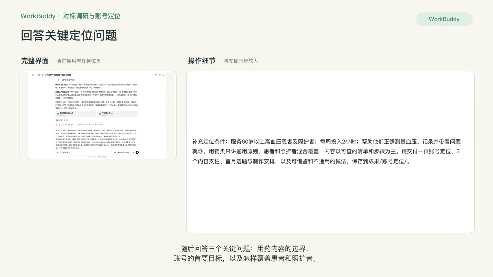
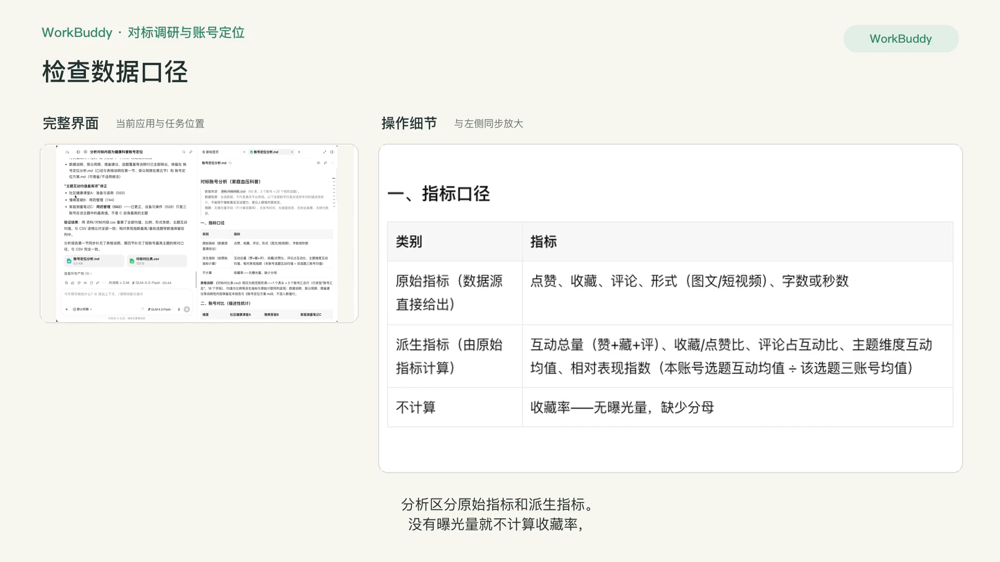
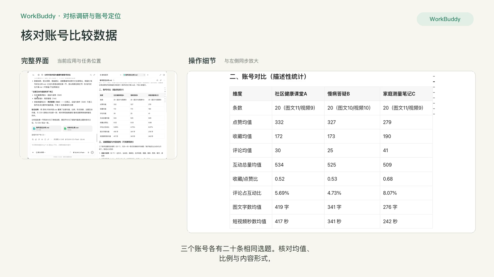
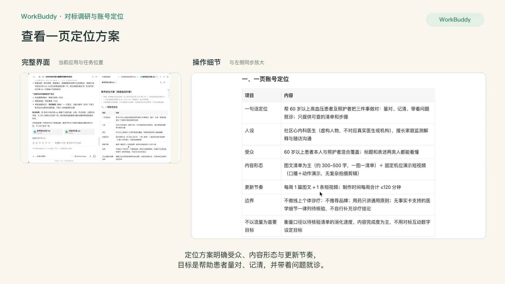
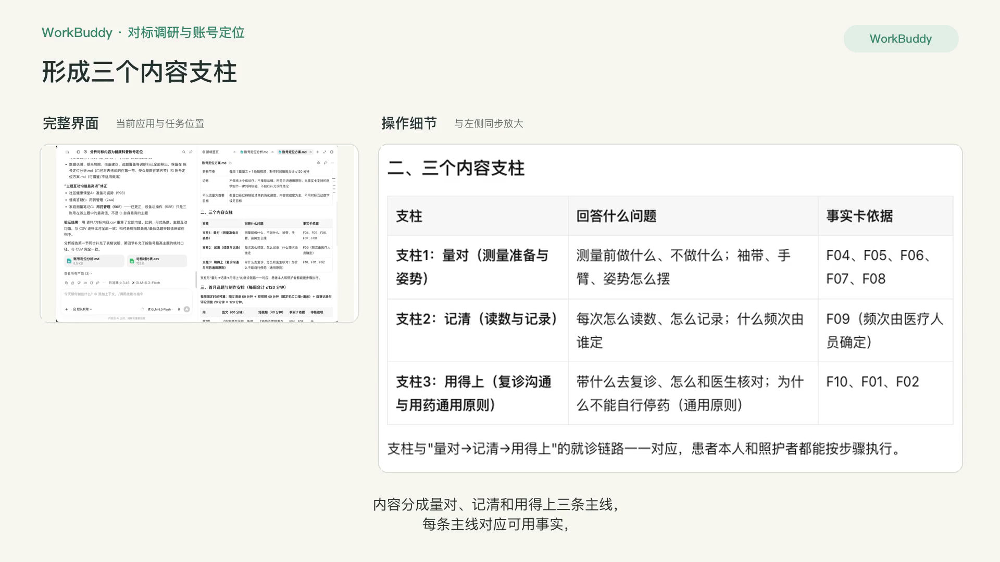
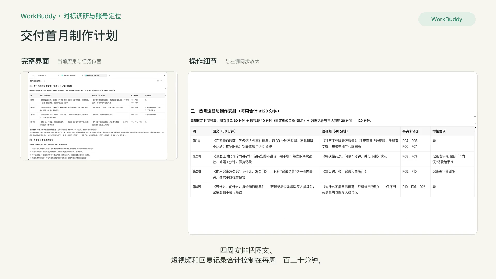

# P1 对标调研与账号定位

## 快速实操：照着提示词做一遍

从对标数据出发，结合受众、内容目标和实际可投入时间，完成定位与首月安排。

课前文件：

- [对标内容.csv](../资料/对标内容.csv)
- [账号定位资料.txt](../资料/账号定位资料.txt)
- [家庭血压事实卡.csv](../资料/家庭血压事实卡.csv)

### 实操 1

```text
请分析资料/对标内容.csv，为我的健康科普账号做定位。按账号整理选题、形式、内容结构和互动数据，区分原始指标与派生指标；缺少曝光量时不计算收藏率。比较受众和内容切入点，素材不足的视觉风格、频率和转化路径不要推测。保存对标对比表到成果/账号定位/，再问我3个最影响定位的问题。
```

### 实操 2

```text
补充定位条件：服务60岁以上高血压患者及照护者；每周投入2小时；帮助他们正确测量血压、记录并带着问题就诊。用药类只讲通用原则，患者和照护者混合覆盖，内容以可查的清单和步骤为主。请交付一页账号定位、3个内容支柱、首月选题与制作安排，以及可借鉴和不适用的做法，保存到成果/账号定位/。
请同时收紧分析结论：收藏/点赞比高不等于互动质量高，评论占比不能推断受众人群，合成样本的比较不能写成已验证真实互动潜力。删除这些无依据的推断。资料/对标内容.csv的数据来源说明已统一为合成数据，报告保留来源与局限，直接呈现定位方案。每周制作安排合计不能超过120分钟，医学细节没有事实卡支持时列待核验，不为选题自行补充诊疗结论。
```

### 实操 3

```text
最后请按当前来源统一两份报告的数据与身份表述：数据性质写“合成数据，不代表真实平台表现”；人设写“虚构人物，不对应真实医生或机构”。保留统计口径、实际限制、定位决策和首月安排，保存当前文件名。
```

### 实操 4

```text
请把对标对比表CSV整理为规范的矩形数据表：只保留一个表头和3个账号数据行，字段数必须一致；数据说明、受众局限、借鉴建议留在分析报告中，不混入数值数据行。均值和比例属于派生指标，行类型不要称“原始指标汇总”。“主题强项”改为中性的“主题互动均值最高项”，并按已计算的主题表核对：A最高为准备与姿势593，B为用药管理744，C为用药管理562，不能把C的设备与操作528称为最高。重新读取CSV验证行列与数值后保存。
```

## 完整方法：理解每一步，迁移到自己的课题

患者线的第一课不写任何内容，而是先想清楚“我为谁、解决什么问题、和别人有什么不同”。你会用 Agent 拆解 2 个对标账号，提炼它们的方法，再得到一页纸的个人定位。后面所有科普内容都以这页纸为标准。

| 项目 | 内容 |
| --- | --- |
| 难度 | 1 |
| 时长 | 30 分钟 |
| 前置 | 01 入门课 |
| 产出 | 对标拆解表 + 一页纸定位 |
| 用到的工具 | WorkBuddy 可用的网页搜索与网页读取；baoyu-url-to-markdown（可选）；WorkBuddy 浏览器工具（可选） |

## 1. 对标要学什么

| 维度 | 要回答的问题 |
| --- | --- |
| 人设 | 他给患者的印象是什么：权威、亲切、幽默、结论直接？ |
| 选题分布 | 疾病科普、病例故事、辟谣、生活方式各占多少 |
| 标题公式 | 常用的几种标题结构 |
| 开头钩子 | 视频前 3 秒或文章首段怎么留住人 |
| 内容结构 | 一篇 / 一条内容的固定套路 |
| 视觉风格 | 封面、字幕、配色、拍摄场景 |
| 更新节奏 | 频率、是否有固定栏目 |
| 转化路径 | 引导到哪：门诊、直播、群、课程，还是不引导 |
| 合规做法 | 如何处理免责声明、患者隐私、药品提及 |

## 2. 课前准备

- 选 2 个对标账号：同科室或相近专业的医生科普号，一个“做得很好但你学不来”的，一个“和你条件差不多”的。
- 每个账号收集近 20 条内容：公众号文章可以直接给链接；视频平台和小红书的数据请手动记录或截图（标题、形式、时长、点赞收藏评论数）。
- 你自己的信息：科室、专长、门诊最常见的患者、每周能投入多少时间、是否愿意出镜。

说明：各平台对自动抓取有限制，教程不演示绕过登录或反爬。手动记录 20 条大约 15 分钟，这个过程本身也是学习。

## 3. 操作步骤

### 第 1 步：整理原始材料

```text
我在做医生科普账号的对标研究。下面是两个对标账号的资料：
- 账号 A：公众号文章链接（见下方），以及我截图的视频列表；
- 账号 B：我手动记录的 20 条内容表格。
请先把所有材料整理成一张统一表格：账号 | 标题 | 形式 | 时长或字数 | 互动数据 | 选题类型。无法获取的信息留空，不要估计。
```

如果装了 baoyu-url-to-markdown，可以说“用 url-to-markdown 把这 5 篇文章转成文本”，再进行分析。

### 第 2 步：九维拆解

```text
请按以下九个维度拆解这两个账号：人设、选题分布、标题公式、开头钩子、内容结构、视觉风格、更新节奏、转化路径、合规做法。
要求：
1. 输出一张对比表，行是维度，列是账号 A / 账号 B；
2. 有素材支持的每一格给出 1–2 个具体例子；无法从素材判断的维度标“素材不足”，不得补造。（引用标题或内容片段），不要写“风格亲切”这类空话；
3. 标题公式请抽象成可复用的模板，例如“患者原话 + 医生反问”。
```

**检查点**：挑一格看它给的例子是不是真的来自你给的材料。没有例子的格子要求重写。


### 第 3 步：提炼方法论

```text
基于拆解表，请分别列出：
- 我可以借鉴的 3 点（说明怎么用到我的内容里）；
- 我不应该照搬的 3 点（说明原因，例如他有专业团队、他的风格依赖个人特质、存在合规风险）。
```

### 第 4 步：让 Agent 追问你，再出定位

```text
现在帮我做个人定位。我的信息：（科室、专长、常见患者、每周可投入时间、是否出镜）。
开始之前先问我 3 个问题，帮助你找到我和对标账号的差异。
```

Agent 可能会问：“患者最常对你说的一句话是什么？”“你有什么别的医生没有的经历或视角？”“你希望患者看完做什么？”认真回答，定位是否具体就取决于这几个答案。


### 第 5 步：生成一页纸定位

```text
请按下面的模板写我的一页纸定位，每项都要具体到可以拿来判断“这条内容该不该发”。
```

## 4. 一页纸定位模板与示例

| 项目 | 示例（虚构） |
| --- | --- |
| 一句话定位 | 帮 60 岁以上高血压患者和子女，把“在家量血压”这件小事做对 |
| 目标人群 | 60 岁以上高血压患者；更重要的是帮父母买血压计的 30–50 岁子女 |
| 内容支柱 | 1. 家庭血压测量  2. 用药常见误区  3. 什么时候必须去医院 |
| 差异化 | 只讲“在家里怎么做”，每条内容都给一个可立即执行的动作 |
| 固定栏目 | “门诊里的一句话”：用一句患者原话开场 |
| 更新频率 | 每周 1 条短视频 + 每月 1 篇长文 |
| 内容红线 | 不推荐具体品牌；不承诺疗效；不使用可识别的患者信息；每条都有就医提示 |

## 5. 自查清单

- [ ] 拆解表每格都有具体例子
- [ ] “不应照搬”的 3 点写了原因
- [ ] 一句话定位里有“为谁”和“解决什么”
- [ ] 内容红线至少 3 条
- [ ] 拿一条你想发的内容对照定位，能判断“该不该发”

## 6. 常见问题

**Agent 抓不到对标账号内容？** 正常，很多平台需要登录。用截图或手动记录，Agent 能直接读取截图中的文字。

**定位和对标太像？** 回到第 4 步，告诉 Agent“我不想和账号 A 一样，请找出只有我能讲的角度”。

## 7. 练习

选一个和你完全不同科室但做得很好的医生账号，只拆“开头钩子”和“内容结构”两个维度，看看能否迁移到你的领域。

## 下一课

P2 会围绕你定下的 3 个内容支柱，建立一个带优先级的患者高频问题选题库。

## 本次任务结果与核对

对比三个账号各20条相同选题，分别统计点赞、收藏、评论、内容形式及派生指标。没有曝光量，不计算收藏率；没有受众、时间戳或画面资料，不推断受众画像、发布频率和视觉风格。来源为合成数据，数值用于描述这份资料，不代表真实传播表现。

确认的定位条件是：服务60岁以上患者及照护者，用药只讲通用原则，每周投入两小时，帮助读者量对、记清并带着问题就诊。最终方案给出三个内容支柱和四周安排，每周图文60分钟、短视频40分钟、数据记录与回复20分钟，合计120分钟。

CSV 已整理为一个表头与三个账号数据行，每行16列。账号均值、比例和主题最高项与来源重新计算核对；C账号自身的最高主题是用药管理（562），不能将设备与操作（528）误称为其最高项。缺少事实支持的医学细节列入待核验内容。

交付文件：

- [账号定位分析.md](../成果/账号定位/账号定位分析.md)
- [账号定位方案.md](../成果/账号定位/账号定位方案.md)
- [对标对比表.csv](../成果/账号定位/对标对比表.csv)

## 操作画面















[观看 P1 实操录屏](../录屏/P1-WorkBuddy实操.mp4) · [字幕](../录屏/P1-WorkBuddy实操.vtt)
