# P2 患者高频问题选题库

## 快速实操：照着提示词做一遍

把患者问题原话整理为可追溯的选题库，完成评分、证据筛选、首月排期和可搜索的看板。

课前文件：[患者问题](../资料/患者问题.csv)、[账号定位资料](../资料/账号定位资料.txt)、[家庭血压事实卡](../资料/家庭血压事实卡.csv)。

### 实操 1

```text
请读取资料/患者问题.csv和资料/账号定位资料.txt，整理适合账号持续创作的患者问题。合并同义问题并保留原话、来源编号和合计频次，按家庭测量、记录随访、特殊情况和就医沟通分类。每个选题列受众、核心问题、内容角度和所需证据，尚未核验的依据如实标注。

请生成可排序的Excel选题库，原始问题支持时保留至少30个独立选题，避免为凑数拆题。列需求0–2、专业匹配0–1、证据充分0–1、重要性0–1、风险扣分0–1及评分理由，公式为max(0,min(5,前四项之和－风险扣分))。添加状态下拉、筛选和色阶，把需要专业复核的题目单列并保留来源。给出首月优先制作清单，检查公式后保存到成果/选题库/。
```

### 实操 2

```text
请修订选题库后重新核对：
1. 只合并真正同义的问题。坐多久与能否聊天、跷腿与无靠背、第一次高值重测与两次间隔等只是相关，保留各自独立选题；Q04与Q35可合并，其他如无真正同义则保留。36条来源均须覆盖一次，合计频次与原CSV一致。
2. “证据充分”不能因为“指南应该有”就给1分。请实际读取资料/家庭血压事实卡.csv，为有足够支持的选题列出F编号、完整支持范围；仍未核验或支持不足的记0并列待核验，医学建议不能凭空补写。“两次取平均”并非F09所写，现有依据只支持两次读数、间隔1分钟并记录。
3. 需求评分写明阈值，全部评分保留底层数字及公式。首月清单根据更新后的总分、证据状态和每周2小时约束重新安排，未核验题目先安排核验、不能当作可直接发布。
4. 同步复核清单、说明页、筛选下拉与色阶，设置各表合理列宽、换行和行高，完整显示长文本。保留同名Excel。
```

### 实操 3

```text
请做最后几处一致性修正并保存同一工作簿：删除说明页“无权威依据的选题按经验型内容标注后发布”的例外，医学结论缺依据时继续待核验，不靠标签替代依据；专业复核清单按实际数据行统计，说明页数量应与之保持一致。袖带相关内容和首月计划统一为“露出测量的上臂，袖带按说明接触皮肤”，不将挽袖或只脱外套写成通用解决办法。首月每周明确制作和核验各用多少分钟，合计不超过120分钟，待核验题状态统一为暂缓。保持35题、36个来源各覆盖一次、353合计频次、所有评分公式与事实编号不变；再次检查每张表长文本完整显示。
```

### 实操 4

```text
请基于最终的高血压科普选题库.xlsx补一份可直接打开的HTML选题看板，提供关键词搜索、分类和证据状态筛选、按评分排序；35个选题都要能查看患者原话、来源编号、评分理由、支持范围和状态。另设首月安排、专业复核与待核验区，统计由工作簿实际数据产生，明确每周120分钟。提供原Excel下载链接。内容角度中超出事实卡的扩展，例如运动后行走/家务等待示例、袖带具体尺寸测量方法，应删去或明确需要补充依据后再写；不把事实卡编号存在当作所有扩展都已核对。修改后保持Excel与看板数据一致，打开看板检查筛选结果。
```

## 完整方法：理解每一步，迁移到自己的课题

科普最大的消耗不是写，而是每次都在想“这次写什么”。这一课帮你一次性建好一个至少 30 题、按优先级排好的选题库，以后 P3–P8 的所有内容都从这里挑。

| 项目 | 内容 |
| --- | --- |
| 难度 | 1 |
| 时长 | 30 分钟（不含课前一周的问题收集） |
| 前置 | P1（一页纸定位里的 3 个内容支柱） |
| 产出 | 选题库 Excel（≥ 30 题，带优先级和适合载体） |
| 用到的 Skill | xlsx；WorkBuddy 可用的网页搜索 |

## 1. 好选题从哪里来

| 来源 | 优点 | 注意 |
| --- | --- | --- |
| 门诊里患者的原话 | 最真实，可直接做标题 | 课前用一周时间随手记 |
| 患者群、随访电话中的问题 | 量大，可看出频率 | 上传前必须删掉姓名、头像、电话 |
| 搜索引擎和平台的下拉联想词 | 代表公众真实搜索 | 只作参考，不追流量 |
| 指南的患者版 / 常见问题 | 有权威答案，写起来快 | 可能不是患者最关心的 |
| 对标账号的高互动内容（P1） | 已被验证受欢迎 | 只借鉴问题，不抄内容 |

## 2. 操作步骤

### 第 1 步：汇集问题

把你一周记下的问题、脱敏后的群聊截图一起上传：

```text
这是我收集的患者问题（门诊记录 + 群聊截图）。请提取出所有问题，尽量保留患者的原话表达，一行一个。截图中如果还有未处理干净的个人信息，请提醒我并跳过。
```

再补充外部来源：

```text
围绕“家庭血压监测”这个主题，请搜索公众常问的问题，补充 15 个我列表里没有的。每个问题注明你在哪里看到的。
```

### 第 2 步：去重与归类

```text
请把意思相同的问题合并，保留最生动的一种说法作为“问题原话”，并记录被问了多少次。然后归入我的 3 个内容支柱：（从 P1 一页纸复制）。不属于任何支柱的放在“其他”。
```

**检查点**：“其他”如果很多，要么是问题收集偏了，要么是你的内容支柱需要调整。

### 第 3 步：逐题标注

```text
请对每个问题按下表列定义标注。证据充分度和合规风险是初步判断，不确定的标“待医生判断”。
```

| 列名 | 说明 |
| --- | --- |
| 问题原话 | 保留患者口语，可直接做标题素材 |
| 被问次数 | 来自第 2 步的合并计数 |
| 内容支柱 | 对应 P1 定位 |
| 目标人群 | 新诊断患者 / 长期服药者 / 家属 |
| 季节性 | 如冬季、春节前后、无 |
| 证据充分度 | 有指南推荐 / 有研究 / 仅专家意见 / 待医生判断 |
| 合规风险 | 低 / 中 / 高（涉及具体用药、疗效、辅助治疗产品的为高） |
| 适合载体 | 长文 / 短视频 / 图文 / 口播 / 患教单（可多选） |
| 优先级 | 第 4 步计算 |

### 第 4 步：优先级打分

```text
请按以下规则给每题打优先级（0–5 分）：
- 患者需求（被问次数、搜索热度）：高 2 分 / 中 1 分 / 低 0 分
- 专业匹配（是否属于我的专长）：是 1 分
- 证据充分（有指南或研究）：是 1 分
- 临床重要性（做错会不会伤害患者）：是 1 分
- 合规风险高：减 1 分
总分使用 max(0,min(5,各项得分之和－风险扣分))，并保留各项评分理由。然后按优先级从高到低排序。
```

**为什么要加“临床重要性”**：有些问题患者很少问，但做错了后果严重（例如自行停药），这类题应该优先写。

### 第 5 步：生成 Excel 并人工调整

```text
请生成选题库 Excel：一个总表（全部列，按优先级排序，优先级用色阶显示），以及每个内容支柱一个分表。加一列“状态”（下拉：待写/写作中/已发布）和一列“发布日期”。
```

打开 Excel，你自己把“待医生判断”的格子填完，并把合规风险高、你又没有把握的题移入“待医生复核”工作表，保留来源与判断记录。


## 3. 选题库示例（前 5 行，虚构）

| 问题原话 | 支柱 | 证据 | 风险 | 载体 | 优先级 |
| --- | --- | --- | --- | --- | --- |
| 左手右手量出来不一样，以哪个为准？ | 家庭测量 | 有指南 | 低 | 短视频、图文 | 5 |
| 血压正常了可以停药吗？ | 用药误区 | 有指南 | 中 | 长文、口播 | 5 |
| 为什么在家量的比医院低？ | 家庭测量 | 有研究 | 低 | 长文 | 4 |
| 早上起来头晕要不要去医院？ | 何时就医 | 待医生判断 | 中 | 患教单 | 4 |
| 腕式血压计准不准？ | 家庭测量 | 有研究 | 中（易涉及品牌） | 图文 | 3 |

## 4. 自查清单

- [ ] 至少 30 题，支柱覆盖合理，不为凑数量虚构问题
- [ ] 问题保留了患者口语
- [ ] 每题都有证据充分度和合规风险
- [ ] “待医生判断”已全部处理
- [ ] 没有任何患者个人信息

## 5. 常见问题

**搜索热词靠谱吗？** 只是参考。Agent 的网页搜索拿不到平台内部的热度数据，真正可靠的是你门诊里的记录。

**选题库多久更新一次？** 每月一次，把新收集的问题追加进去，重跑第 2–4 步。把 Excel 放在 工作空间 里会更方便。

## 6. 练习

从选题库里挑出优先级最高的 4 题，排成下个月的发布计划。

## 下一课

P3 是患者线的核心：从选题库挑 1 题，先做事实卡，再写公众号文章并逐句核验。

## 本次任务结果与核对

交付Excel工作簿与HTML选题看板，包含35个独立选题；36条合成问题来源各覆盖一次，合计频次353。评分保留底层数值和公式，14项已有事实卡支持，21项待核验并暂缓，5项单列专业复核。

工作簿有选题库、首月优先清单、专业复核清单、待核验清单和说明五张表，已检查公式与长文本显示。看板的35×21个选题字段及19行排期与工作簿逐项一致，实际测试了F06搜索、证据状态筛选、频次排序及各专区。

首月安排16项任务：每周两条制作各45分钟、两项核验各15分钟，四周均120分钟；另有三个备选选题，启用时在同一时间额度内替换。表尾说明不计入任务数。支持范围以事实卡实际覆盖为准，超出的扩展保留待补依据。

问题及频次是合成输入，来源核对和医生签署为不同状态；本次未完成医生签署或内容发布。

交付文件：

- [高血压科普选题库.xlsx](../成果/选题库/高血压科普选题库.xlsx)
- [选题看板.html](../成果/选题库/选题看板.html)

## 操作画面

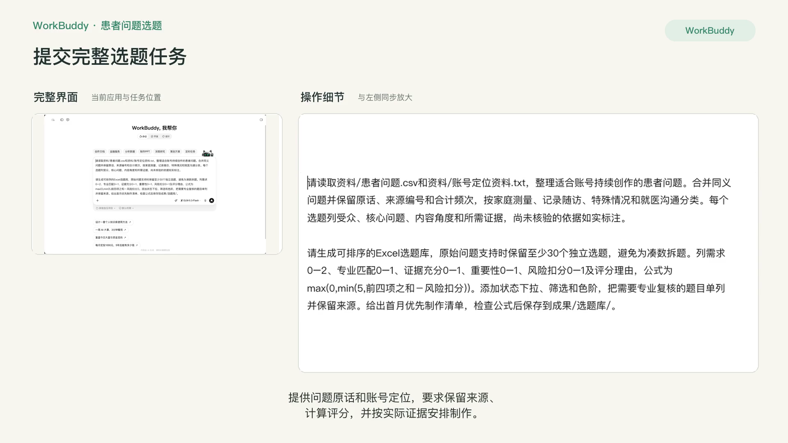

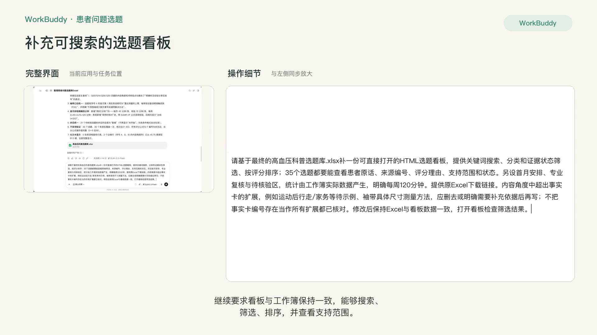

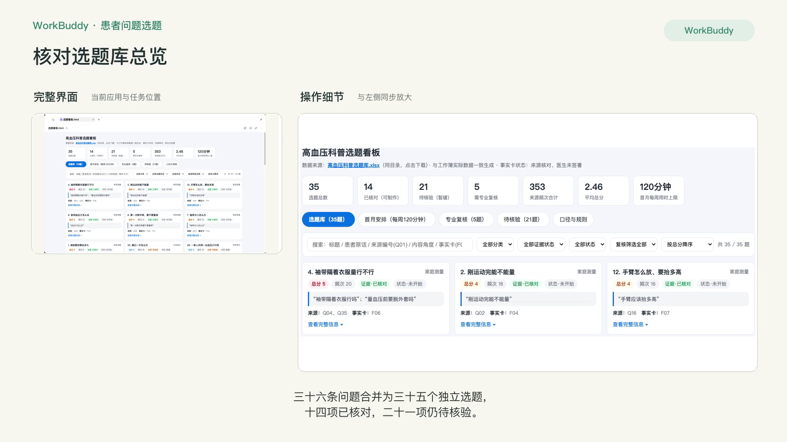

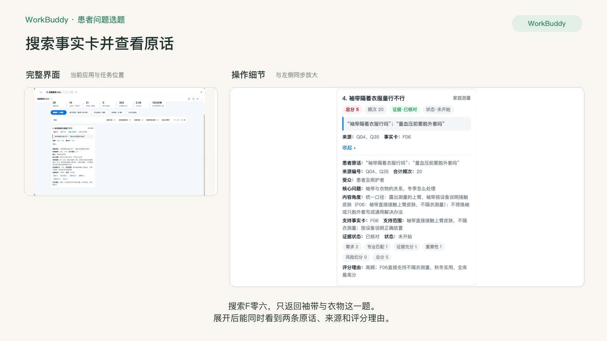

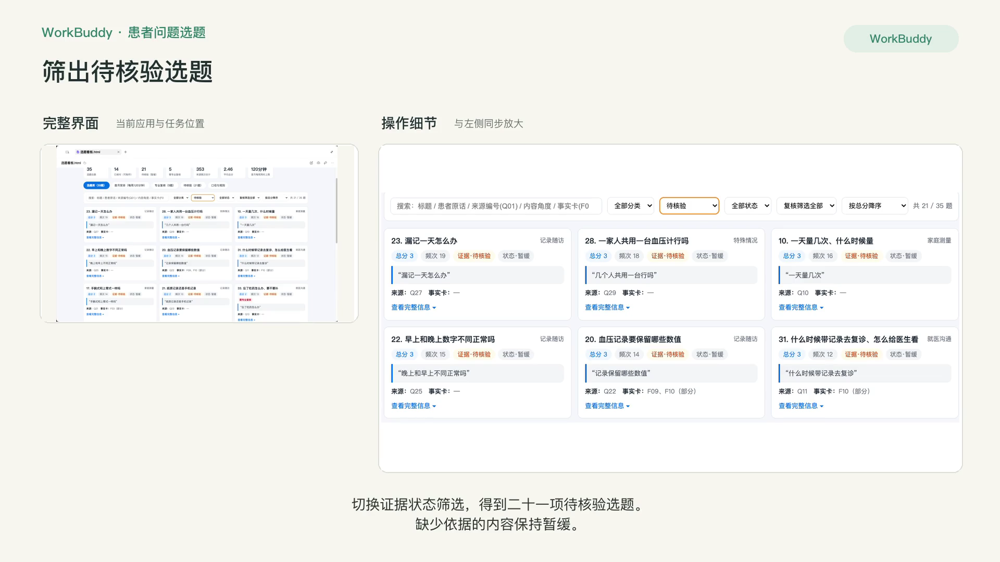

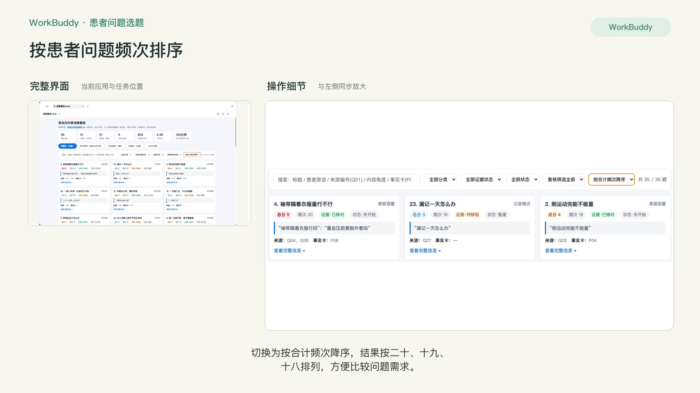

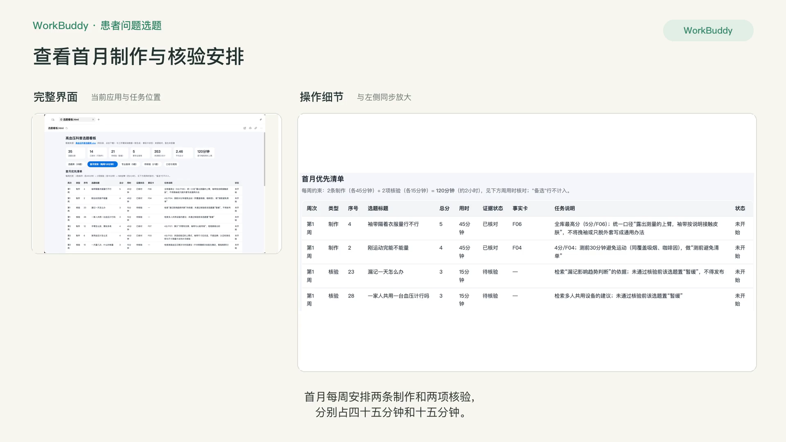

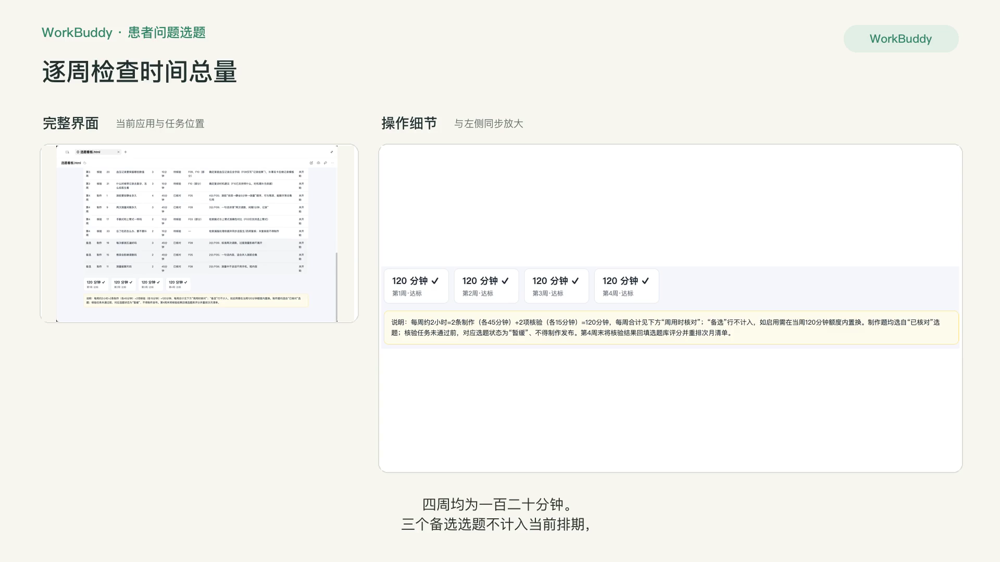

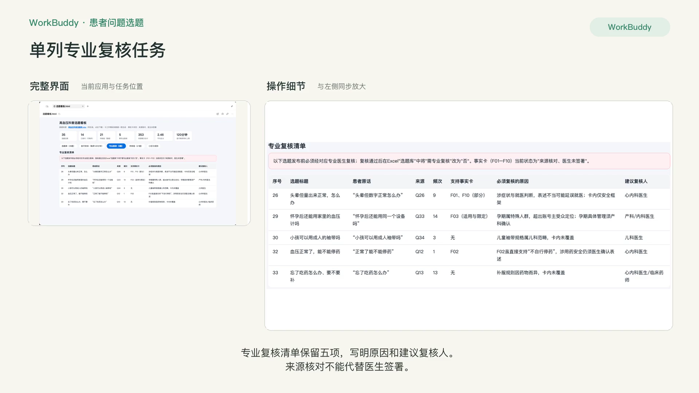

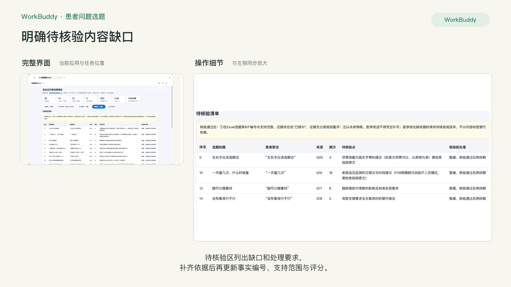

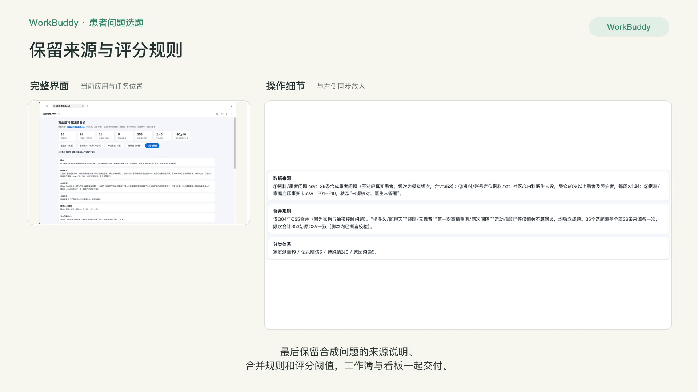

[观看 P2 实操录屏](../录屏/P2-WorkBuddy实操.mp4) · [字幕](../录屏/P2-WorkBuddy实操.vtt)
