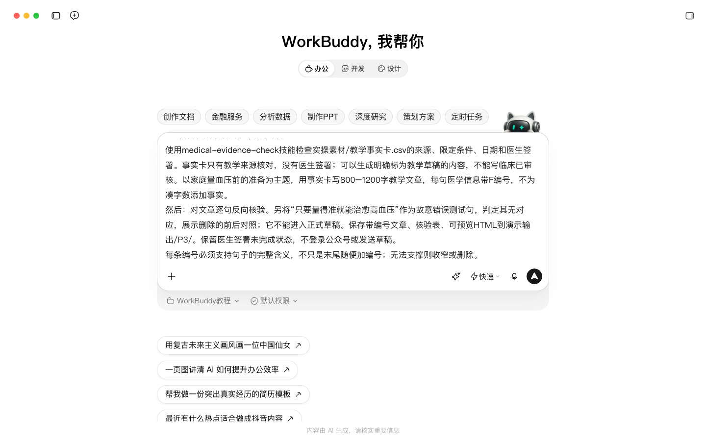
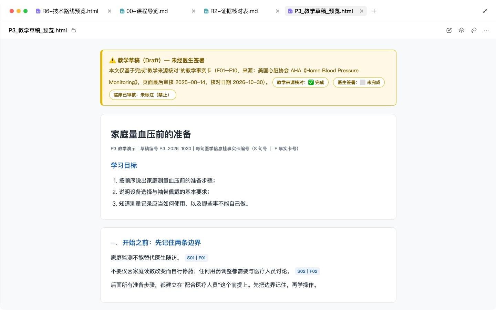
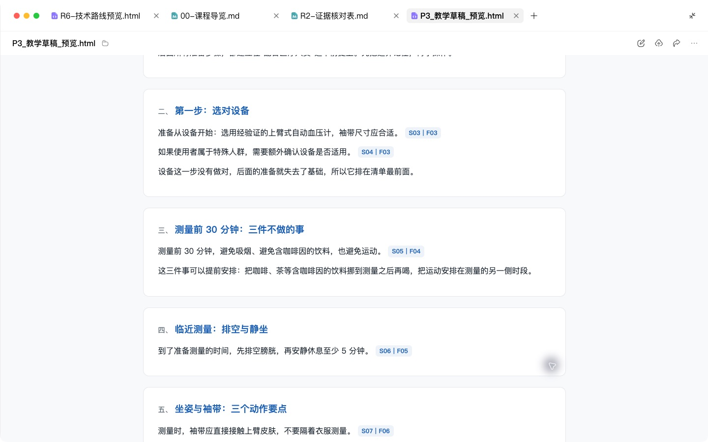

# P3 科普长文 / 公众号：由事实卡生成并核验

## 快速实操：照着提示词做一遍

本课重点：从有来源的事实卡写文并反向核验。先在“新建任务”中选定课程工作空间。每个阶段完成后打开产物预览，再继续下一段提示词。

课前文件：

- [教学事实卡.csv](../实操素材/教学事实卡.csv)
- [来源索引.md](../实操素材/来源索引.md)

### 实操 1

```text
当前工作空间：WorkBuddy教程。
使用medical-evidence-check技能检查实操素材/教学事实卡.csv的来源、限定条件、日期和医生签署。事实卡只有教学来源核对，没有医生签署；可以生成明确标为教学草稿的内容，不能写临床已审核。以家庭量血压前的准备为主题，用事实卡写800–1200字教学文章，每句医学信息带F编号，不为凑字数添加事实。
```

### 实操 2

```text
当前工作空间：WorkBuddy教程。
对文章逐句反向核验。另将“只要量得准就能治愈高血压”作为故意错误测试句，判定其无对应，展示删除的前后对照；它不能进入正式草稿。保存带编号文章、核验表、可预览HTML到演示输出/P3/。保留医生签署未完成状态，不登录公众号或发送草稿。
```

## 完整方法：理解每一步，迁移到自己的课题

这是患者线最重要的一课。你会学到一套方法：先把医学事实做成“事实卡”并亲自确认，再让 Agent 只用这些事实写文章，最后反向核验每一句。核验记录可以帮助你发现错误，最终内容仍需负责审核的专业人员确认。P4–P9 全部建立在这个方法上。

| 项目 | 内容 |
| --- | --- |
| 难度 | 1 |
| 时长 | 45 分钟 |
| 前置 | P1（定位）、P2（选题库）；建议先学 R1、R2 的检索和核对方法 |
| 产出 | 1 张事实卡 + 1 篇 1500–2500 字公众号文章 + 核验记录 + 公众号草稿 |
| 用到的 Skill | PubMed 检索工具（官网或已核验的连接器）、Humanizer-zh、baoyu-markdown-to-html / baoyu-post-to-wechat、baoyu-cover-image（后三者可选） |

## 1. 什么是事实卡，为什么要先做它

直接让 AI 写科普，它会把“大致对”的内容写得非常流畅，你很难从一篇通顺的文章里发现哪句是没有依据的。事实卡把“对不对”和“好不好读”拆成两步：

1. 事实卡：只管对不对。一句一条，每条有出处，由你确认。
2. 文章：只管好不好读。只能使用事实卡里的事实。

事实卡字段：

| 字段 | 说明 |
| --- | --- |
| 编号 | F01、F02……文章中用它标注 |
| 事实陈述 | 一句话，专业表述 |
| 来源 | 指南名称+页码，或 PMID |
| 证据等级 | 指南推荐 / 系统综述 / 单项研究 / 专家共识 |
| 适用人群 | 这条事实适用于谁 |
| 不可外推到 | 哪些人不适用，写科普时最容易被丢掉的部分 |
| 医生确认 | 已确认 / 需修改 / 删除 |
| 更新日期 | 指南更新后要复查 |

## 2. 操作步骤

本课示例选题（来自 P2）：“量血压前，需要做哪些准备？”

### 第 1 步：准备来源

在“高血压家庭血压监测”工作空间 里确认已有指南 PDF。再用 PubMed 补充证据：

```text
选题：“量血压前，需要做哪些准备？”
请：
1. 在项目中的指南里查找与家庭血压测量准备、测量姿势有关的内容，注明页码；
2. 用 PubMed 检索家庭血压监测的方法与测量误差的系统综述或大型研究，列 3–5 篇，给出 PMID；
3. 先不要写任何科普内容。
```

### 第 2 步：生成事实卡，你逐条确认

```text
请只根据上面找到的指南内容和文献，生成事实卡表格（字段：编号、事实陈述、来源、证据等级、适用人群、不可外推到、医生确认、更新日期）。
规则：
1. 每条只写一个事实；
2. 找不到出处的不要写，哪怕你认为它是常识；
3. “医生确认”列一律留空，由我填写。
```

你得到的事实卡大致是这样（示例，内容请按你使用的指南核对）：

| 编号 | 事实陈述 | 来源 | 证据等级 | 适用人群 | 不可外推到 | 医生确认 |
| --- | --- | --- | --- | --- | --- | --- |
| F05 | 测量前安静休息至少5分钟 | AHA 家庭测量网页，准备部分 | 权威机构患者教育资料 | 一般家庭测量 | 特殊人群需个别评估 | 待医生签署 |
| F08 | 测量期间安静，不说话或使用手机 | 同上，测量部分 | 权威机构患者教育资料 | 一般家庭测量 | 不替代个体医疗建议 | 待医生签署 |
| F09 | 每次两次读数，间隔1分钟并记录 | 同上，记录部分 | 权威机构患者教育资料 | 一般家庭测量 | 一天的测量频次另遵医嘱 | 待医生签署 |

**检查点**：你必须按着来源列打开指南对应页，亲自填写“医生确认”。这是整个流程里唯一不能交给 AI 的一步。确认后，把事实卡保存为文件放进 工作空间。


### 第 3 步：只用事实卡写文章

```text
请用已确认的事实卡写一篇公众号科普文章。
读者：60 岁以上高血压患者和他们的子女。
字数：1500–2500 字。
结构：用患者原话开头 → 这是怎么回事 → 为什么会这样 → 在家具体怎么做（步骤）→ 什么情况必须去医院 → 常见误区 → 一句话总结。
硬性规则：
1. 只能使用事实卡中“已确认”的事实，每句医学信息后用 [F01] 标出编号；
2. 事实卡里的“不可外推到”必须在文中体现；
3. 不提具体药品和血压计品牌，不写剂量；
4. 用“您”，句子短，术语第一次出现时解释；
5. 文末加就医提示：“本文为健康科普，不能替代面诊。……”。
给出 5 个标题备选，参考我定位里的“门诊里的一句话”栏目。
```

### 第 4 步：反向核验（本课核心）

```text
请对刚才的文章做反向核验：
1. 逐句找出所有包含医学信息的句子（包括没有标编号的）；
2. 输出表格：原句 | 对应事实卡编号 | 是否忠实于事实卡（是 / 表述放大 / 无对应）| 说明；
3. “表述放大”和“无对应”的句子单独列在最前面。
请严格检查，不要为了保护你刚才的写作而放宽标准。
```

你对每一条“无对应”只有三种处理：删掉它；改写成事实卡已有的内容；或者回到第 2 步给事实卡补一条（有出处、经你确认）。


### 第 5 步：去 AI 味

```text
请使用 humanizer-zh 技能处理这篇文章。保留所有 [F××] 编号、医学术语和限定词（如“部分患者”“通常”），只清理套话、排比和总结腔。改完后列出你改动过的含医学信息的句子。
```

**检查点**：去 AI 味最容易误删限定词，把“部分患者可能”改成“患者会”。改动过的医学句要再对一遍事实卡。

### 第 6 步：发布前合规检查

```text
请按下面的清单逐项检查这篇文章，每项给出“通过 / 不通过 + 原句”。
```

- [ ] 没有承诺或暗示疗效（“根治”“保证”“100%”）
- [ ] 没有推荐具体药品、器械品牌或购买渠道
- [ ] 没有可识别的患者信息（姓名、照片、可推断身份的细节）
- [ ] 没有引导患者自行调药、停药
- [ ] 有明确的就医提示和免责声明
- [ ] 符合所在医院宣传部门的发布要求（如需院内审核、署名规范）

合规要求以你所在机构和现行法规为准，上面是通用底线。

### 第 7 步：排版、配图、进草稿箱

1. 让 Agent 删除所有 [F××] 编号，保存为 Markdown 终稿。核验表和带编号的版本你自己留档，以后被问“依据是什么”时可以拿出来。
2. 配图：用 baoyu-cover-image 生成封面，或写一份配图说明给设计师（方法见 P5）。禁止使用真实患者照片和来源不明的网图。
3. 排版：用 baoyu-markdown-to-html 转成公众号可粘贴的格式；或在 WorkBuddy 中用 baoyu-post-to-wechat 推送到公众号草稿箱。课堂可先保存本地 HTML 预览。实际进入公众号草稿箱需要相应账号、授权和真实后台操作，不能把本地 HTML 称为公众号后台草稿。


## 3. 交付物清单

```markdown
P3-测量准备/
├── fact-card.xlsx           # 已确认的事实卡
├── article-with-ids.md      # 带 [F××] 编号的版本（留档）
├── verification.md          # 反向核验表 + 合规检查结果
├── article-final.md         # 终稿
└── cover.png
```

## 4. 自查清单

- [ ] 事实卡每条有出处，“医生确认”由我本人填写
- [ ] 反向核验后没有“无对应”和“表述放大”的句子
- [ ] 去 AI 味后限定词仍在
- [ ] 合规清单全部通过
- [ ] 我通读过终稿，愿意署名

## 5. 常见问题

**事实卡太少，文章写不到 1500 字？** 那就写短一点。不要为了凑字数让 Agent 自由发挥。也可以合并两个相关选题。

**生活经验类的内容（“袖子要撸起来”）也要进事实卡吗？** 涉及测量准确性的要进。纯情境描写（“王阿姨坐在沙发上”）不用。

**事实卡可以重复用吗？** 可以，而且应该。P4–P8 就是用同一张事实卡变出不同载体。

## 6. 练习

1. 从你的选题库另选一题，完整走一遍 7 步。
2. 进阶：用你以前发过的一篇文章做反向核验，看看有多少句“无对应”。

## 下一课

P4 用同一张事实卡做 30 秒短视频脚本，你会发现压缩比扩写更容易出错。

## 本次实操复盘

先核对事实卡编号，再生成文章与本地 HTML 预览。改写删除无来源效果暗示，保留测量准备和使用限制。HTML 可以本地打开，并不等于已写入公众号草稿箱；来源核对也不等于医生已经签署。


## 配套结果文件

- [P3_教学文章_家庭量血压前的准备.md](../演示输出/P3/P3_教学文章_家庭量血压前的准备.md)
- [P3_教学草稿_预览.html](../演示输出/P3/P3_教学草稿_预览.html)
- [P3_核验表.md](../演示输出/P3/P3_核验表.md)


## 操作画面



事实卡写作任务。



文章预览与审核状态。



逐句事实卡引用。

录屏为无旁白的实际操作节选，保留输入、选择与查看结果的片段，较长生成等待已剪去。完整提示词见上文；操作阶段字幕和时间点可辅助定位。

[观看P3实操录屏](../录屏/P3-WorkBuddy实操.mp4) · [操作阶段字幕](../录屏/P3-WorkBuddy实操.vtt)
