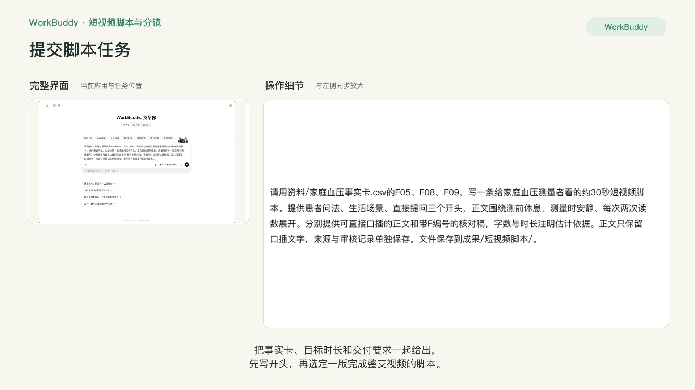
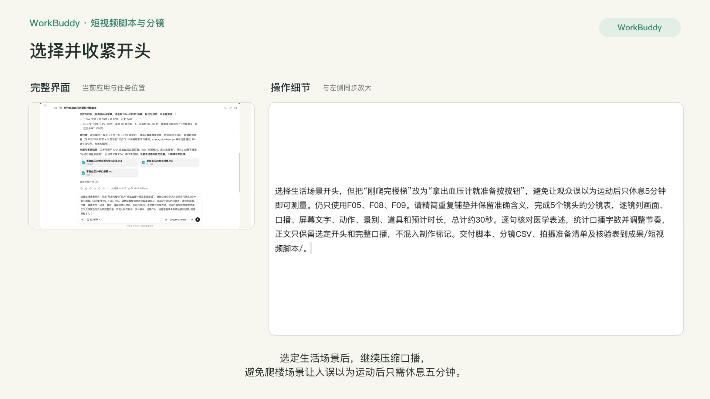
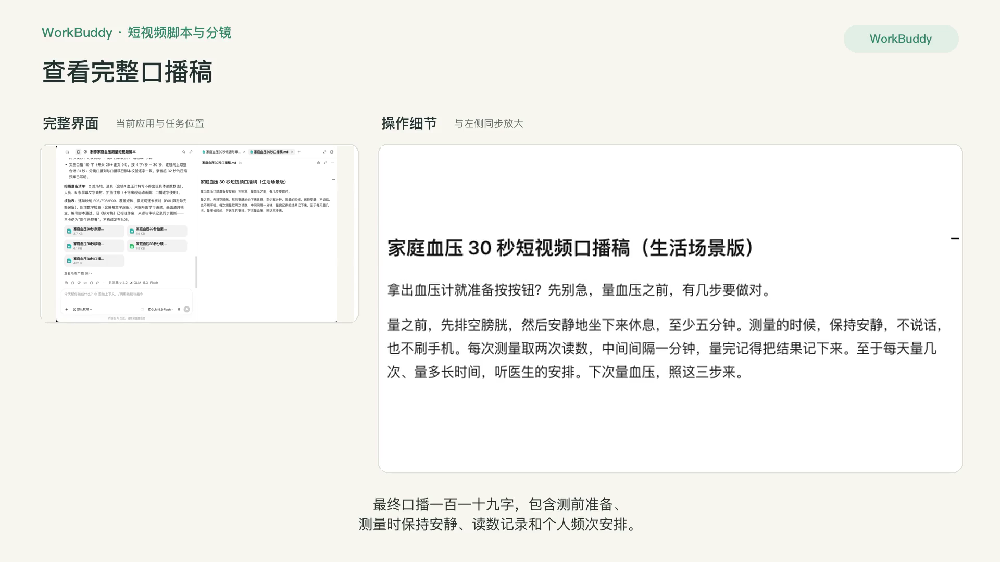
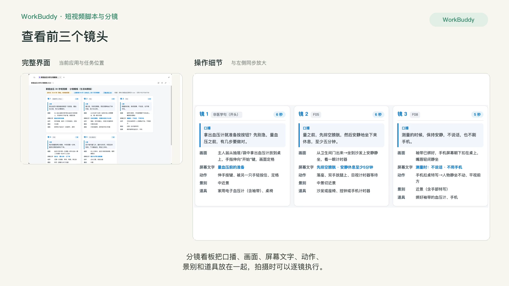
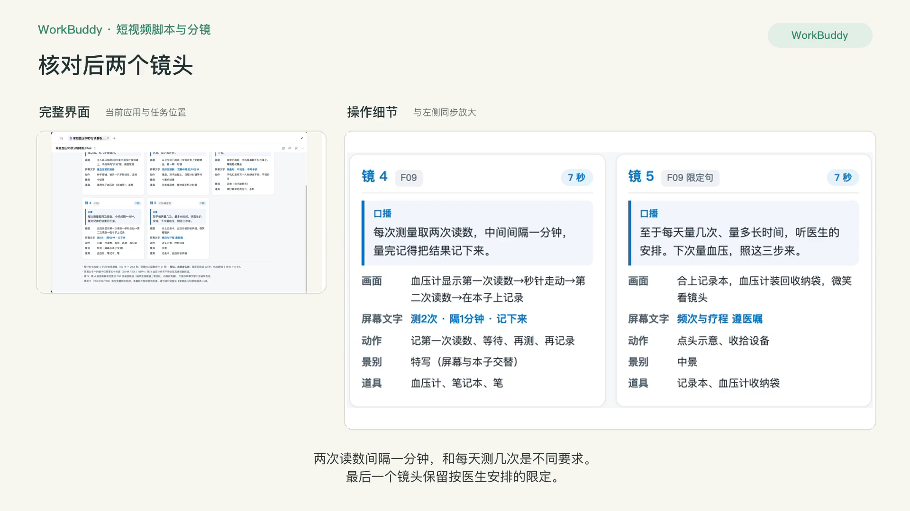
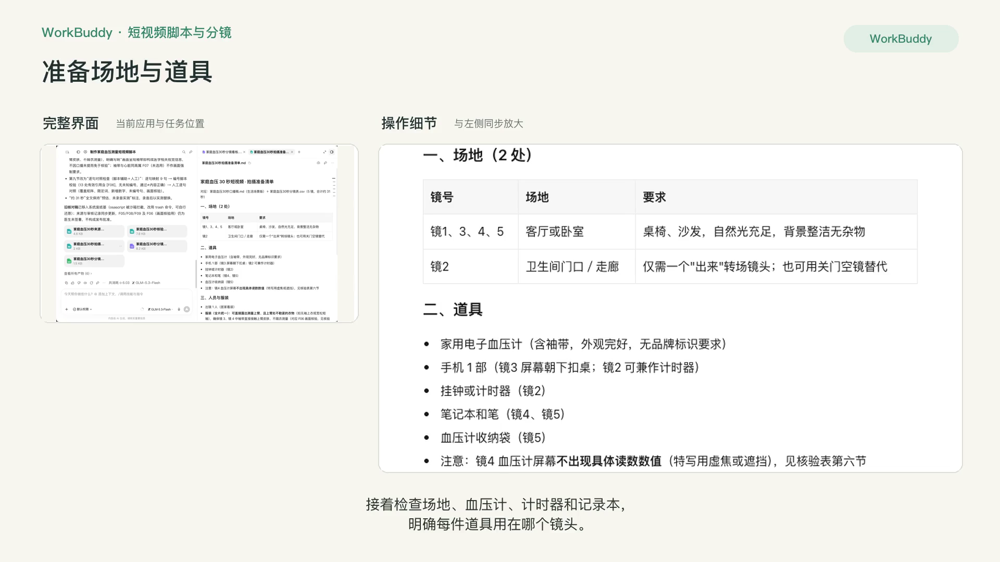
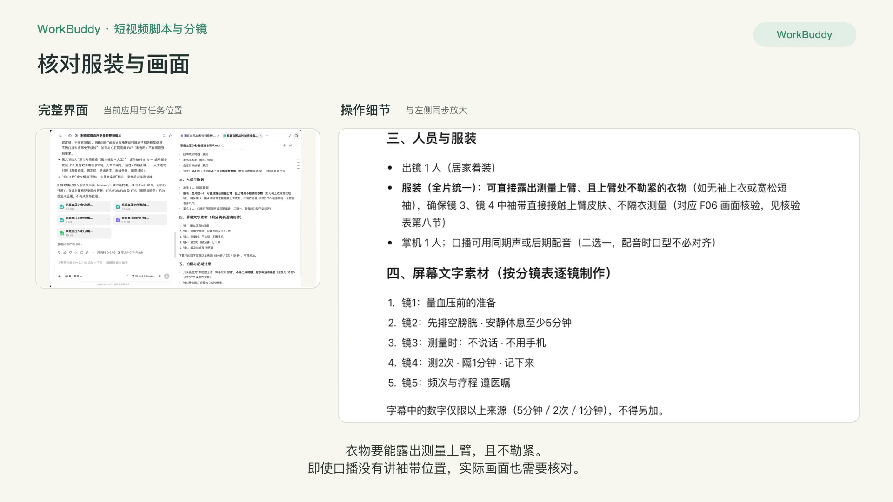
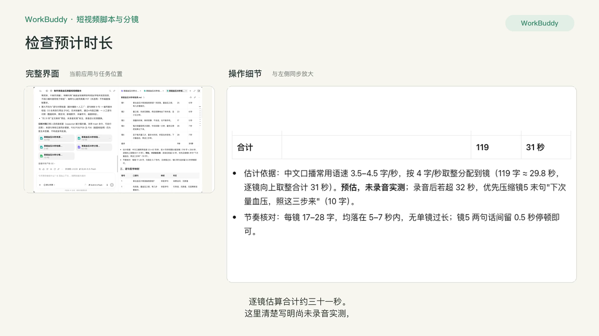
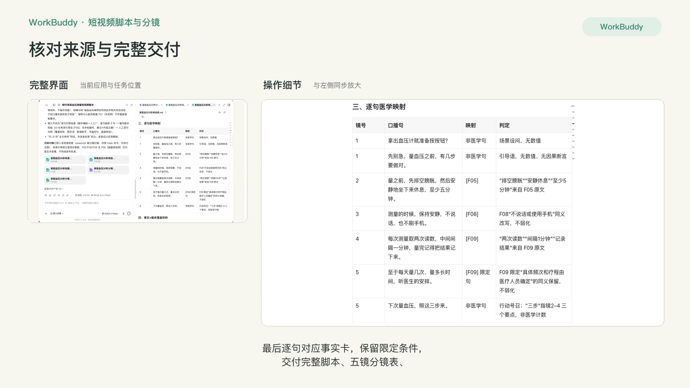

# P4 短视频脚本与分镜

## 快速实操：照着提示词做一遍

完成一条家庭血压测量短视频的口播、五镜分镜表与拍摄准备清单。

课前文件：[家庭血压事实卡.csv](../资料/家庭血压事实卡.csv)

### 实操 1

```text
请用资料/家庭血压事实卡.csv的F05、F08、F09，写一条给家庭血压测量者看的约30秒短视频脚本。提供患者问法、生活场景、直接提问三个开头，正文围绕测前休息、测量时安静、每次两次读数展开。分别提供可直接口播的正文和带F编号的核对稿，字数与时长注明估计依据。正文只保留口播文字，来源与审核记录单独保存。文件保存到成果/短视频脚本/。
```

### 实操 2

```text
选择生活场景开头，但把“刚爬完楼梯”改为“拿出血压计就准备按按钮”，避免让观众误以为运动后只休息5分钟即可测量。仍只使用F05、F08、F09。请精简重复铺垫并保留准确含义，完成5个镜头的分镜表，逐镜列画面、口播、屏幕文字、动作、景别、道具和预计时长，总计约30秒。逐句核对医学表述，统计口播字数并调整节奏，正文只保留选定开头和完整口播，不混入制作标记。交付脚本、分镜CSV、拍摄准备清单及核验表到成果/短视频脚本/。
```

### 实操 3

```text
请再提供一份可直接打开的HTML分镜看板，把5个镜头逐镜排开，每镜完整展示画面、口播、屏幕文字、动作、景别、道具和预计秒数，手机和电脑都能读全。CSV保持可下载。拍摄准备清单的服装统一为可直接露出测量上臂且不勒紧上臂的衣物。核验表将AI检查写为逐句对照；画面中的袖带位置仍需按F06核对，不能因为口播没有提到就免于画面核验。约31秒是预估时长，请保持如实标注。
```

## 完整方法：理解每一步，迁移到自己的课题

这一课把 P3 同一张事实卡压缩成一条 30 秒以内的短视频。短视频的难点不是“写得有趣”，而是在 100 字里只讲一件事、且不丢掉限定条件。压缩比扩写更容易出错。

| 项目 | 内容 |
| --- | --- |
| 难度 | 1 |
| 时长 | 25 分钟 |
| 前置 | P3（已确认的事实卡） |
| 产出 | 口播脚本（3 个钩子版本）+ 分镜表 |
| 用到的 Skill | Humanizer-zh（口语化）；可选 baoyu-image-gen（分镜参考图）。拍摄剪辑仍用剪映等工具 |

## 1. 30 秒的结构

中文口播语速大约每秒 4 字，30 秒大约 100–120 字。这点字数只够说清一件事：

| 时间 | 作用 | 字数 | 例子（虚构） |
| --- | --- | --- | --- |
| 0–3 秒 | 钩子：留住人 | 10–15 字 | “左手 150，右手 135，到底信哪个？” |
| 3–22 秒 | 讲清这一个点 | 70–85 字 | 第一次两只手都量，以后量高的那一侧…… |
| 22–30 秒 | 行动 + 就医提示 | 25–30 字 | “如果两边经常差很多，要来医院查一下。” |

## 2. 操作步骤

### 第 1 步：从事实卡里只挑 1–2 条

```text
这是我已确认的事实卡。我要做一条 30 秒以内的短视频。请帮我从中挑出最适合单独成片的 1–2 条，理由是：患者最关心、能一句话说清、看完就能做。其他条目列为“后续可做的系列选题”。
```

**为什么只挑一条**：短视频里塞三个知识点，观众一个都记不住。剩下的事实可以做成系列。

### 第 2 步：写脚本，出 3 个钩子

```text
用选中的事实写一条 30 秒口播脚本。
要求：
1. 总字数 100–120 字，按“钩子 / 主体 / 行动与就医提示”三段；
2. 钩子写 3 个版本：A 患者原话型，B 反常识型，C 场景型；但钩子不能夸大、不能制造恐慌；
3. 口语化，短句，一句不超过 15 字；
4. 每句医学信息后用 [F××] 标出事实卡编号；
5. 事实卡里的“不可外推到”如果会影响观众行动，必须用一句话说出来；
6. 标注每段的预估秒数。
```

**检查点**：用手机秒表大声朗读一遍。超过 30 秒就删，先删形容词和重复，不要删限定条件和就医提示。


### 第 3 步：口语化与核验

```text
请用 humanizer-zh 技能把脚本改得更像医生在诊室里对患者说话，保留 [F××] 编号。然后做反向核验：每句医学信息是否忠实于对应事实卡，压缩时有没有丢掉限定条件。
```

核验方法和 P3 第 4 步完全一样，只是要特别留意“压缩导致的失真”。常见的例子：“两臂差值持续较大要就医”压缩成“两臂不一样就要就医”，意思就变了。

### 第 4 步：生成分镜表

```text
请根据定稿脚本生成分镜表。我的拍摄条件：办公室或诊室、一部手机、我本人出镜、有一台电子血压计可以做道具。不出现真实患者。
列：镜号 | 时长 | 画面内容 | 景别 | 口播台词 | 字幕/花字 | B-roll 或贴图 | 拍摄提示。
镜头数 5–8 个，时长加起来等于脚本时长。
```

分镜表示例（前 3 镜，虚构）：

| 镜号 | 时长 | 画面内容 | 景别 | 口播 | 字幕 / 花字 | B-roll | 拍摄提示 |
| --- | --- | --- | --- | --- | --- | --- | --- |
| 1 | 0–3 秒 | 医生举起两张写着血压值的卡片 | 近景 | 左手 150，右手 135，信哪个？ | 大字问号 | 无 | 语速稍快，盯镜头 |
| 2 | 3–9 秒 | 医生在自己两臂依次绑袖带 | 中景 | 第一次量，两只手都要量 | “第一次：两边都量” | 袖带特写 | 插入袖带位置特写 |
| 3 | 9–16 秒 | 指向数值较高的一侧 | 近景 | 以后就量数值高的那一侧 | “以后：量高的那边” | 无 | — |


### 第 5 步：标题与封面文案

```text
请为这条视频写 5 个标题（≤ 20 字）和 3 个封面大字（≤ 10 字）。不用“震惊”“必看”“都做错了”等夸张词。
```

## 3. 自查清单

- [ ] 朗读实测 20–30 秒
- [ ] 整条视频只有一个核心信息
- [ ] 每句医学信息都能对上事实卡，压缩后未丢失限定条件
- [ ] 结尾有就医提示
- [ ] 字幕与口播一致；画面中没有真实患者、没有品牌标识

## 4. 常见问题

**钩子写得太平淡？** 用 P2 选题库里的患者原话做钩子，往往比 AI 想的更有力量。

**觉得自己对着镜头说话不自然？** 让 Agent 把脚本改成“问答式”，由助手在镜头外提问，你回答，口语会自然很多。或者考虑 P6 的数字人方案。

## 5. 练习

用同一张事实卡里的另一条，做系列的第 2 集，开头用“上一期有人问……”接上。

## 下一课

P5 把同一份内容做成图文和海报，并学习写一份设计师和 AI 都看得懂的配图需求。

## 本次任务结果与核对

最终口播采用“拿出血压计就准备按按钮”的生活场景开头，避免将测前休息与运动后的等待时间混淆。119字口播对应五个镜头，分镜完整列出画面、口播、屏幕文字、动作、景别、道具与预计时长，并提供可打开的HTML看板。

口播选用F05、F08、F09；画面中的袖带位置另按F06核验。两次读数之间的间隔与每天的测量频次分开说明。合计约31秒为预估，尚未录音实测；本节交付的是可执行的拍摄脚本与分镜。

交付文件：

- [家庭血压30秒分镜看板.html](../成果/短视频脚本/家庭血压30秒分镜看板.html)
- [家庭血压30秒分镜表.csv](../成果/短视频脚本/家庭血压30秒分镜表.csv)
- [家庭血压30秒口播稿.md](../成果/短视频脚本/家庭血压30秒口播稿.md)
- [家庭血压30秒拍摄准备清单.md](../成果/短视频脚本/家庭血压30秒拍摄准备清单.md)
- [家庭血压30秒来源与审核记录.md](../成果/短视频脚本/家庭血压30秒来源与审核记录.md)
- [家庭血压30秒核验表.md](../成果/短视频脚本/家庭血压30秒核验表.md)

## 操作画面



















[观看 P4 实操录屏](../录屏/P4-WorkBuddy实操.mp4) · [字幕](../录屏/P4-WorkBuddy实操.vtt)
