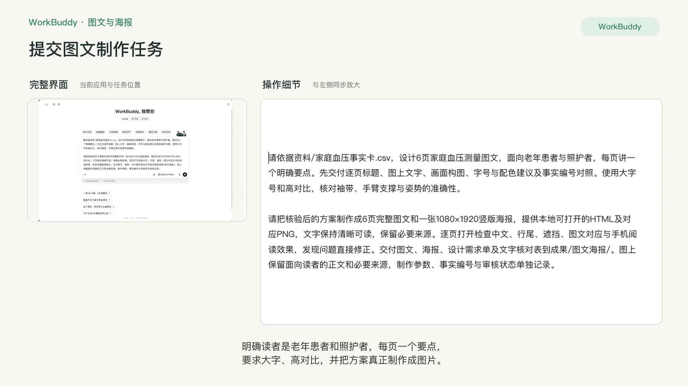
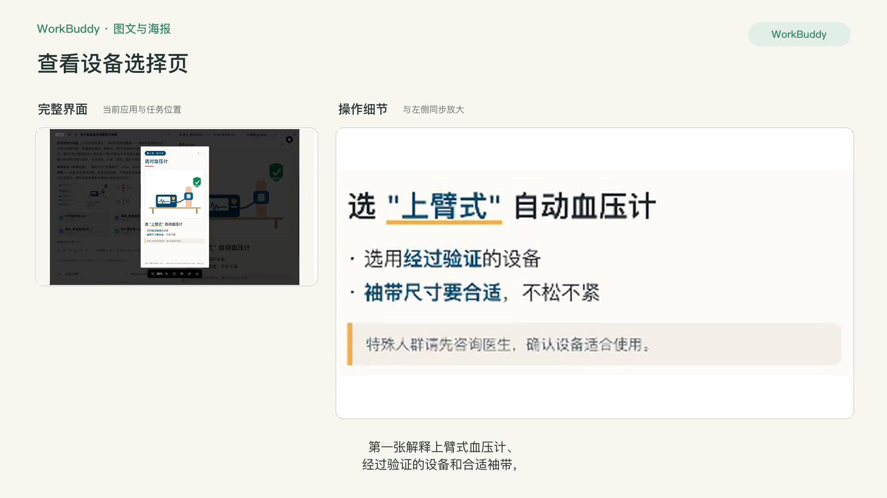
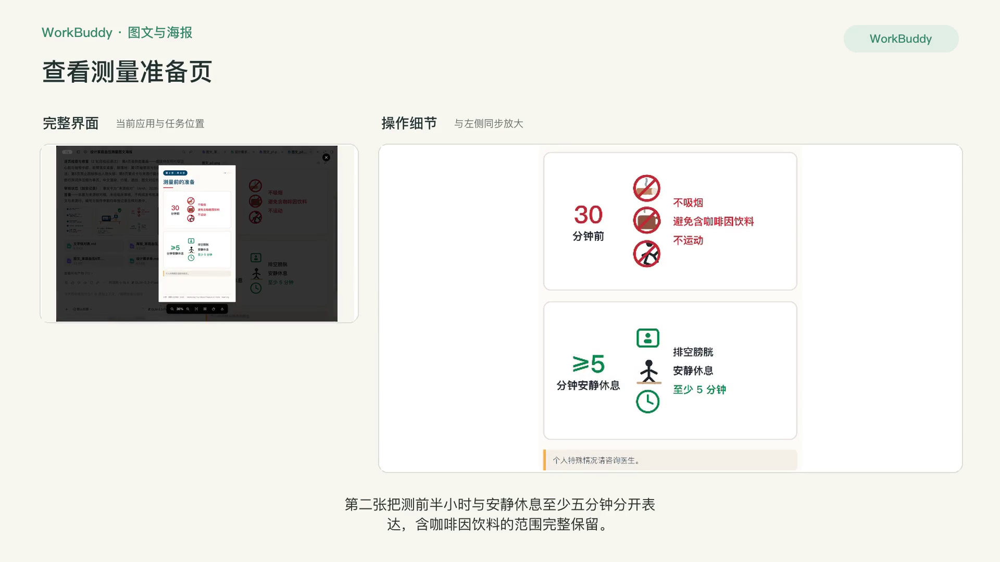
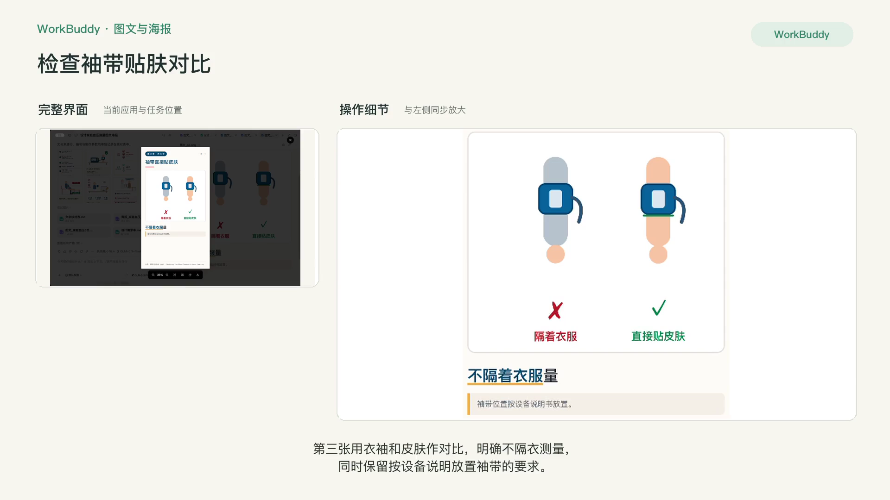
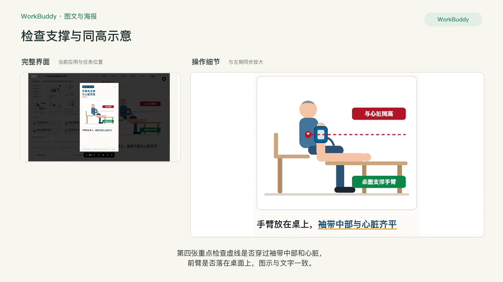
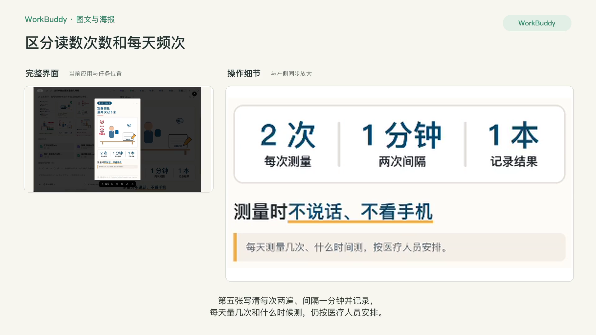
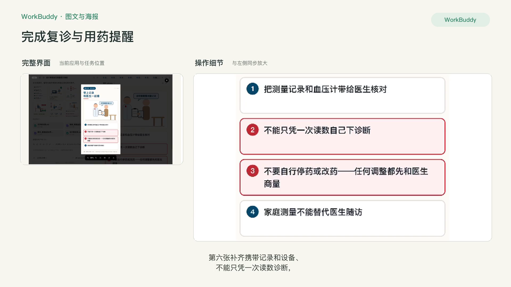
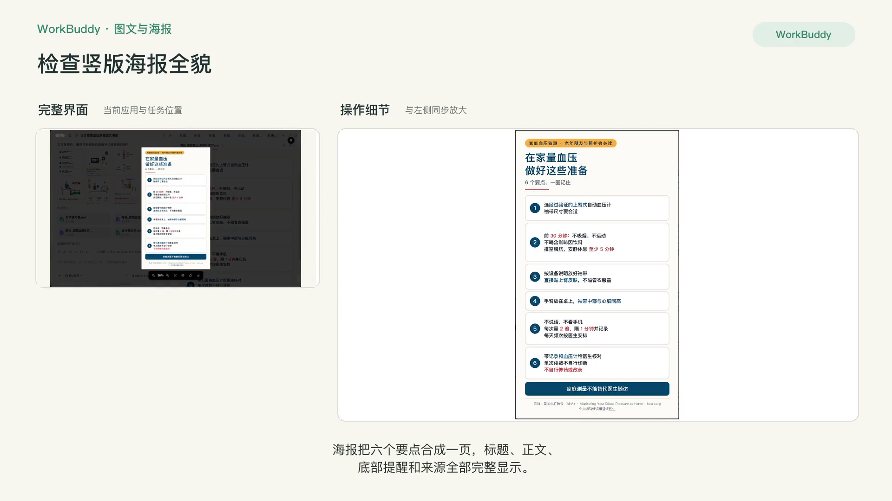
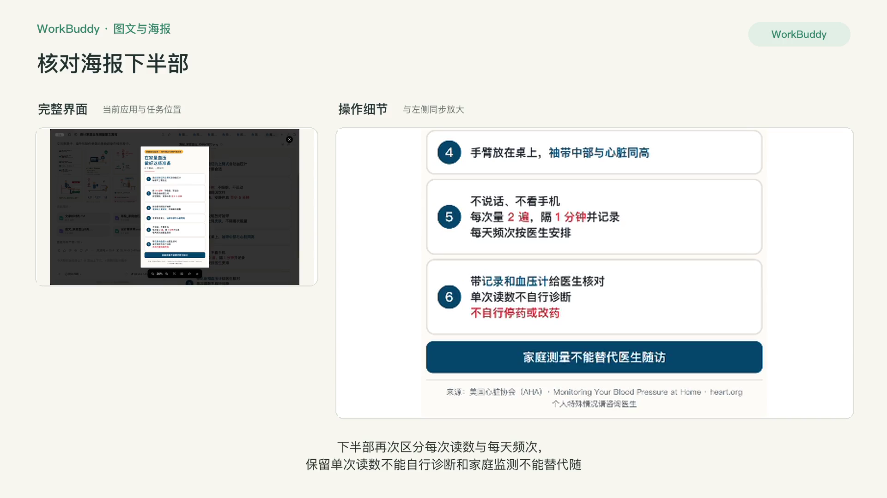
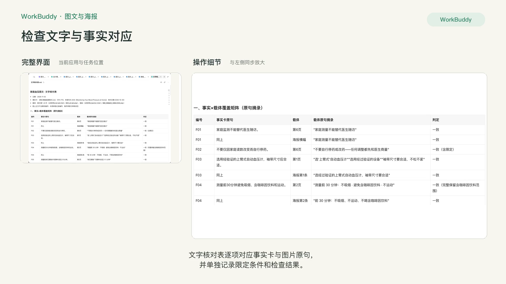

# P5 图文与海报

## 快速实操：照着提示词做一遍

将家庭血压测量事实卡制作成六页图文和一张竖版海报，完成图片与文字核对。

课前文件：[家庭血压事实卡.csv](../资料/家庭血压事实卡.csv)

### 实操 1

```text
请依据资料/家庭血压事实卡.csv，设计6页家庭血压测量图文，面向老年患者与照护者，每页讲一个明确要点。先交付逐页标题、图上文字、画面构图、字号与配色建议及事实编号对照。使用大字号和高对比，核对袖带、手臂支撑与姿势的准确性。

请把核验后的方案制作成6页完整图文和一张1080×1920竖版海报，提供本地可打开的HTML及对应PNG，文字保持清晰可读，保留必要来源。逐页打开检查中文、行尾、遮挡、图文对应与手机阅读效果，发现问题直接修正。交付图文、海报、设计需求单及文字核对表到成果/图文海报/。图上保留面向读者的正文和必要来源，制作参数、事实编号与审核状态单独记录。
```

### 实操 2

```text
请导出全部6页图文和海报的PNG，逐张查看，修复裁切、文字与图示问题后重新导出，并补齐逐页事实对照和检查记录。海报标题改为“在家量血压，做好这些准备”；设备、袖带和手臂图示应清楚易懂，测量频率由医生指导。
```

## 完整方法：理解每一步，迁移到自己的课题

这一课把同一张事实卡变成一组小红书式图文（6–8 页），以及一份海报。你会学到两种做法：让 Agent 直接出图，或者写一份需求单交给设计师。两种都需要先把“每一页讲什么、画什么、不能画什么”想清楚。

| 项目 | 内容 |
| --- | --- |
| 难度 | 1 |
| 时长 | 35 分钟 |
| 前置 | P3（事实卡）；P1（视觉风格参考） |
| 产出 | 图文方案（逐页结构 + 配图说明）+ 主视觉需求单 + 一组图或一张海报 |
| 用到的 Skill | baoyu-xhs-images（小红书图组）、baoyu-infographic、frontend-design（HTML 海报）、pptx（需可编辑版时） |

## 1. 图文与长文的区别

长文是“读”的，图文是“划”的。患者在每一页停留可能只有一两秒，所以：

- 每页只放一个信息点，文字尽量不超过 50 字。
- 封面决定会不会被点开，标题 15 字以内。
- 最后一页放行动建议和就医提示。
- 图上的每一个字都是“发布内容”，和正文一样需要核验。

## 2. 操作步骤

### 第 1 步：逐页结构

```text
用我已确认的事实卡，设计一组 6–8 页的小红书图文。
结构：封面 → 每页一个要点 → 结尾页（行动建议 + 就医提示 + 账号信息）。
每页输出：页号 | 本页要点（一句话）| 图上文字（≤ 50 字）| 对应事实卡编号。
封面标题给 3 个备选，每个 ≤ 15 字。
另写一段发布正文（≤ 300 字）和 5 个话题标签。
```

**检查点**：图上文字是压缩后的文字，和 P4 一样要检查有没有丢掉限定条件。

### 第 2 步：逐页配图说明

```text
请为每一页写配图说明，字段：画面描述 | 版式（文字位置）| 配色 | 必须出现的元素 | 禁止出现的元素。
全套风格统一：清爽、温和、适合中老年人阅读（字号大、对比度高）。
全套禁止：真实患者形象、血腥或惊吓画面、任何药品或器械品牌标识、未经核对的解剖结构。
```

配图说明示例（第 2 页，虚构）：

| 字段 | 内容 |
| --- | --- |
| 本页要点 | 测量前先安静休息 |
| 图上文字 | 测量前：安静休息至少5分钟 |
| 画面描述 | 插画风，一位老人坐在桌前，一只上臂有合适袖带，前臂放在桌面支撑上 |
| 版式 | 文字在上 1/3，插画在下 2/3 |
| 配色 | 浅蓝底、深蓝字 |
| 必须出现 | 姿势正确且手臂有支撑 |
| 禁止出现 | 血压计品牌、具体数值之外的文字 |

### 第 3 步：生成图片（三选一）

**方式 A：用 Skill 直接出图组**（需在 WorkBuddy 等支持该 Skill 的环境）

```text
请使用 baoyu-xhs-images 技能，按上面的逐页结构和配图说明生成图组。风格选择清爽插画风。
```

首次使用时该 Skill 会先问你水印、默认风格等设置，按提示选择即可。

**方式 B：做成 HTML 海报或信息图**（WorkBuddy 桌面端即可）

```text
请参考 frontend-design 技能，把第 2–5 页的内容做成一张竖版信息图海报（1080×1920），字号适合中老年人阅读。
```

生成后可以截图使用，或让 Agent 导出为图片。

**方式 C：交给设计师**：直接把第 1–2 步的结果和下面的主视觉需求单发给设计师。


### 第 4 步：逐字检查

AI 生成的图片里，中文经常出现错字、缺字或乱码，医学示意图也可能画错。检查方法：

```text
请识别这组图片上的所有文字，和我的逐页结构中的“图上文字”逐字对比，列出所有不一致的地方。再检查画面中是否有品牌标识或不合理的人体结构。
```

然后你自己再用眼睛看一遍，尤其是数字和单位。

## 3. 主视觉需求单模板

```markdown
# 主视觉需求单

使用场景与尺寸：小红书 3:4 / 公众号封面 2.35:1 / 科室打印海报 A3
目标人群：
一句话核心信息：
必须出现的文字（逐字）：
风格参考：（附 2–3 张图或链接）
品牌色与字体：
禁用元素：真实患者形象、品牌标识、惊吓画面
需要的标注：“AI 生成”标识（如使用 AI 生成）、账号名、就医提示
交付格式：PNG / 可编辑源文件
交付时间：
```

## 4. 自查清单

- [ ] 每页只有一个信息点，图上文字对应事实卡
- [ ] 图中文字无错字，数字和单位正确
- [ ] 没有真实患者影像、品牌标识、来源不明的图片
- [ ] 结尾页有就医提示
- [ ] AI 生成的图片已按平台要求标注

## 5. 常见问题

**图里的中文总是错？** 把文字和画面分开：让 AI 只生成无文字的插画，文字用 HTML 海报（方式 B）或稿定设计、Canva 等工具叠加。

**可以用网上找的图吗？** 除非明确是可商用的素材库图片，否则不要用。版权风险和医学准确性风险都很高。

## 6. 练习

把同一组图文改成科室走廊可以张贴的 A3 海报，考虑患者是站着从 1 米外看的。

## 下一课

P6 让同一份内容“开口说话”：写口播稿，用数字人生成预览，并判断能不能发布。

## 本次任务结果与核对

已交付六页1080×1920图文和一张同尺寸竖版海报，每页一个明确要点，并保留可编辑的HTML。逐张检查中文、完整行尾、图示和来源行；姿势图已修正袖带中心与心脏同高、前臂有桌面支撑，海报七张图片均完整导出。

文字核对表逐项对应F01–F10及限定条件，测量前30分钟使用“含咖啡因饮料”的完整范围；每次两遍读数与每天频次分开说明。海报补齐经验证设备、按设备说明放置袖带、携带设备复诊和单次读数不能自行诊断。来源核对已完成，医生签署尚未完成。

主要交付文件：

- [_编号检查报告.md](../成果/图文海报/_编号检查报告.md)
- [图文_p1.png](../成果/图文海报/图文_p1.png)
- [图文_p2.png](../成果/图文海报/图文_p2.png)
- [图文_p3.png](../成果/图文海报/图文_p3.png)
- [图文_p4.png](../成果/图文海报/图文_p4.png)
- [图文_p5.png](../成果/图文海报/图文_p5.png)
- [图文_p6.png](../成果/图文海报/图文_p6.png)
- [图文_家庭血压6页.html](../成果/图文海报/图文_家庭血压6页.html)
- [文字核对表.md](../成果/图文海报/文字核对表.md)
- [海报_家庭血压_1080x1920.html](../成果/图文海报/海报_家庭血压_1080x1920.html)
- [海报_家庭血压_1080x1920.png](../成果/图文海报/海报_家庭血压_1080x1920.png)
- [设计需求单.md](../成果/图文海报/设计需求单.md)

## 操作画面





















[观看 P5 实操录屏](../录屏/P5-WorkBuddy实操.mp4) · [字幕](../录屏/P5-WorkBuddy实操.vtt)
