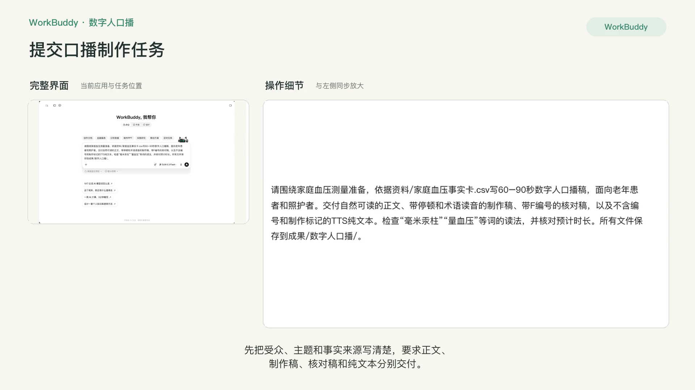
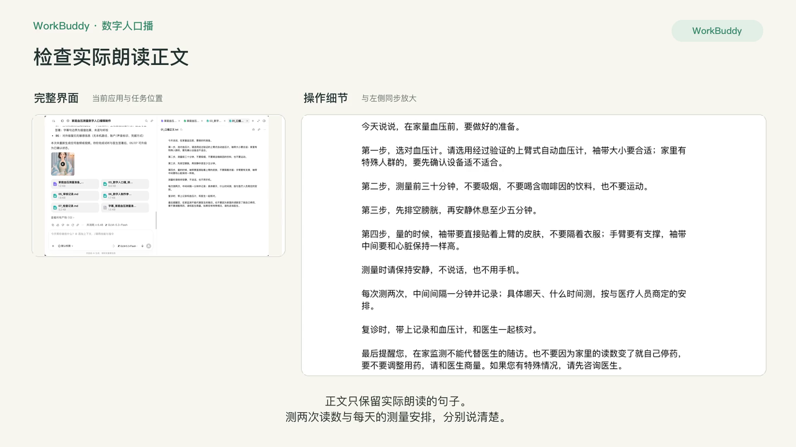
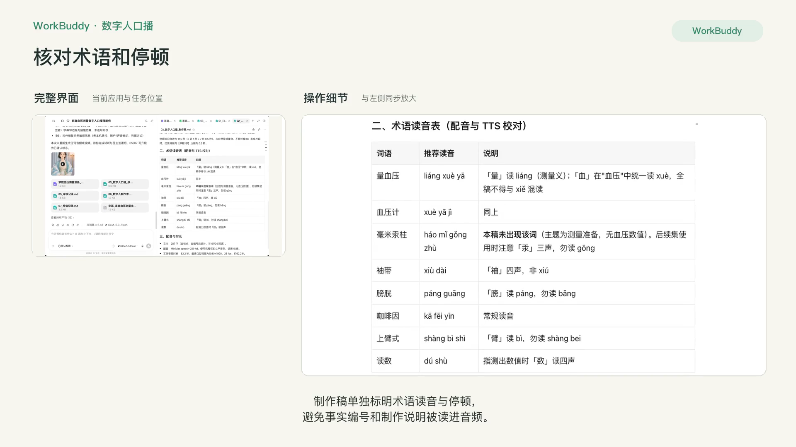
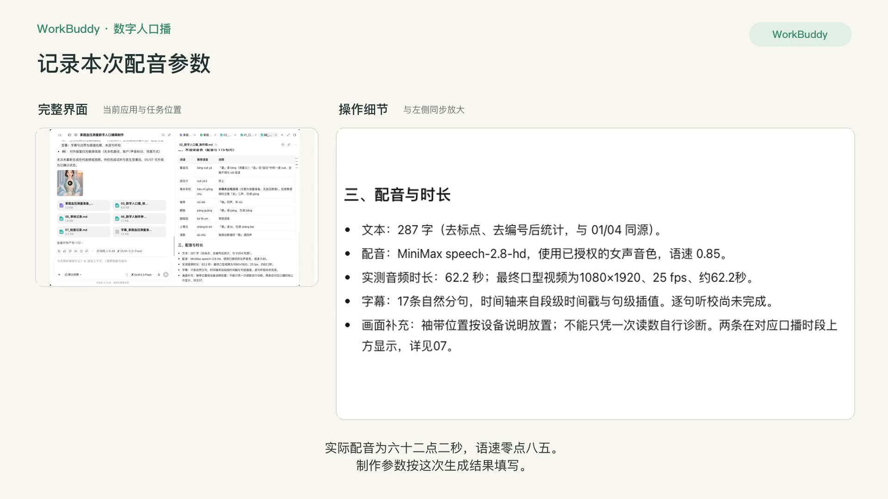
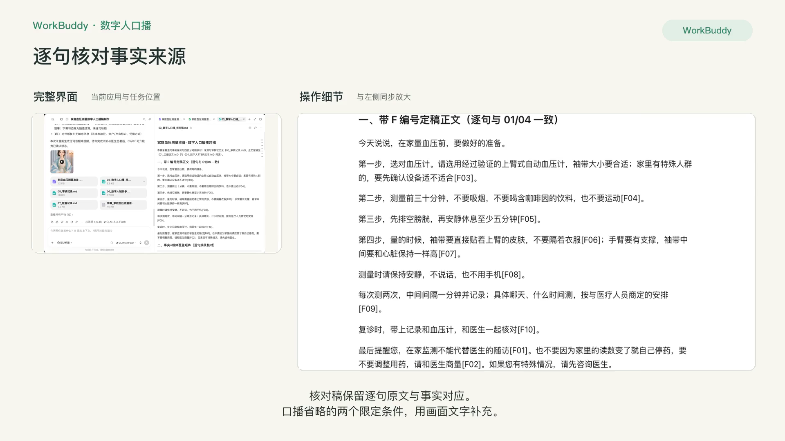
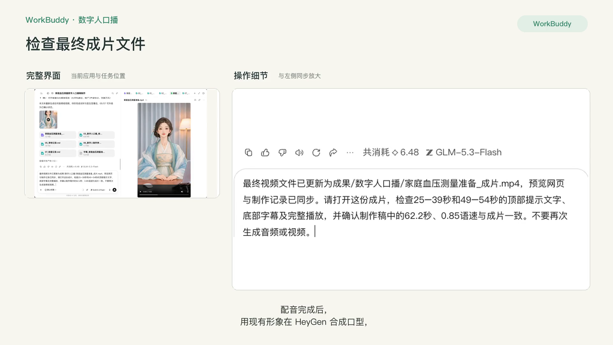
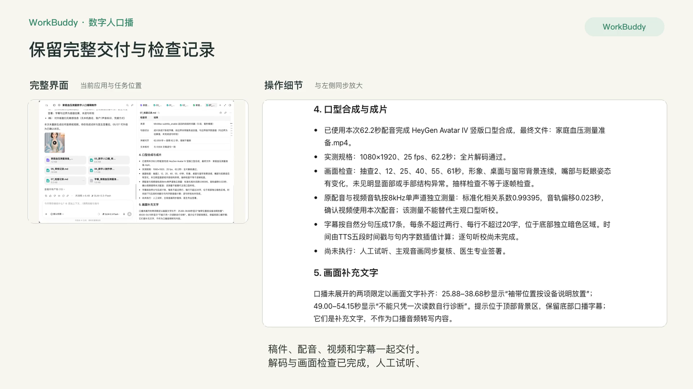

# P6 数字人口播

## 快速实操：照着提示词做一遍

制作一条家庭血压测量准备口播，完成稿件、配音、口型合成、字幕与视频检查。

> **开始前注意**：生成配音和数字人视频需要你自己的数字人平台账号（课程示范用的是 HeyGen 和 MiniMax）、已授权的本人形象与声音，并会产生费用。没有这些条件时，只做实操 1（口播稿与核对稿），再看录屏了解后续步骤。

课前文件：[家庭血压事实卡.csv](../资料/家庭血压事实卡.csv)

### 实操 1

```text
请围绕家庭血压测量准备，依据资料/家庭血压事实卡.csv写60–90秒数字人口播稿，面向老年患者和照护者。交付自然可读的正文、带停顿和术语读音的制作稿、带F编号的核对稿，以及不含编号和制作标记的TTS纯文本。检查“毫米汞柱”“量血压”等词的读法，并核对预计时长。所有文件保存到成果/数字人口播/。
```

### 实操 2

```text
请先整理现有口播文件：正文与TTS纯文本只保留实际朗读文字，标题、事实编号、制作参数和审核状态分别放到制作稿、核对稿与独立审核记录。每次测两次读数与具体监测频次要分清；改成“每次测两次，中间间隔一分钟并记录；具体哪天、什么时间测，按与医疗人员商定的安排”。核对稿按最终逐句原文更新。重新读取当前medical-content-pipeline技能并运行编号检查，保留真实审核状态。

请用当前项目已授权的形象、声音及可用额度，制作这份新稿的数字人口播视频。使用项目中已授权的形象与声音配置，沿用已验证9:16、1080p和动作设置；MiniMax配音可复用该项目现有配置及环境加载器，不输出凭据。先生成并试听配音，再合成口型，生成与实际音频同步的字幕；检查术语读音、口型、画面和字幕，修正后交付MP4、音频、SRT、制作参数及检查记录到成果/数字人口播/。已有形象直接复用，不新建身份或声音。账号或额度缺项如实说明；需要新增付费时先确认。不自动发布。
```

### 实操 3

```text
本次口播已经用现有形象和本次62.2秒配音完成合成。最终视频在成果/数字人口播/家庭血压测量准备_成片.mp4，配套字幕为字幕_家庭血压测量准备.srt，06制作参数和07检查记录已按实际完成情况更新。请核对文件齐全与视频规格，读取最新审核状态，汇总完整交付文件并打开家庭血压测量准备_视频.html预览。不要重新生成音频或视频；视频内容与配音来自本次任务。检查记录中的人工试听、主观口型听校、医生签署均尚未执行，保持如实记录。
```

### 实操 4

```text
最终视频文件已更新为成果/数字人口播/家庭血压测量准备_成片.mp4，预览网页与制作记录已同步。请打开这份成片，检查25–39秒和49–54秒的顶部提示文字、底部字幕及完整播放，并确认制作稿中的62.2秒、0.85语速与成片一致。不要再次生成音频或视频。
```

## 完整方法：理解每一步，迁移到自己的课题

没时间出镜的医生，可以用数字人替自己“说话”。但数字人带来了三个新风险：读错术语、看起来不像本人、没有按规定标注 AI 生成。这一课的重点不是“做出来”，而是学会用一张清单判断“能不能发”。

| 项目 | 内容 |
| --- | --- |
| 难度 | 1-2 |
| 时长 | 40 分钟（不含首次创建数字分身的等待时间） |
| 前置 | P3（事实卡）、P4（口语化脚本写法） |
| 产出 | 60–90 秒口播稿 + 数字人预览视频 + 发布判断表 |
| 用到的 Skill | Humanizer-zh；HeyGen Skills（heygen-avatar、heygen-video），或所在机构选定的国内数字人平台 |

## 1. 开始前必须确认的三件事

1. **授权**：用你本人的肖像和声音做数字人，需要你本人书面同意；如果以医院名义发布，还需要医院宣传部门同意。平台也会要求你确认拥有素材权利。
2. **标注**：《人工智能生成合成内容标识办法》（2025-09-01 施行）及配套国标 GB 45438-2025 要求，合成人声和虚拟人像要有显式“AI 生成”标识，发布时也要主动声明。各平台另有规则，发布前再查一次最新要求。
3. **账号与费用**：生成前确认账号额度、计费方式和预计消耗，按实际需求选择生成规格。

## 2. 操作步骤

### 第 1 步：写口播稿

口播稿和短视频脚本的区别：更长（60–90 秒）、没有镜头切换、全靠“说”。所以节奏和停顿特别重要。

```text
用我已确认的事实卡写一段 60–90 秒的数字人口播稿（约 250–350 字）。
要求：
1. 结构：开场问题 → 2–3 个要点 → 行动建议 → 就医提示；
2. 短句，每句不超过 15 字，用“您”；
3. 用 / 标出短停顿，用 // 标出长停顿，用【】标出需要重读的词；
4. 所有药名、术语、英文缩写、多音字在括号中标注读音或读法（例如 mmHg 读作“毫米汞柱”）；
5. 每句医学信息后用 [F××] 标出事实卡编号。
```

然后按 P3 的方法做反向核验，再用 Humanizer-zh 口语化。

### 第 2 步：先听，再看

视频生成耗时也耗费用。先用低成本的方式检查声音：

1. 用数字人平台的“试听 / 仅生成音频”功能，或任意文字转语音工具，生成音频。
2. 边听边对稿，重点听：药名和术语、数字和单位、多音字（如“量血压”的“量”）、英文缩写。
3. 读错的地方有三种修法：改写成不易读错的说法；用平台的读音校正功能；在稿中用同音字替换（字幕单独保留正确写法）。


### 第 3 步：生成数字人视频

**用 HeyGen Skills**（在 WorkBuddy 等本地 Agent 中，需 HeyGen 账号和 API Key）：

在 WorkBuddy 技能页查阅数字人技能的官方来源、调用方式与费用；导入之前阅读说明，并确认当前账号和接口真实可用。

```text
第一次：请用 heygen-avatar 技能，用我提供的照片和声音样本创建我的数字分身。
之后：请用 heygen-video 技能，用我的数字分身和下面的定稿口播稿生成一段竖版视频。背景简洁，不加任何品牌元素。先生成预览，不要发布到任何平台。
```

**用国内平台**：流程类似：创建分身 → 粘贴口播稿 → 生成预览。口播稿和发布判断的方法完全通用。


### 第 4 步：逐项判断能否发布

看完预览，按下表逐项打分。可以让 Agent 帮你生成这张表，但“看”和“听”必须由你自己完成。

| 检查项 | 类型 | 结果 |
| --- | --- | --- |
| 本人肖像与声音已书面授权，机构允许 | 硬性 | 通过 / 不通过 |
| 已按平台和现行规定标注“AI 生成” | 硬性 | |
| 口播内容全部能对上事实卡 | 硬性 | |
| 术语、药名、数字读音无误 | 硬性 | |
| 有就医提示，不承诺疗效 | 硬性 | |
| 口型与声音同步 | 体验 | 好 / 可接受 / 差 |
| 表情和手势自然，无明显卡顿或变形 | 体验 | |
| 看起来像本人，没有过度美化 | 体验 | |
| 字幕与口播一致 | 体验 | |

**判定规则**：任何一项“硬性”不通过 → 不发布；硬性全通过但有“体验”为“差” → 改后发布；全部通过 → 可发布。

### 第 5 步：写结论和修改清单

```text
根据我的检查结果，请写出结论（可发布 / 改后发布 / 不发布）和逐项的修改方案。修改方案要具体到“改哪句稿、调哪个参数、重新生成哪一段”。
```

## 3. 自查清单

- [ ] 口播稿经过事实卡反向核验
- [ ] 先试听，读音问题已修正
- [ ] 发布判断表中的“硬性”项全部由我本人确认
- [ ] 有明确的发布结论

## 4. 常见问题

**可以用平台提供的公共数字人吗？** 可以，但仍需核对平台提供的使用授权和允许用途，但患者会觉得“不是医生本人在说”，信任感会下降。建议在画面中注明“内容由 ×× 医生审核”。

**可以自动发布吗？** 不建议。医学内容的每一次发布都应该由医生本人看过成片后手动完成。

## 5. 练习

用同一篇口播稿，对比“你自己出镜用手机录一遍”和“数字人版本”，请两位同事和一位患者家属盲看，记录他们更信任哪个。

## 下一课

P7 把事实卡带回诊室：写一页患者拿在手里就知道下一步的患教单和随访话术。

## 本次任务结果与核对

已完成287字口播正文、带停顿和术语读音的制作稿、逐句事实核对稿、TTS纯文本、音频、字幕及本次新稿生成的数字人视频。实际配音62.2秒，使用已有授权女声，语速0.85；HeyGen Avatar IV成片为1080×1920、25 fps。

成片包含17条自然分句字幕；两条画面提示补齐袖带按设备说明放置、不能只凭一次读数自行诊断。原音频与成片音轨的波形相关系数为0.994、偏移0.023秒，确认使用本次配音。完整解码及抽样画面检查通过，人工逐句试听、主观口型听校和医生专业签署尚未完成，详见检查记录。

[播放完整数字人成片](../成果/数字人口播/家庭血压测量准备_视频.html)

交付文件：

- [01_口播正文.txt](../成果/数字人口播/01_口播正文.txt)
- [02_数字人口播_制作稿.md](../成果/数字人口播/02_数字人口播_制作稿.md)
- [03_数字人口播_核对稿.md](../成果/数字人口播/03_数字人口播_核对稿.md)
- [04_数字人TTS纯文本.txt](../成果/数字人口播/04_数字人TTS纯文本.txt)
- [05_审核记录.md](../成果/数字人口播/05_审核记录.md)
- [06_数字人制作参数.md](../成果/数字人口播/06_数字人制作参数.md)
- [07_检查记录.md](../成果/数字人口播/07_检查记录.md)
- [字幕_家庭血压测量准备.srt](../成果/数字人口播/字幕_家庭血压测量准备.srt)
- [家庭血压测量准备_成片.mp4](../成果/数字人口播/家庭血压测量准备_成片.mp4)
- [家庭血压测量准备_视频.html](../成果/数字人口播/家庭血压测量准备_视频.html)
- [编号检查报告.md](../成果/数字人口播/编号检查报告.md)
- [口播_淡彩仕女V2_v2_0.85速.mp3](../成果/数字人口播/voice/口播_淡彩仕女V2_v2_0.85速.mp3)

## 操作画面
















[观看 P6 实操录屏](../录屏/P6-WorkBuddy实操.mp4) · [字幕](../录屏/P6-WorkBuddy实操.vtt)
