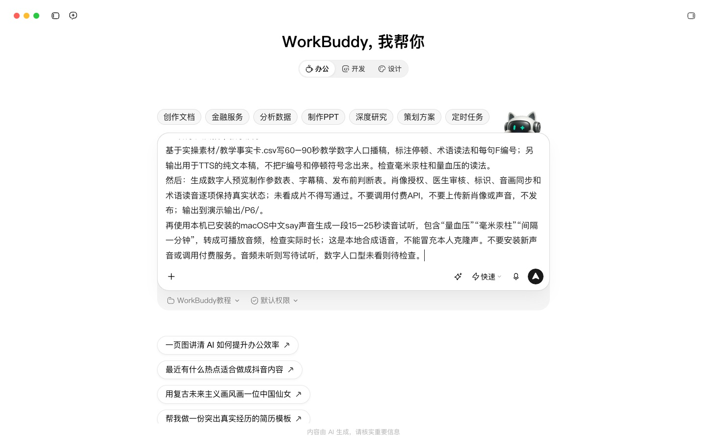
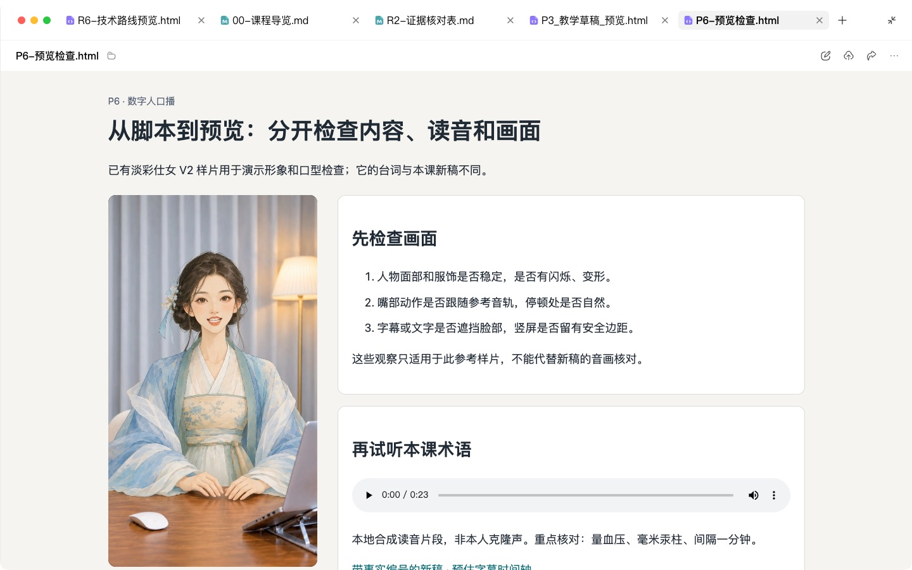
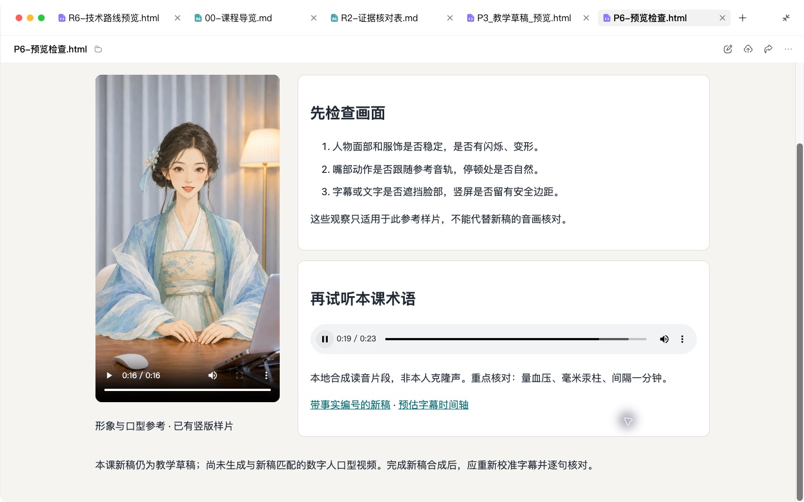

# P6 数字人口播：口播稿转数字人预览，判断能否发布

## 快速实操：照着提示词做一遍

本课重点：先核对读音，再审看数字人预览。先在“新建任务”中选定课程工作空间。每个阶段完成后打开产物预览，再继续下一段提示词。

课前文件：

- [教学事实卡.csv](../实操素材/教学事实卡.csv)

### 实操 1

```text
当前工作空间：WorkBuddy教程。
基于实操素材/教学事实卡.csv写60–90秒教学数字人口播稿，标注停顿、术语读法和每句F编号；另输出用于TTS的纯文本稿，不把F编号和停顿符号念出来。检查毫米汞柱和量血压的读法。
```

### 实操 2

```text
当前工作空间：WorkBuddy教程。
生成数字人预览制作参数表、字幕稿、发布前判断表。肖像授权、医生审核、标识、音画同步和术语读音逐项保持真实状态；未看成片不得写通过。不要调用付费API，不要上传新肖像或声音，不发布；输出到演示输出/P6/。
```

## 完整方法：理解每一步，迁移到自己的课题

没时间出镜的医生，可以用数字人替自己“说话”。但数字人带来了三个新风险：读错术语、看起来不像本人、没有按规定标注 AI 生成。这一课的重点不是“做出来”，而是学会用一张清单判断“能不能发”。

| 项目 | 内容 |
| --- | --- |
| 难度 | 1-2 |
| 时长 | 40 分钟（不含首次创建数字分身的等待时间） |
| 前置 | P3（事实卡）、P4（口语化脚本写法） |
| 产出 | 60–90 秒口播稿 + 数字人预览视频 + 发布判断表 |
| 用到的 Skill | Humanizer-zh；HeyGen Skills（heygen-avatar、heygen-video），或所在机构选定的国内数字人平台 |

## 1. 开始前必须确认的三件事

1. **授权**：用你本人的肖像和声音做数字人，需要你本人书面同意；如果以医院名义发布，还需要医院宣传部门同意。平台也会要求你确认拥有素材权利。
2. **标注**：国内对 AI 生成合成内容有标识要求，各平台也有自己的规则。发布前请查看最新的规定和平台要求。
3. **账号与费用**：数字人服务通常按分钟计费，教学演示使用试用额度即可。

## 2. 操作步骤

### 第 1 步：写口播稿

口播稿和短视频脚本的区别：更长（60–90 秒）、没有镜头切换、全靠“说”。所以节奏和停顿特别重要。

```text
用我已确认的事实卡写一段 60–90 秒的数字人口播稿（约 250–350 字）。
要求：
1. 结构：开场问题 → 2–3 个要点 → 行动建议 → 就医提示；
2. 短句，每句不超过 15 字，用“您”；
3. 用 / 标出短停顿，用 // 标出长停顿，用【】标出需要重读的词；
4. 所有药名、术语、英文缩写、多音字在括号中标注读音或读法（例如 mmHg 读作“毫米汞柱”）；
5. 每句医学信息后用 [F××] 标出事实卡编号。
```

然后按 P3 的方法做反向核验，再用 Humanizer-zh 口语化。

### 第 2 步：先听，再看

视频生成耗时也耗费用。先用低成本的方式检查声音：

1. 用数字人平台的“试听 / 仅生成音频”功能，或任意文字转语音工具，生成音频。
2. 边听边对稿，重点听：药名和术语、数字和单位、多音字（如“量血压”的“量”）、英文缩写。
3. 读错的地方有三种修法：改写成不易读错的说法；用平台的读音校正功能；在稿中用同音字替换（字幕单独保留正确写法）。


### 第 3 步：生成数字人视频

**用 HeyGen Skills**（在 WorkBuddy 等本地 Agent 中，需 HeyGen 账号和 API Key）：

在 WorkBuddy 技能页查阅数字人技能的官方来源、调用方式与费用；导入之前阅读说明，并确认当前账号和接口真实可用。

```text
第一次：请用 heygen-avatar 技能，用我提供的照片和声音样本创建我的数字分身。
之后：请用 heygen-video 技能，用我的数字分身和下面的定稿口播稿生成一段竖版视频。背景简洁，不加任何品牌元素。先生成预览，不要发布到任何平台。
```

**用国内平台**：流程类似：创建分身 → 粘贴口播稿 → 生成预览。口播稿和发布判断的方法完全通用。


### 第 4 步：逐项判断能否发布

看完预览，按下表逐项打分。可以让 Agent 帮你生成这张表，但“看”和“听”必须由你自己完成。

| 检查项 | 类型 | 结果 |
| --- | --- | --- |
| 本人肖像与声音已书面授权，机构允许 | 硬性 | 通过 / 不通过 |
| 已按平台和现行规定标注“AI 生成” | 硬性 | |
| 口播内容全部能对上事实卡 | 硬性 | |
| 术语、药名、数字读音无误 | 硬性 | |
| 有就医提示，不承诺疗效 | 硬性 | |
| 口型与声音同步 | 体验 | 好 / 可接受 / 差 |
| 表情和手势自然，无明显卡顿或变形 | 体验 | |
| 看起来像本人，没有过度美化 | 体验 | |
| 字幕与口播一致 | 体验 | |

**判定规则**：任何一项“硬性”不通过 → 不发布；硬性全通过但有“体验”为“差” → 改后发布；全部通过 → 可发布。

### 第 5 步：写结论和修改清单

```text
根据我的检查结果，请写出结论（可发布 / 改后发布 / 不发布）和逐项的修改方案。修改方案要具体到“改哪句稿、调哪个参数、重新生成哪一段”。
```

## 3. 自查清单

- [ ] 口播稿经过事实卡反向核验
- [ ] 先试听，读音问题已修正
- [ ] 发布判断表中的“硬性”项全部由我本人确认
- [ ] 有明确的发布结论

## 4. 常见问题

**可以用平台提供的公共数字人吗？** 可以，但仍需核对平台提供的使用授权和允许用途，但患者会觉得“不是医生本人在说”，信任感会下降。建议在画面中注明“内容由 ×× 医生审核”。

**可以自动发布吗？** 不建议。医学内容的每一次发布都应该由医生本人看过成片后手动完成。

## 5. 练习

用同一篇口播稿，对比“你自己出镜用手机录一遍”和“数字人版本”，请两位同事和一位患者家属盲看，记录他们更信任哪个。

## 下一课

P7 把事实卡带回诊室：写一页患者拿在手里就知道下一步的患教单和随访话术。

## 本次实操复盘

实操播放了已有获授权形象样片，并提供本课新稿的本地语音试听和字幕文件。已有样片用于检查形象与口型，其台词与本课新稿不同；本课新稿尚未进行数字人口型合成。字幕时轴是待校准稿，不能把参考样片当作本课新稿成片。


## 配套结果文件

- [P6-TTS纯文本稿.txt](../演示输出/P6/P6-TTS纯文本稿.txt)
- [P6-发布前判断表.md](../演示输出/P6/P6-发布前判断表.md)
- [P6-口播稿-带标注.md](../演示输出/P6/P6-口播稿-带标注.md)
- [P6-字幕稿.srt](../演示输出/P6/P6-字幕稿.srt)
- [P6-形象口型检查参考.mp4](../演示输出/P6/P6-形象口型检查参考.mp4)
- [P6-数字人预览制作参数表.md](../演示输出/P6/P6-数字人预览制作参数表.md)
- [P6-读音试听-本地say合成.m4a](../演示输出/P6/P6-读音试听-本地say合成.m4a)
- [P6-预览检查.html](../演示输出/P6/P6-预览检查.html)


## 操作画面



口播试听任务。



既有样片与本课读音分开检查。



术语试听与字幕校准说明。

录屏为无旁白的实际操作节选，保留输入、选择与查看结果的片段，较长生成等待已剪去。完整提示词见上文；操作阶段字幕和时间点可辅助定位。

[观看P6实操录屏](../录屏/P6-WorkBuddy实操.mp4) · [操作阶段字幕](../录屏/P6-WorkBuddy实操.vtt)
