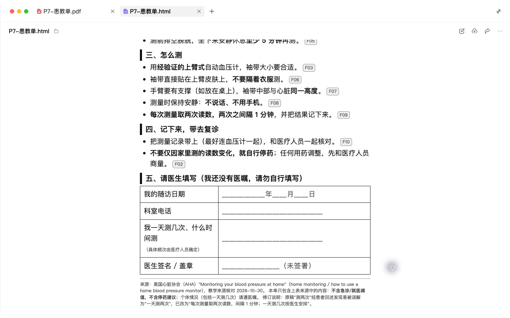
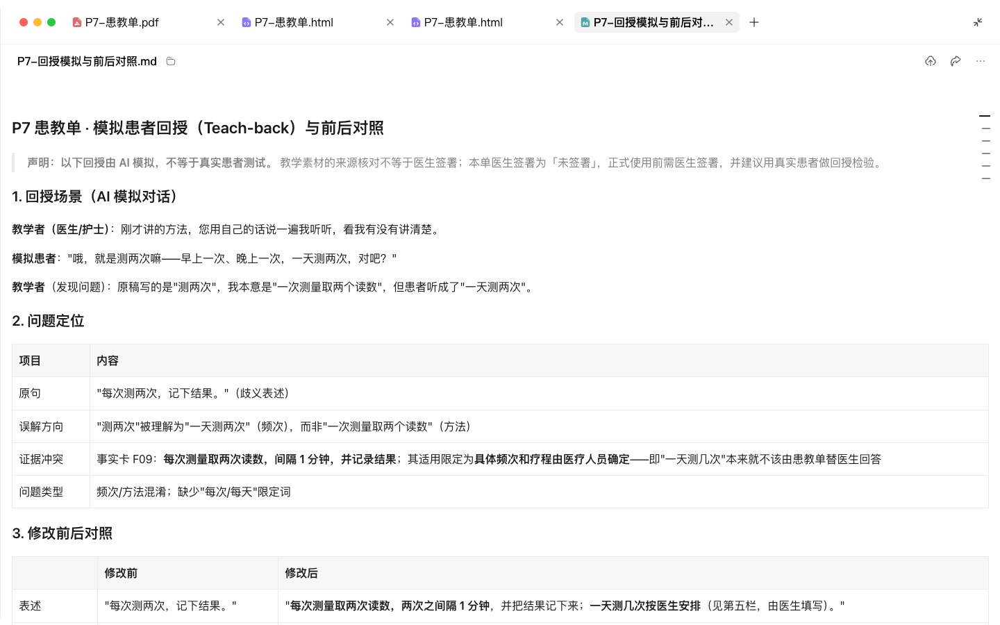
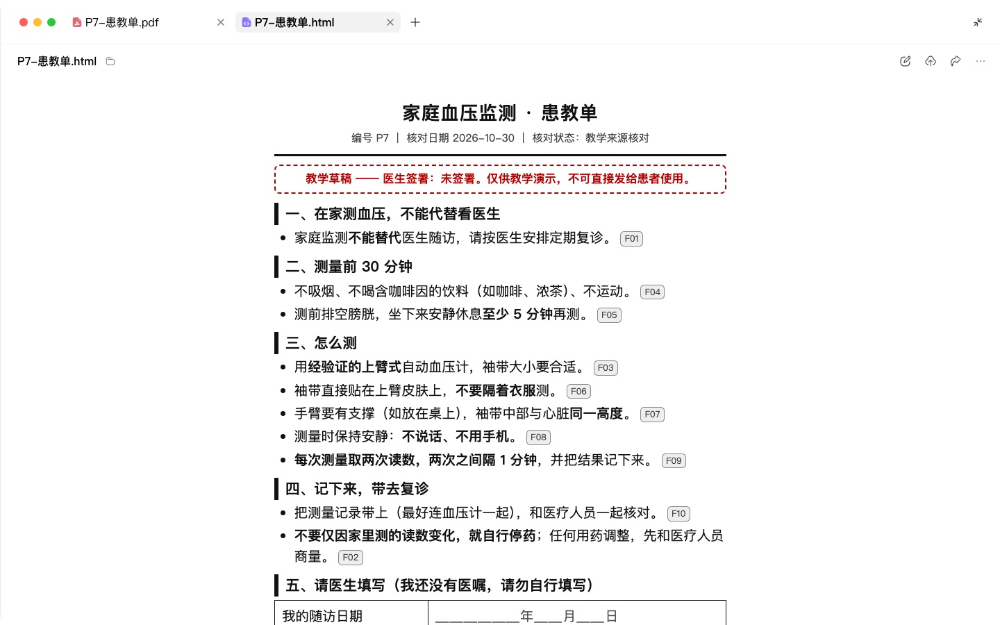

# P7 患教单与随访材料

## 快速实操：照着提示词做一遍

本课重点：用回授法找误解，缺少医嘱不自行补齐。先在“新建任务”中选定课程工作空间。每个阶段完成后打开产物预览，再继续下一段提示词。

课前文件：

- [教学事实卡.csv](../实操素材/教学事实卡.csv)

### 实操 1

```text
当前工作空间：WorkBuddy教程。
请根据实操素材/教学事实卡.csv，制作一页A4家庭血压测量患教单，面向老年患者及照护者，使用大字、短句和清楚的操作顺序。包含测量前准备、测量中注意事项、读数记录和复诊时携带材料；随访日期、科室电话、个体测量频次缺少具体信息时保留填写栏，不自行编造。
```

### 实操 2

```text
当前工作空间：WorkBuddy教程。
请从患者理解角度检查患教单，重点排查“测两次”是否会被理解为一天两次，区分每次读数次数与每日测量频次，修改不清楚的句子。交付可编辑Word、一页PDF、HTML预览、电话与微信随访话术，以及修改对照和回授提问表到演示输出/P7/。逐页检查排版；实际患者回授尚未进行时，在检查记录中如实说明。
```

## 完整方法：理解每一步，迁移到自己的课题

科普是写给“可能会看到的人”，患教单是写给“今天就坐在你面前的患者”。它不需要吸引人，只需要让患者回家后知道做什么、什么时候必须回来。这一课教你把事实卡和科室医嘱改写成一页 A4 患教单，以及一套随访话术。

| 项目 | 内容 |
| --- | --- |
| 难度 | 1 |
| 时长 | 30 分钟 |
| 前置 | P3（事实卡） |
| 产出 | 一页 A4 患教单（Word / PDF）+ 电话与微信随访话术 |
| 用到的 Skill | docx、pdf |

## 1. 好患教单的六个标准

| 标准 | 不好的写法 | 好的写法 |
| --- | --- | --- |
| 读得懂 | 规律监测血压 | 按医生给定的时段测量；每次取两次读数，间隔1分钟 |
| 短句 | 长句套长句 | 每句不超过 20 字 |
| 具体 | 必要时就医 | 出现下面任何一种情况，立即去急诊 |
| 有下一步 | 请定期复查 | 请在【日期】带血压记录本来门诊 |
| 警示突出 | 混在正文里 | 单独一个框，放在显眼位置 |
| 能联系上 | 无 | 科室电话、咨询时间 |

## 2. 操作步骤

### 第 1 步：准备输入

- 已确认的事实卡（P3）
- 你科室对这类患者的常规医嘱（文字版，不含患者信息）
- 目标人群：例如“刚诊断高血压、第一次在家量血压的 65 岁以上患者，部分人不识字或视力不好，常由子女陪同”
- 科室联系方式与咨询时间

### 第 2 步：生成初稿

```text
请用我的事实卡和科室医嘱，写一页 A4 患教单。
读者：（粘贴目标人群描述）。
固定结构：
1. 标题：一句话说清这张纸是干什么的；
2. 您需要做的 3 件事（编号，每件带具体时间、次数、方法）；
3. 出现这些情况，请立即去急诊（单独一框）；
4. 下次复诊：时间、要带的东西；
5. 常见问题 3 问 3 答；
6. 科室联系方式。
写作规则：用“您”；每句不超过 20 字；数字具体；术语第一次出现时加括号解释；不写药品名称和剂量（由医生手写或打印在处方上）；只使用事实卡和医嘱中的内容。
```

**检查点**：警示信号部分必须由你逐条审定。这是患教单里风险最高的部分：漏写会延误就医，写太多会引起不必要的急诊。

### 第 3 步：teach-back 测试

teach-back（回授法）是患者教育里常用的方法：让患者用自己的话复述一遍，复述不出来的地方就是没写清楚的地方。先用 Agent 模拟：

```text
请扮演一位 72 岁、小学文化程度、第一次拿到这张患教单的患者。读完后用自己的话回答：
1. 回家后我要做哪几件事？
2. 什么情况下我要马上去医院？
3. 我什么时候再来？要带什么？
然后指出您读起来最吃力、最容易误解的 3 处，并给出修改建议。
```

按建议修改后，最好再拿给一位真实的患者或家属试读一次。


### 第 4 步：排版成可打印的一页

```text
请把定稿排版成一页 A4 的 Word 文档和 PDF：正文字号不小于四号；急诊警示框用粗边框；“下次复诊”日期留空白横线供手写；页脚放科室名称和联系电话。如果一页放不下，删常见问题，不要缩小字号。
```

### 第 5 步：随访话术

```text
基于同一份患教单，请写两套随访话术：
1. 电话随访（约 3 分钟）：开场自我介绍 → 确认患者是否在做那 3 件事 → 用问句确认有无警示症状 → 提醒复诊时间 → 结束语；
2. 微信随访消息：不超过 100 字，包含一个需要患者回复的问题。
规则：只问询和提醒，不做诊断、不调整用药；如果患者提到警示症状，话术中只引导就医。
```

## 3. 患教单骨架示例（虚构）

```markdown
# 在家量血压，这样做才准

## 您需要做的 3 件事
1. 按照医生填写的测量时段执行。每次取两次读数，间隔1分钟。
2. 量之前先坐下休息 5 分钟，不说话。
3. 每次的数字写在记录本上，复诊时带来。

## 出现下面任何一种情况，请立即去急诊
（由医生逐条确认后填写）

## 下次复诊
日期：______  请带上：血压记录本、正在吃的药

科室电话：______  咨询时间：______
```

## 4. 自查清单

- [ ] 一页 A4 放得下，字号足够大
- [ ] “您需要做的事”都有具体时间和次数
- [ ] 急诊警示单独成框，并由我逐条审定
- [ ] AI 回述发现的问题已修改；真实患者或照护者的回授结果另行确认
- [ ] 随访话术不含诊断和用药调整

## 5. 常见问题

**可以做成不同版本吗？** 可以。让 Agent 生成“大字版”（视力不好）、“家属版”（写给照顾者），核心内容不变。

**患者不识字怎么办？** 让 Agent 把“3 件事”改成配图说明，用 P5 的方法做成图示版。

## 6. 练习

把你科室现在正在用的一张旧患教单上传，让 Agent 按六个标准打分并改写，对比前后。

## 下一课

P8 把 P3–P7 串起来：一张事实卡一次性产出所有载体，并把这条链路做成 Skill。

## 本次实操复盘

回授模拟暴露了“每次测两次”被理解成“一天测两次”的风险。修改后的患教单明确每次两次、间隔 1 分钟，并给一天测量频次留出医嘱填写栏。实际 PDF 已渲染检查为一页 A4，正文和表格没有裁切；模拟回授不能替代真实患者或照护者试读。


## 配套结果文件

- [P7-回授模拟与前后对照.md](../演示输出/P7/P7-回授模拟与前后对照.md)
- [P7-患教单.docx](../演示输出/P7/P7-患教单.docx)
- [P7-患教单.html](../演示输出/P7/P7-患教单.html)
- [P7-患教单.pdf](../演示输出/P7/P7-患教单.pdf)
- [P7-随访话术.md](../演示输出/P7/P7-随访话术.md)
- [make_docx.py](../演示输出/P7/make_docx.py)


## 操作画面



医嘱填写区。



回授模拟与改写。



患教单预览。


患教回授任务。

录屏为无旁白的实际操作节选，保留输入、选择与查看结果的片段，较长生成等待已剪去。完整提示词见上文；操作阶段字幕和时间点可辅助定位。

[观看P7实操录屏](../录屏/P7-WorkBuddy实操.mp4) · [操作阶段字幕](../录屏/P7-WorkBuddy实操.vtt)
