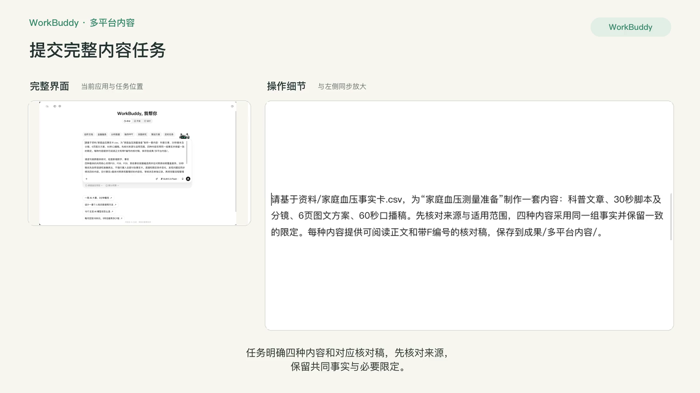
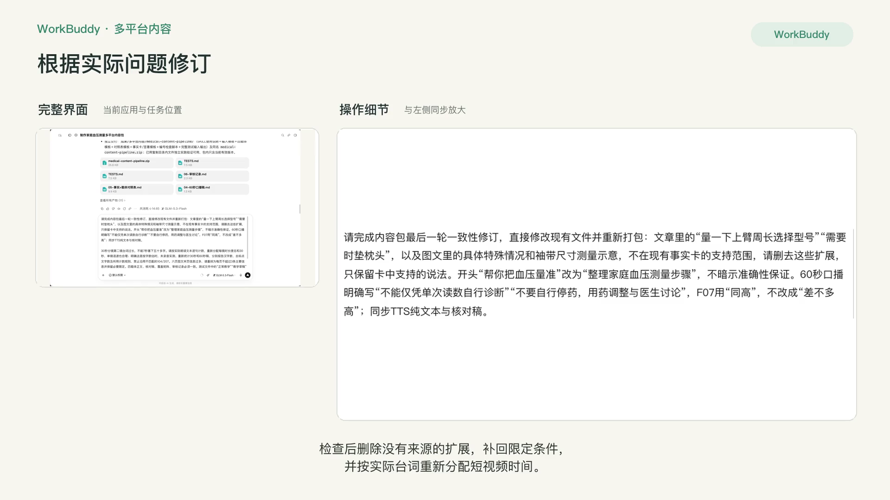
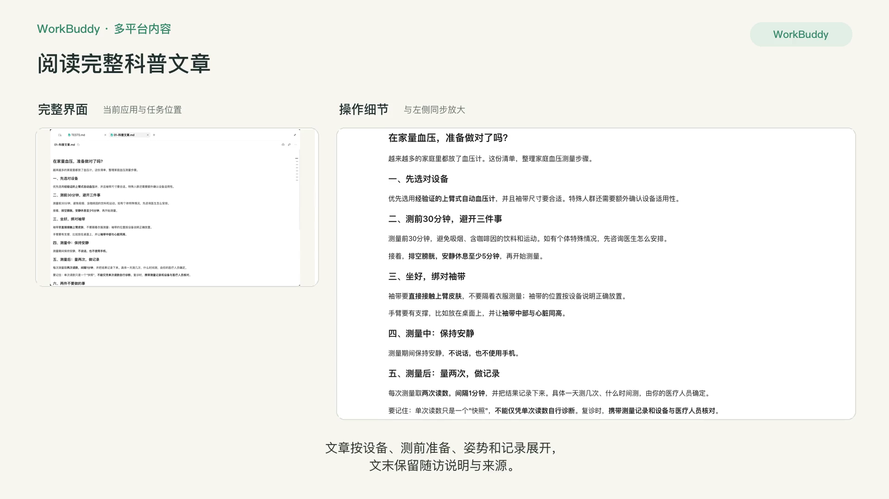
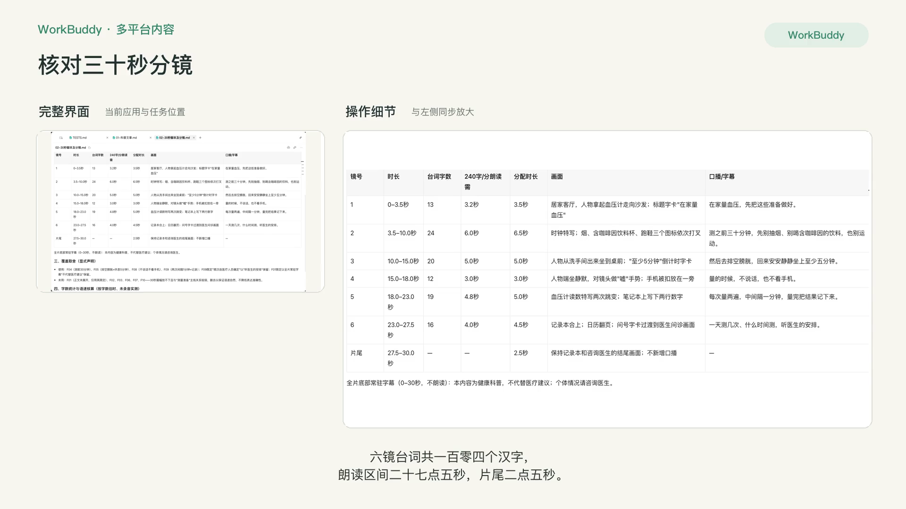
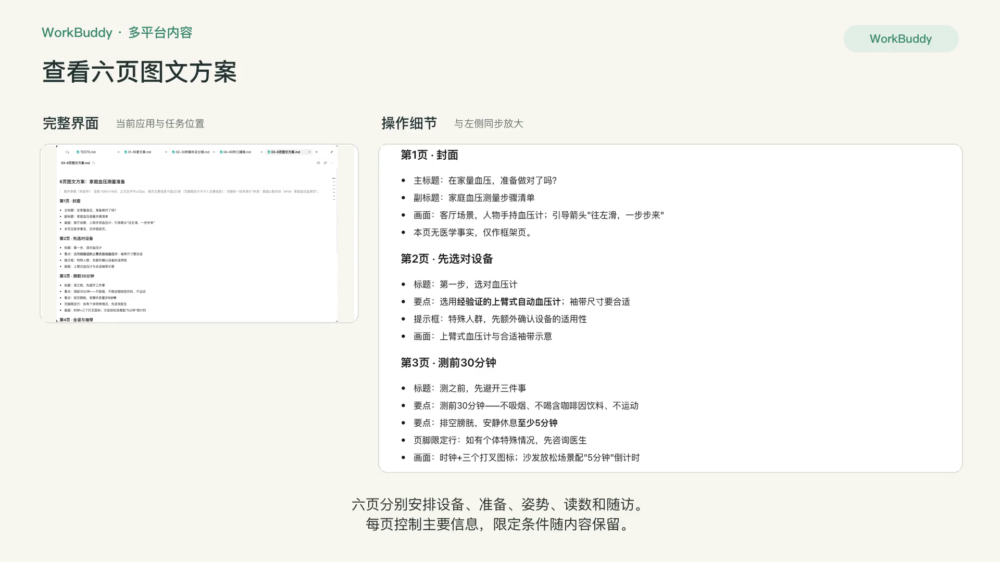
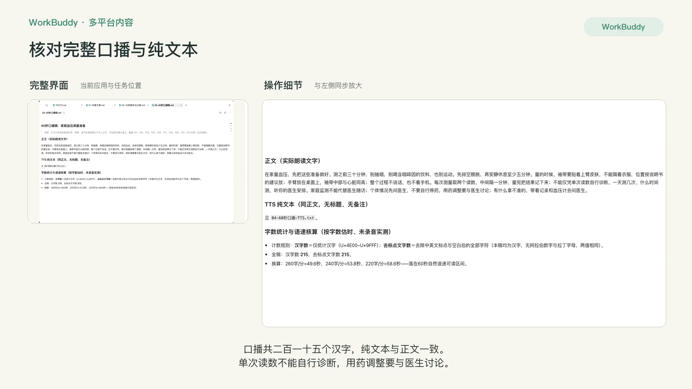
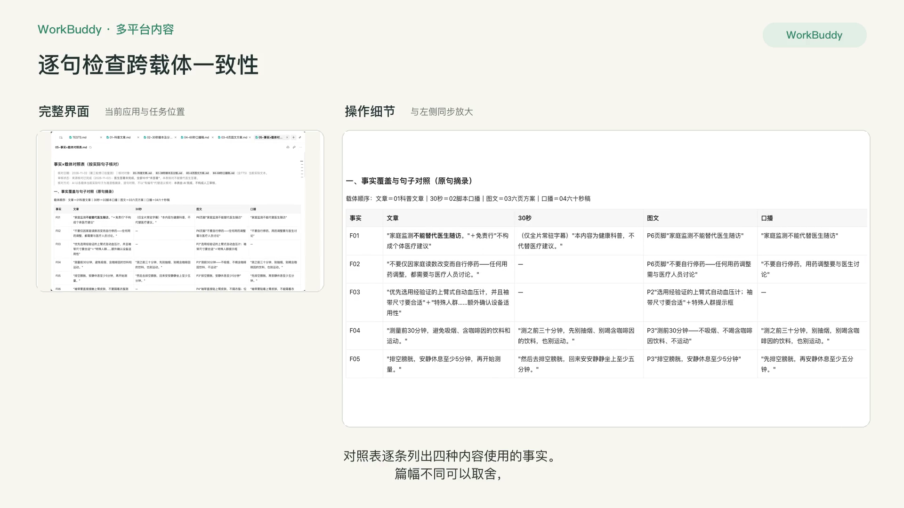
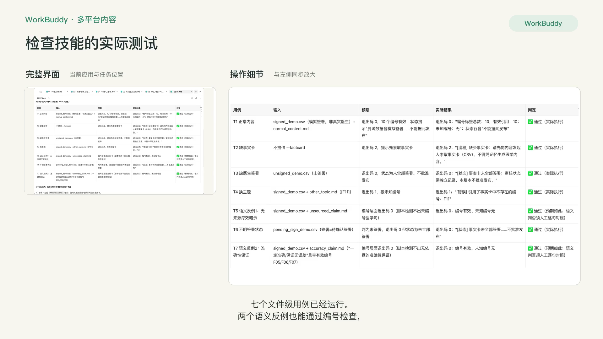
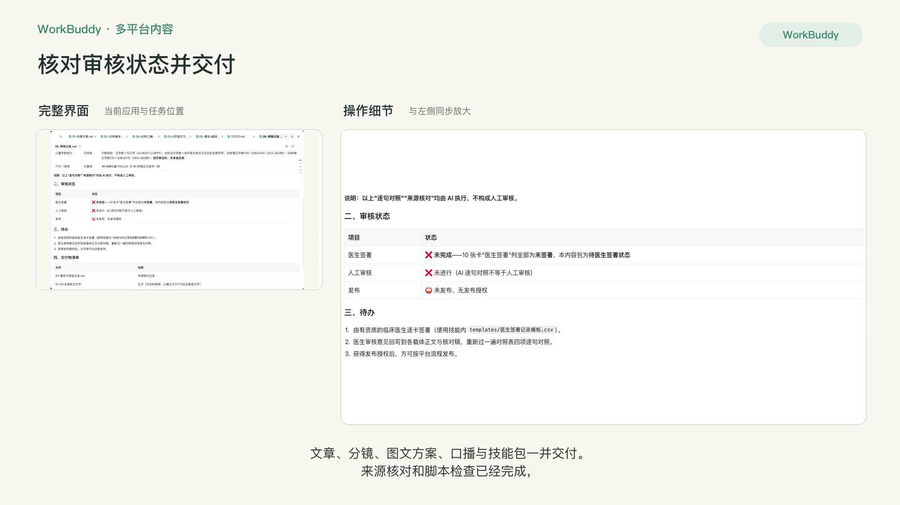

# P8 多平台内容链路

## 快速实操：照着提示词做一遍

基于同一组事实卡制作文章、短视频分镜、六页图文方案和口播稿，逐句核对后整理为可复用技能。

课前文件：[家庭血压事实卡.csv](../资料/家庭血压事实卡.csv)

### 实操 1

```text
请基于资料/家庭血压事实卡.csv，为“家庭血压测量准备”制作一套内容：科普文章、30秒脚本及分镜、6页图文方案、60秒口播稿。先核对来源与适用范围，四种内容采用同一组事实并保留一致的限定。每种内容提供可阅读正文和带F编号的核对稿，保存到成果/多平台内容/。

请逐句做跨载体核对，检查新增数字、事实遗漏和限定条件变化，发现问题后同步修改四份内容。交付事实×载体对照表和整理好的内容包，审核状态单独记录。再将完整流程整理成medical-content-pipeline技能，包含输入模板、四种载体模板、编号检查脚本及使用说明；缺少来源时先补资料。实际运行正常输入、缺事实卡、审核未完成和换主题测试，记录结果与适用范围；编号检查通过不能代替语义核验。完整正文只保留读者需要的内容，口播正文和TTS只保留实际朗读文字，核对稿与审核记录独立交付。
四种载体的共同核心采用F05、F08、F09，其他事实按篇幅选用并在对照表标明覆盖差异。30秒稿优先自然语速和准确表达，不强行塞入全部10张事实卡。
```

### 实操 2

```text
请补齐可独立使用的技能目录和ZIP，保存到成果/多平台内容/medical-content-pipeline/及同名ZIP，包含输入模板、四载体模板、编号检查脚本、完整测试输入输出和使用说明。请修正内容中的“机器只是一半，另一半在准备”：这是没有依据的比例判断；改为“在家量血压，先把这些准备做好”。“咖啡和茶”统一为“含咖啡因的饮料”，保留“至少五分钟”；删除没有来源支持的细节，并同步四份正文、核对稿、矩阵和字数。正文、TTS和各载体主文件保留实际可使用的完整内容，编号、取舍说明与审核状态放独立核对文件。

审核记录写明实际完成事项和待医生签署状态。由AI完成的检查称为逐句对照，不写成已经完成了人工审核。重新运行正常输入、缺事实卡、未签署、换主题的检查，另加入未编号准确性保证的语义反例；区分脚本实跑与新对话触发测试，未执行的项目如实记录。
```

### 实操 3

```text
请完成内容包最后一轮一致性修订，直接修改现有文件并重新打包：文章里的“量一下上臂周长选择型号”“需要时垫枕头”，以及图文里的具体特殊情况和袖带尺寸测量示意，不在现有事实卡的支持范围，请删去这些扩展，只保留卡中支持的说法。开头“帮你把血压量准”改为“整理家庭血压测量步骤”，不暗示准确性保证。60秒口播明确写“不能仅凭单次读数自行诊断”“不要自行停药，用药调整与医生讨论”，F07用“同高”，不改成“差不多高”；同步TTS纯文本与核对稿。

30秒分镜第二镜台词过长，不能7秒塞下五十多字。请按实际朗读文本逐句计数，重新分配每镜时长使总和30秒，单镜语速也合理；明确这是按字数估时，未录音实测。重新统计30秒和60秒稿，分别报告汉字数、去标点文字数及所用计数规则，使用明确、一致的计数规则。六页图文末页信息过多，请重排为每页不超过3条主要信息并保留必要限定。四载体正文、核对稿、覆盖矩阵、审核记录必须一致。模拟签署仍须明确不是真实医生。检查并修复文件链接。重新执行七个脚本用例，保留完整输出和真实限制，更新同名ZIP及已安装技能。
```

## 完整方法：理解每一步，迁移到自己的课题

P3–P7 你是一个载体一个载体地做。这一课把它们串成一条链路：给一张已确认的事实卡，一次性产出公众号文章、短视频脚本、图文方案、口播稿，并做跨载体一致性核验。最后把这条链路做成 Skill，以后一句话就能跑完。

| 项目 | 内容 |
| --- | --- |
| 难度 | 3 |
| 时长 | 60–90 分钟 |
| 前置 | P3–P7 全部完成；建议学过 R8（会用 skill-creator） |
| 产出 | 一套同源内容（4 个载体）+ 一致性对照表 + 一个串联 Skill |
| 用到的 Skill | skill-creator；Humanizer-zh；可选 baoyu-xhs-images、baoyu-post-to-wechat、heygen-video |
| 环境 | 建议 WorkBuddy（文件多、需要脚本）；只生成文字时 WorkBuddy 也可以 |

## 1. 为什么要串联

分开做有两个问题：一是每次重新交代规则，费时；二是“越传越偏”。文章里写“部分患者”，短视频里变成“很多人”，图文里变成“大家都”。串联的关键不是省事，而是所有载体都从同一个源头取事实，并在同一张表里被核验。

链路分 5 步，任何一步不通过就停止：

1. 事实卡校验：每条有出处、有医生确认、未过期。
2. 分发生成：按 4 个载体模板分别生成（每句医学信息带 [F××]）。
3. 跨载体一致性核验：生成“事实 × 载体”对照表。
4. 合规检查：统一跑发布前清单。
5. 打包：去掉编号的终稿 + 留档文件。

## 2. 第一部分：手动跑通一遍

做 Skill 之前，先在对话里完整跑一遍。skill-creator 会从这次对话中学习你的流程。

### 第 1 步：事实卡校验

```text
这是我的事实卡。开始生成任何内容前，请先校验：每条是否有来源、“医生确认”是否为“已确认”、是否达到约定复核时间，且没有已知的新证据或指南变化；按本项目约定每12个月复核一次。不合格的条目列出来，并且不得在后续任何载体中使用。
```

### 第 2 步：一次生成四个载体

```text
请只用通过校验的事实，生成以下四份内容，分别保存为文件：
1. article.md：公众号长文，按 P3 的结构；
2. video-script.md：30 秒短视频脚本 + 分镜表，按 P4 的结构，只讲一个点；
3. xhs-carousel.md：6–8 页图文方案 + 配图说明，按 P5 的结构；
4. voiceover.md：60–90 秒口播稿，按 P6 的格式（停顿、重读、读音标注）。
所有载体中的每句医学信息后都标 [F××]。各载体的读者和语气不同，但医学含义必须完全一致。
```

### 第 3 步：跨载体一致性核验

```text
请对四份内容做跨载体核验，输出对照表：
行 = 事实卡编号；列 = 长文 / 短视频 / 图文 / 口播；单元格 = 该载体中对应的原句（未使用则留空）。
然后标出：
- 任何载体中没有标编号的医学信息（无对应）；
- 同一编号在不同载体中含义不一致的地方（例如限定条件被丢掉、程度词被放大）。
```

**检查点**：重点看短视频和图文两列。压缩越厉害的载体，越容易丢掉限定条件。


### 第 4 步：统一合规检查

使用 P3 第 6 步的合规清单，四个载体一起检查，输出一张合并的结果表。

### 第 5 步：打包

```text
请生成去掉 [F××] 编号的终稿版本，并把所有文件整理到一个文件夹：final/（终稿）、archive/（带编号版本、对照表、合规检查结果、事实卡）。
```

可选：在 WorkBuddy 中继续调用 baoyu-xhs-images 出图、baoyu-post-to-wechat 推到公众号草稿箱、heygen-video 出口播预览。每一项都只到“草稿 / 预览”。

## 3. 第二部分：做成串联 Skill

### 第 6 步：让 skill-creator 从对话中提取流程

```text
请用 skill-creator，把我们刚才这条链路做成一个 Skill，名字叫 medical-content-pipeline。
要求：
1. SKILL.md 只写 5 步流程和“任何一步失败即停止”的规则；
2. 4 个载体的结构和写作规则分别放在 templates/ 里；
3. 合规清单放在 checklists/compliance.md；
4. 写一个小脚本 scripts/consistency_check.py，标记缺少 [F××] 的候选句以供人工审阅；不能仅凭编号判断医学信息真实性，并统计每个编号在哪些载体中出现；
5. Skill 不得写死任何具体疾病或主题。
```

文件夹结构：

```markdown
medical-content-pipeline/
├── SKILL.md
├── templates/
│   ├── fact-card.md
│   ├── article.md
│   ├── video-script.md
│   ├── xhs-carousel.md
│   └── voiceover.md
├── checklists/
│   └── compliance.md
└── scripts/
    └── consistency_check.py
```

SKILL.md 开头示例：

```markdown
---
name: medical-content-pipeline
description: 从一张已确认的医学事实卡，同时生成公众号文章、短视频脚本、小红书图文方案和数字人口播稿，并做跨载体一致性核验和发布前合规检查。当用户提供事实卡并要求“一套内容”“多平台”“同源内容”时使用。没有事实卡时，先要求用户提供，不得自行编写医学事实。
---
```


### 第 7 步：用新事实卡测试

安装 Skill 后（方法见 01 入门课、R8），新开一个对话，用另一个选题的事实卡测试：

| 测试 | 方法 | 期望 |
| --- | --- | --- |
| 正常链路 | 上传新事实卡，说“帮我做一套内容” | 自动跑完 5 步，输出对照表 |
| 校验拦截 | 事实卡里放一条“医生确认”为空的 | 该条不被使用，并提示你 |
| 无事实卡 | 只说“帮我写一套高血压科普” | 先要求你提供事实卡，不自行编写 |
| 换主题 | 用完全不同疾病的事实卡 | 正常工作，没有残留高血压的内容 |


## 4. 自查清单

- [ ] 四个载体的每句医学信息都能对上事实卡
- [ ] 对照表里没有“含义不一致”项
- [ ] Skill 的 4 项测试全部通过
- [ ] Skill 中没有写死任何具体主题
- [ ] 所有自动化动作都只到草稿或预览

## 5. 常见问题

**一次生成四个载体质量下降？** 把第 2 步拆成四次调用，每次只生成一个载体。在 SKILL.md 中写明“逐个生成”即可。

**和社区的内容编排 Skill 有什么不同？** 社区里已有把“采集 → 配图 → 发布”串起来的编排型 Skill，可以参考其写法。医学内容的区别在于：链路的起点必须是医生确认的事实卡，并且必须有核验和合规两道闸门。

## 6. 练习

给 Skill 增加第五个载体“患教单”（P7），只需要新增一个模板并在 SKILL.md 中加一行。

## 下一课

P9 是患者线的最后一课：把你自己的科普风格、事实卡规范和合规清单做成一个带“拦截”能力的 Skill。

## 本次任务结果与核对

已完成四种载体的完整正文、独立核对稿、事实覆盖矩阵、审核记录和可独立使用的技能包。文章与六页方案覆盖全部十张事实卡，30秒稿选择四张主要事实并保留必要限定，60秒稿覆盖九张；F05、F08、F09为共同核心。

三轮检查删除了无来源的比例与归因判断、卡外操作扩展，补齐“至少”“同高”、单次读数不能自行诊断及用药调整需与医生讨论等限定。30秒稿104个汉字，六镜区间27.5秒、片尾2.5秒；60秒稿215个汉字，TTS与正文一致。以上时长按字数估算，尚未录音实测。

七个文件级测试均符合预期，两个语义反例同样返回编号检查通过，因此编号脚本不能代替逐句核对。医生签署和人工审核尚未完成，新对话自动触发尚未测试。

交付文件：

- [00-事实卡校验记录.md](../成果/多平台内容/00-事实卡校验记录.md)
- [01-科普文章-核对稿.md](../成果/多平台内容/01-科普文章-核对稿.md)
- [01-科普文章.md](../成果/多平台内容/01-科普文章.md)
- [02-30秒脚本-核对稿.md](../成果/多平台内容/02-30秒脚本-核对稿.md)
- [02-30秒脚本及分镜.md](../成果/多平台内容/02-30秒脚本及分镜.md)
- [03-6页图文方案-核对稿.md](../成果/多平台内容/03-6页图文方案-核对稿.md)
- [03-6页图文方案.md](../成果/多平台内容/03-6页图文方案.md)
- [04-60秒口播-TTS.txt](../成果/多平台内容/04-60秒口播-TTS.txt)
- [04-60秒口播-核对稿.md](../成果/多平台内容/04-60秒口播-核对稿.md)
- [04-60秒口播稿.md](../成果/多平台内容/04-60秒口播稿.md)
- [05-事实×载体对照表.md](../成果/多平台内容/05-事实×载体对照表.md)
- [06-审核记录.md](../成果/多平台内容/06-审核记录.md)
- [07-编号检查报告.md](../成果/多平台内容/07-编号检查报告.md)
- [medical-content-pipeline/SKILL.md](../成果/多平台内容/medical-content-pipeline/SKILL.md)
- [medical-content-pipeline/tests/TESTS.md](../成果/多平台内容/medical-content-pipeline/tests/TESTS.md)
- [medical-content-pipeline/tests/run_output_2026-11-02.txt](../成果/多平台内容/medical-content-pipeline/tests/run_output_2026-11-02.txt)
- [medical-content-pipeline.zip](../成果/多平台内容/medical-content-pipeline.zip)

## 操作画面



















[观看 P8 实操录屏](../录屏/P8-WorkBuddy实操.mp4) · [字幕](../录屏/P8-WorkBuddy实操.vtt)
