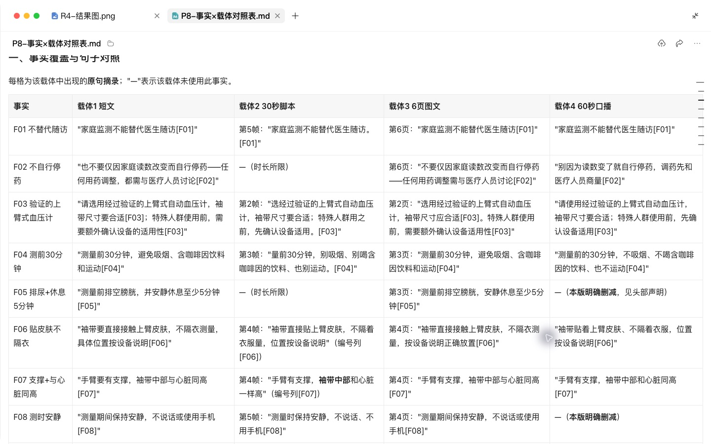
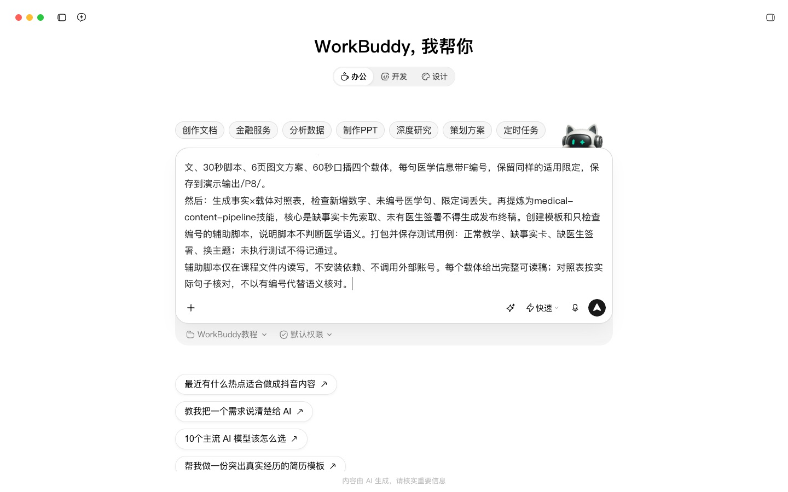
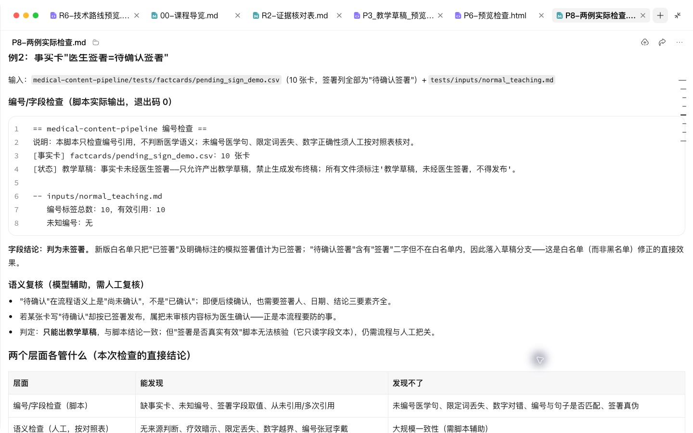
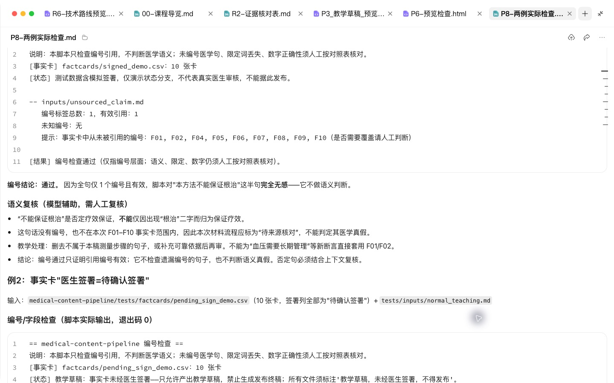
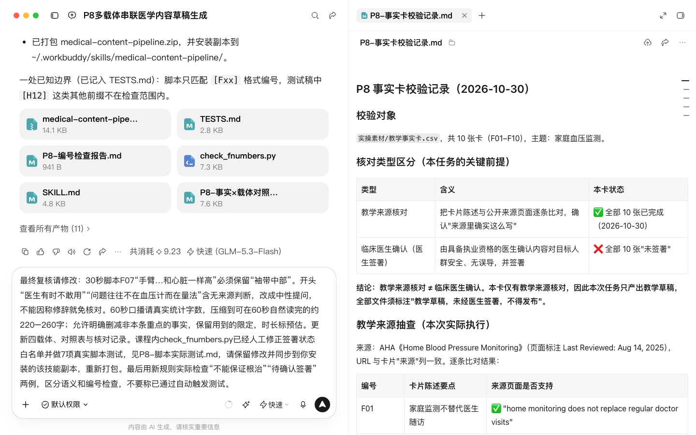

# P8 同源多载体串联：一张事实卡出四种内容，并用 Skill 固化

## WorkBuddy 实操

本课重点：四个载体都从同一事实卡取材并核查限定条件。先在“新建任务”中选定课程工作空间。每个阶段完成后打开产物预览，再继续下一段提示词。

课前文件：

- [教学事实卡.csv](../实操素材/教学事实卡.csv)

### 实操 1

```text
当前工作空间：WorkBuddy教程。
先校验实操素材/教学事实卡.csv，区分教学来源核对与临床医生确认；此任务只做教学草稿。生成短文、30秒脚本、6页图文方案、60秒口播四个载体，每句医学信息带F编号，保留同样的适用限定，保存到演示输出/P8/。
```

### 实操 2

```text
当前工作空间：WorkBuddy教程。
生成事实×载体对照表，检查新增数字、未编号医学句、限定词丢失。再提炼为medical-content-pipeline技能，核心是缺事实卡先索取、未有医生签署不得生成发布终稿。创建模板和只检查编号的辅助脚本，说明脚本不判断医学语义。打包并保存测试用例：正常教学、缺事实卡、缺医生签署、换主题；未执行测试不得记通过。
```

## 完整方法与练习

P3–P7 你是一个载体一个载体地做。这一课把它们串成一条链路：给一张已确认的事实卡，一次性产出公众号文章、短视频脚本、图文方案、口播稿，并做跨载体一致性核验。最后把这条链路做成 Skill，以后一句话就能跑完。

| 项目 | 内容 |
| --- | --- |
| 难度 | 3 |
| 时长 | 60–90 分钟 |
| 前置 | P3–P7 全部完成；建议学过 R8（会用 skill-creator） |
| 产出 | 一套同源内容（4 个载体）+ 一致性对照表 + 一个串联 Skill |
| 用到的 Skill | skill-creator；Humanizer-zh；可选 baoyu-xhs-images、baoyu-post-to-wechat、heygen-video |
| 环境 | 建议 WorkBuddy（文件多、需要脚本）；只生成文字时 WorkBuddy 也可以 |

## 1. 为什么要串联

分开做有两个问题：一是每次重新交代规则，费时；二是“越传越偏”。文章里写“部分患者”，短视频里变成“很多人”，图文里变成“大家都”。串联的关键不是省事，而是所有载体都从同一个源头取事实，并在同一张表里被核验。

链路分 5 步，任何一步不通过就停止：

1. 事实卡校验：每条有出处、有医生确认、未过期。
2. 分发生成：按 4 个载体模板分别生成（每句医学信息带 [F××]）。
3. 跨载体一致性核验：生成“事实 × 载体”对照表。
4. 合规检查：统一跑发布前清单。
5. 打包：去掉编号的终稿 + 留档文件。

## 2. 第一部分：手动跑通一遍

做 Skill 之前，先在对话里完整跑一遍。skill-creator 会从这次对话中学习你的流程。

### 第 1 步：事实卡校验

```text
这是我的事实卡。开始生成任何内容前，请先校验：每条是否有来源、“医生确认”是否为“已确认”、是否达到约定复核时间，且没有已知的新证据或指南变化；12个月仅作为教学复核周期。不合格的条目列出来，并且不得在后续任何载体中使用。
```

### 第 2 步：一次生成四个载体

```text
请只用通过校验的事实，生成以下四份内容，分别保存为文件：
1. article.md：公众号长文，按 P3 的结构；
2. video-script.md：30 秒短视频脚本 + 分镜表，按 P4 的结构，只讲一个点；
3. xhs-carousel.md：6–8 页图文方案 + 配图说明，按 P5 的结构；
4. voiceover.md：60–90 秒口播稿，按 P6 的格式（停顿、重读、读音标注）。
所有载体中的每句医学信息后都标 [F××]。各载体的读者和语气不同，但医学含义必须完全一致。
```

### 第 3 步：跨载体一致性核验

```text
请对四份内容做跨载体核验，输出对照表：
行 = 事实卡编号；列 = 长文 / 短视频 / 图文 / 口播；单元格 = 该载体中对应的原句（未使用则留空）。
然后标出：
- 任何载体中没有标编号的医学信息（无对应）；
- 同一编号在不同载体中含义不一致的地方（例如限定条件被丢掉、程度词被放大）。
```

**检查点**：重点看短视频和图文两列。压缩越厉害的载体，越容易丢掉限定条件。


### 第 4 步：统一合规检查

使用 P3 第 6 步的合规清单，四个载体一起检查，输出一张合并的结果表。

### 第 5 步：打包

```text
请生成去掉 [F××] 编号的终稿版本，并把所有文件整理到一个文件夹：final/（终稿）、archive/（带编号版本、对照表、合规检查结果、事实卡）。
```

可选：在 WorkBuddy 中继续调用 baoyu-xhs-images 出图、baoyu-post-to-wechat 推到公众号草稿箱、heygen-video 出口播预览。每一项都只到“草稿 / 预览”。

## 3. 第二部分：做成串联 Skill

### 第 6 步：让 skill-creator 从对话中提取流程

```text
请用 skill-creator，把我们刚才这条链路做成一个 Skill，名字叫 medical-content-pipeline。
要求：
1. SKILL.md 只写 5 步流程和“任何一步失败即停止”的规则；
2. 4 个载体的结构和写作规则分别放在 templates/ 里；
3. 合规清单放在 checklists/compliance.md；
4. 写一个小脚本 scripts/consistency_check.py，标记缺少 [F××] 的候选句以供人工审阅；不能仅凭编号判断医学信息真实性，并统计每个编号在哪些载体中出现；
5. Skill 不得写死任何具体疾病或主题。
```

文件夹结构：

```markdown
medical-content-pipeline/
├── SKILL.md
├── templates/
│   ├── fact-card.md
│   ├── article.md
│   ├── video-script.md
│   ├── xhs-carousel.md
│   └── voiceover.md
├── checklists/
│   └── compliance.md
└── scripts/
    └── consistency_check.py
```

SKILL.md 开头示例：

```markdown
---
name: medical-content-pipeline
description: 从一张已确认的医学事实卡，同时生成公众号文章、短视频脚本、小红书图文方案和数字人口播稿，并做跨载体一致性核验和发布前合规检查。当用户提供事实卡并要求“一套内容”“多平台”“同源内容”时使用。没有事实卡时，先要求用户提供，不得自行编写医学事实。
---
```


### 第 7 步：用新事实卡测试

安装 Skill 后（方法见第 0 课、R8），新开一个对话，用另一个选题的事实卡测试：

| 测试 | 方法 | 期望 |
| --- | --- | --- |
| 正常链路 | 上传新事实卡，说“帮我做一套内容” | 自动跑完 5 步，输出对照表 |
| 校验拦截 | 事实卡里放一条“医生确认”为空的 | 该条不被使用，并提示你 |
| 无事实卡 | 只说“帮我写一套高血压科普” | 先要求你提供事实卡，不自行编写 |
| 换主题 | 用完全不同疾病的事实卡 | 正常工作，没有残留高血压的内容 |


## 4. 自查清单

- [ ] 四个载体的每句医学信息都能对上事实卡
- [ ] 对照表里没有“含义不一致”项
- [ ] Skill 的 4 项测试全部通过
- [ ] Skill 中没有写死任何具体主题
- [ ] 所有自动化动作都只到草稿或预览

## 5. 常见问题

**一次生成四个载体质量下降？** 把第 2 步拆成四次调用，每次只生成一个载体。在 SKILL.md 中写明“逐个生成”即可。

**和社区的内容编排 Skill 有什么不同？** 社区里已有把“采集 → 配图 → 发布”串起来的编排型 Skill，可以参考其写法。医学内容的区别在于：链路的起点必须是医生确认的事实卡，并且必须有核验和合规两道闸门。

## 6. 练习

给 Skill 增加第五个载体“患教单”（P7），只需要新增一个模板并在 SKILL.md 中加一行。

## 下一课

P9 是患者线的最后一课：把你自己的科普风格、事实卡规范和合规清单做成一个带“拦截”能力的 Skill。

## 本次实操复盘

同一组事实卡衍生短文、30 秒分镜、六页图文和约 60 秒口播，并用逐句对照表检查限定词。编号检查脚本实际运行 7 项用例；编号有效不代表语义正确。“不能保证根治”是否定句，不能按关键词判为疗效保证；来源未覆盖的内容需另行核对。待确认签署仍按未签署处理。


## 配套结果文件

- [P8-两例实际检查.md](../演示输出/P8/P8-两例实际检查.md)
- [P8-事实×载体对照表.md](../演示输出/P8/P8-事实×载体对照表.md)
- [P8-事实卡校验记录.md](../演示输出/P8/P8-事实卡校验记录.md)
- [P8-口播字数统计.txt](../演示输出/P8/P8-口播字数统计.txt)
- [P8-编号检查报告.md](../演示输出/P8/P8-编号检查报告.md)
- [P8-脚本实际测试.md](../演示输出/P8/P8-脚本实际测试.md)
- [P8-载体1-短文.md](../演示输出/P8/P8-载体1-短文.md)
- [P8-载体2-30秒脚本.md](../演示输出/P8/P8-载体2-30秒脚本.md)
- [P8-载体3-6页图文方案.md](../演示输出/P8/P8-载体3-6页图文方案.md)
- [P8-载体4-60秒口播稿.md](../演示输出/P8/P8-载体4-60秒口播稿.md)
- [medical-content-pipeline.zip](../演示输出/P8/medical-content-pipeline.zip)


## 操作画面



四载体逐句事实对照。



多载体任务。



待确认不等于已签署。



编号通过仍需语义复核。



逐句复核。

录屏为无旁白的实际操作节选，保留输入、选择与查看结果的片段，较长生成等待已剪去。完整提示词见上文；操作阶段字幕和时间点可辅助定位。

[观看P8实操录屏](../录屏/P8-WorkBuddy实操.mp4) · [操作阶段字幕](../录屏/P8-WorkBuddy实操.vtt)
