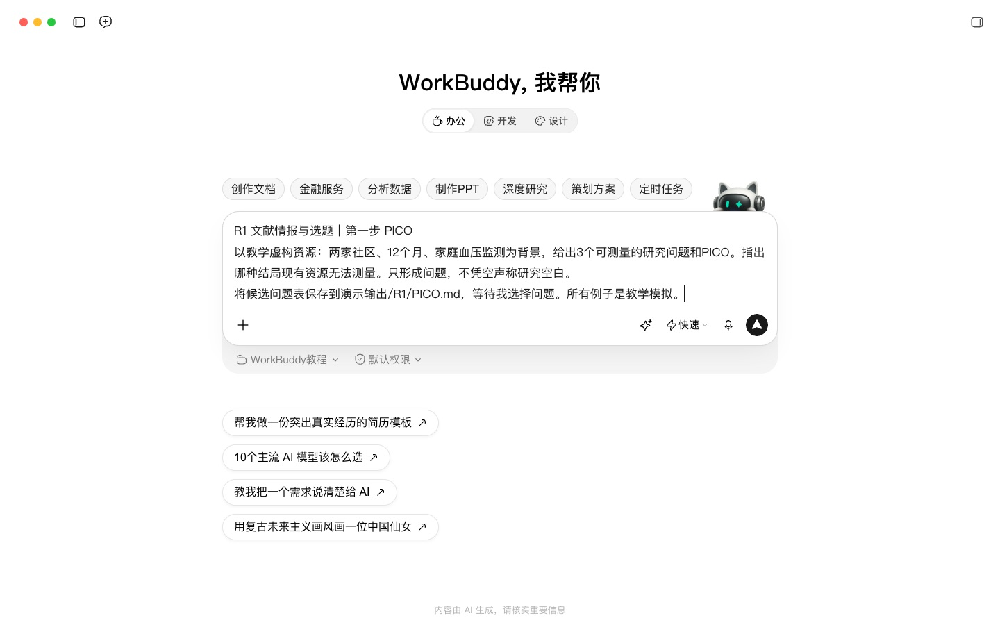
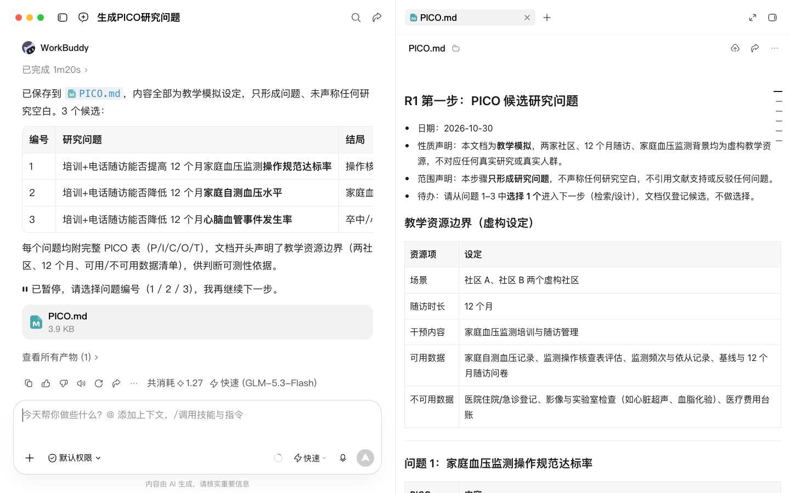
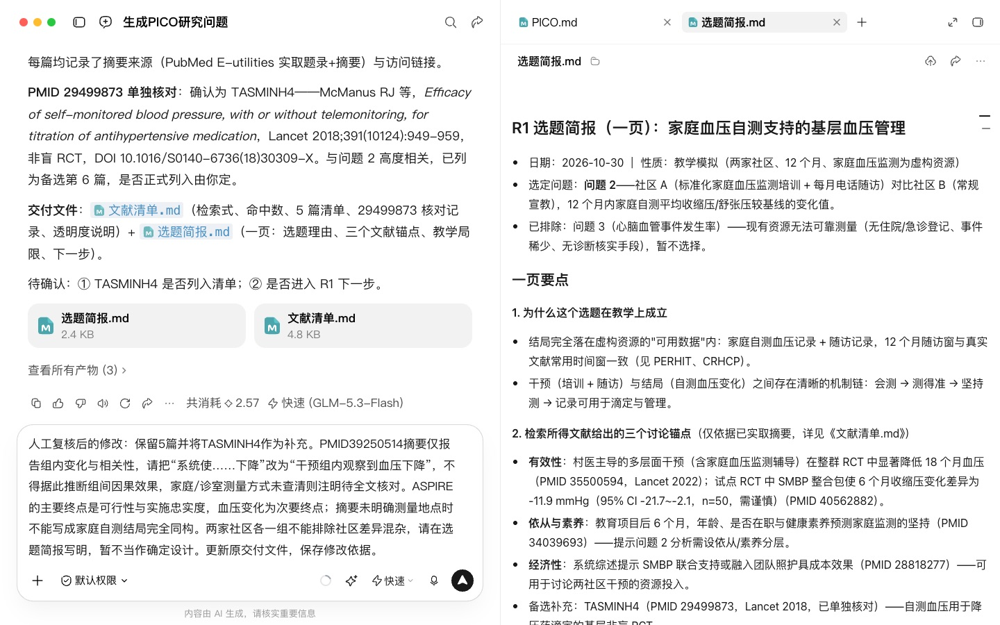
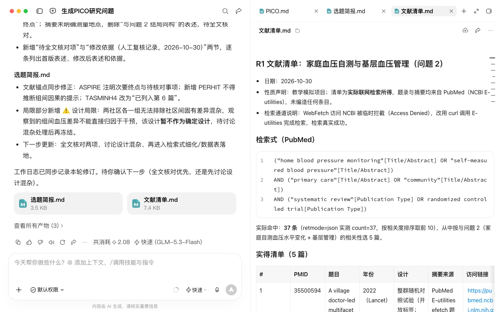
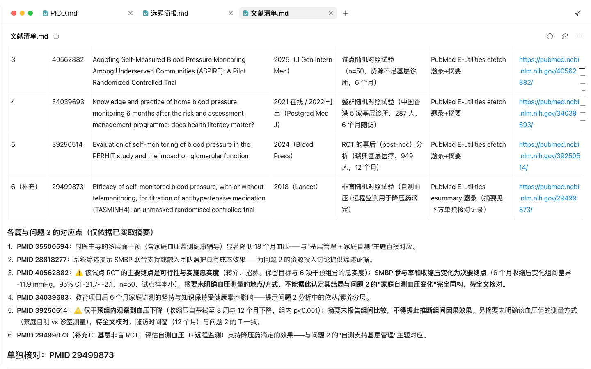
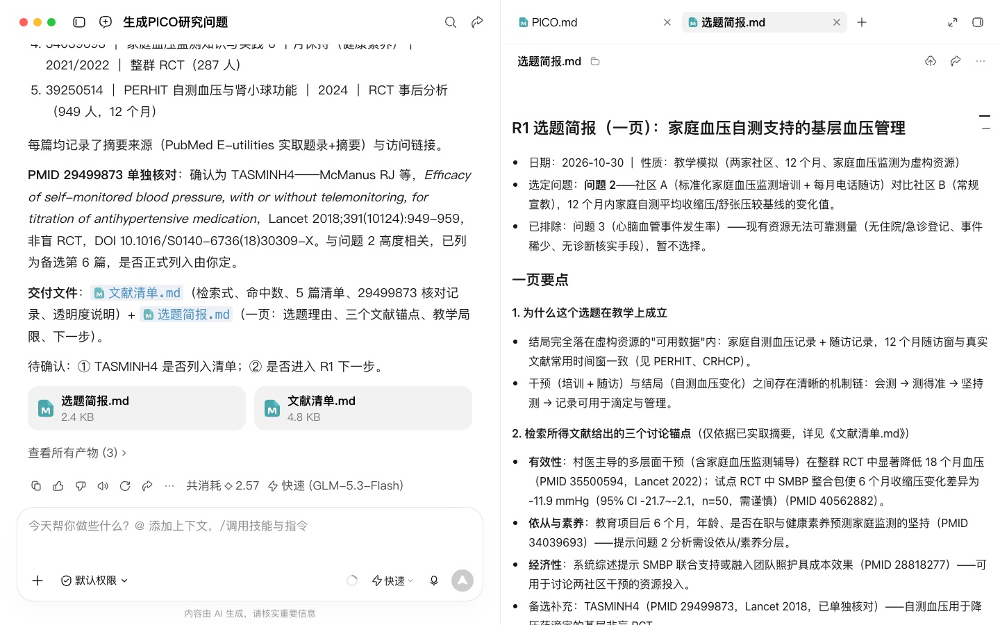

# R1 文献情报与选题

## WorkBuddy 实操

本课重点：将模糊方向拆成 PICO，实际检索并核对 PMID。先在“新建任务”中选定课程工作空间。每个阶段完成后打开产物预览，再继续下一段提示词。

课前文件：

- [模拟医生定位.txt](../实操素材/模拟医生定位.txt)
- [来源索引.md](../实操素材/来源索引.md)

### 实操 1

```text
当前工作空间：WorkBuddy教程。
以教学虚构资源：两家社区、12个月、家庭血压监测为背景，给出3个可测量的研究问题和PICO。指出哪种结局现有资源无法测量。只形成问题，不凭空声称研究空白。
```

### 实操 2

```text
当前工作空间：WorkBuddy教程。
选定家庭血压自测支持的基层管理主题。构造PubMed检索式，并实际联网检索5篇相关原始研究或综述。每篇记录PMID、题目、年份、设计、摘要来源和访问链接；做不到联网就明确报告，不编结果数。单独打开核对PMID 29499873。把实得清单和一页选题简报保存到演示输出/R1/。
```

## 完整方法与练习

这一课教你用 Agent 在 30 分钟内把一个模糊的研究方向，变成 3 个有文献支撑、打过分的候选选题。关键不在“让 AI 想题目”，而在让它走一遍你本该走的检索流程，并且每一步都留下可核对的证据。

| 项目 | 内容 |
| --- | --- |
| 难度 | 1 |
| 时长 | 30 分钟 |
| 前置 | 第 0 课（PubMed 检索工具（官网或已核验的连接器）、scientific-problem-selection 已装好） |
| 产出 | 一页选题简报 + 一份文献清单（约 20 篇） |
| 后续会用到 | R2 精读、R3 方案、R6 基金、P3 事实卡 |

## 1. 先懂四个工具概念

**PICO**：把临床问题拆成人群（P）、干预或暴露（I）、对照（C）、结局（O）。拆不出来的问题，通常也做不成研究。

**检索式**：主题词（PubMed 的 MeSH）负责查全，自由词（题名摘要字段 [tiab]）负责查新，同一概念内用 OR，不同概念之间用 AND。

**研究设计与证据质量**：先按问题类型和研究设计分类，再评估偏倚、精确性及适用性。系统综述的质量取决于纳入研究与综述方法，不能仅凭文献类型排出适用于所有问题的固定等级。

**FINER**：好选题的五个标准：可行（Feasible）、有趣（Interesting）、创新（Novel）、符合伦理（Ethical）、有意义（Relevant）。临床医生最容易高估的是“可行”。

## 2. 课前准备

- 一句话写下你想研究的方向，越口语越好。本课示例：“我想研究老年高血压患者在家量血压的事。”
- 你科室能拿到什么资源：每年大致病例数、有无随访队列、有无合作社区、计划研究周期。
- 中文文献：在知网或万方检索后导出题录（RIS 或 EndNote 格式，50 条以内）。Agent 目前不能直接检索这些中文库。

## 3. 操作步骤

### 第 1 步：用 PICO 把方向拆开

在第 0 课建的 工作空间 里新开一个对话：

```text
我是三甲医院心内科医生，每年门诊约 3000 例高血压患者，有 2 个合作社区卫生服务中心，计划 2 年内完成一项研究。
我的方向：老年高血压患者的家庭血压监测。
请：
1. 用 PICO 提出 3 个不同的具体研究问题（分别对应描述性、关联性、干预性研究）；
2. 对每个问题列出中英文检索词，英文包括可能的 MeSH 主题词和自由词同义词；
3. 先不要检索。
```

**你会得到**：类似“社区老年高血压患者家庭血压监测依从性及影响因素”“家庭血压与诊室血压不一致的发生率”“远程家庭血压监测对血压控制率的影响”三个问题。

**检查点**：你自己选定 1–3 个继续。如果某个问题的 O（结局）你科室根本测不到，现在就划掉。


### 第 2 步：生成并人工修正检索式

```text
针对我选定的问题，请写出：
1. PubMed 检索式（MeSH + [tiab] 自由词，限定 2020 年至今）；
2. 知网专业检索式；
3. 逐行解释每个部分的作用，并标出你不确定是否存在的 MeSH 词。
```

示例输出仅用于理解布尔结构。下式的 ambulatory 可能引入动态血压监测研究，需核对 MeSH 层级及实际结果，不能直接把它等同于家庭自测：

```text
("home blood pressure"[tiab] OR "self-measured blood pressure"[tiab]
 OR "home blood pressure monitoring"[tiab] OR "Blood Pressure Monitoring, Ambulatory"[Mesh])
AND (adherence[tiab] OR compliance[tiab] OR "Patient Compliance"[Mesh])
AND (aged[tiab] OR elderly[tiab] OR "Aged"[Mesh])
AND ("2020"[dp] : "3000"[dp])

知网：SU=('家庭血压监测'+'家庭自测血压'+'家庭血压')*('依从性'+'影响因素')
```

**检查点**：把 PubMed 检索式粘贴到 PubMed 网站试跑。结果量是调整检索式的线索，不能用固定篇数判断对错。结合预期核心文献是否检出、同义词覆盖与抽查相关性决定是否调整。这一步是你作为研究者必须亲自把关的。


### 第 3 步：用连接器检索并分层

```text
请用 PubMed 检索工具（官网或已核验的连接器）执行调整后的检索式，取最相关的 40 篇。
按研究类型分层（系统综述/Meta 分析、RCT、队列、横断面、其他），每篇给出 PMID、题目、年份、期刊、样本量（摘要中有就写）、一句话结论。
所有信息只能来自检索结果，摘要里没有的写“摘要未提及”。
```

然后上传中文题录文件：

```text
这是我从知网导出的题录。请用同样的分层规则整理，并合并到英文结果中。中文文献用“作者+年份+期刊”作为标识。
```

**检查点**：随机挑 3 个 PMID 到 PubMed 核对题目和年份。只要有一个对不上，就让 Agent 重新从连接器拉取，并检查工具图标里 PubMed 是否开启。


### 第 4 步：热点梳理

```text
基于上面的文献，请输出一张三栏表：
- 已有较强证据回答的问题
- 仍有争议或结论不一致的问题
- 未见研究或研究很少的问题（请特别关注中国人群、老年人群、基层场景）
每一条都要列出支持它的文献编号。“未见研究”只能表述为“在本次检索范围内未见”。
```

**为什么强调“在本次检索范围内”**：40 篇文献没找到，不等于世界上没人做过。写基金时把“国内外空白”说满是评审最反感的事之一。

### 第 5 步：用 Skill 做可行性评估

```text
请使用 scientific-problem-selection 技能，对我的 3 个候选选题做评估：
1. 按 FINER 五项各打 1–5 分，并写理由；
2. 列出每个选题成立所依赖的关键假设（例如“患者有电子血压计”），哪个假设最可能不成立；
3. 估算需要的样本量量级和我的病例来源是否足够；
4. 如果我只能做一个，推荐哪个，它做不下去时的备选方案是什么。
先问我最多 3 个你需要知道的信息。
```

**检查点**：Skill 被调用时，对话中会显示读取了该技能。重点看第 2 项“关键假设”，这是这个 Skill 最有价值的部分，它会把你默认成立的前提摆到桌面上。


### 第 6 步：生成交付物

```text
请生成两个文件：
1. 选题简报（Word，一页），按我下面给的模板；
2. 文献清单（Excel），列：编号、PMID/DOI、题目、年份、期刊、研究类型、样本量、一句话结论、与选题的关系（支持背景 / 方法参考 / 竞争研究）。
```

## 4. 产出物模板

```markdown
# 选题简报：（题目）

一句话研究问题（PICO）：
为什么值得做（3 句话，每句带文献编号）：
现有证据到哪一步了：
本研究的切入点：
可行性（病例来源 / 样本量量级 / 周期 / 伦理）：
FINER 评分：F _ I _ N _ E _ R _
最大风险及备选方案：
下一步：
```

## 5. 自查清单

- [ ] 每篇英文文献都有能打开的 PMID，并抽查过 3 篇
- [ ] 检索式在 PubMed 网站亲自跑过，结果数合理
- [ ] 简报里每个“空白”都有文献编号和“本次检索范围内”的限定
- [ ] 可行性里写了我自己的真实资源，而不是 AI 假设的

## 6. 常见问题

**Agent 列出的文献查不到？** 这是典型的“幻觉引用”。通常是连接器没开或你问法太宽。解决：确认连接器开启，并在提示词里写“只能使用 PubMed 检索工具（官网或已核验的连接器）返回的结果”。

**只看摘要够吗？** 可用于初筛和形成候选问题，不能据此完成正式证据评价。但准备引用到正文的文献，必须进入 R2 精读全文。

**发文量很多的方向是不是更好？** 不一定。发文多可能说明热，也可能说明已经被回答得差不多了，要看第 4 步的三栏表。

## 7. 练习

1. 用你自己科室的方向重做一遍，把示范主题换掉。
2. 进阶：让 Agent 对你推荐的选题做“逆向检索”：用它的题目关键词再搜一次，看是否已经有人做过几乎一样的研究。

## 下一课

R2 会从你的文献清单里挑 1 篇做精读，并学习怎么核对“这篇文献到底有没有说过这句话”。

## 本次实操复盘

实际检索得到文献后，重点纠正两类问题：PERHIT 的组内变化不能直接当作组间因果效应；ASPIRE 是小型先导试验，血压是次要结局。选题简报也将“两社区各固定一组”的社区与干预混杂列为设计风险。


## 配套结果文件

- [PICO.md](../演示输出/R1/PICO.md)
- [文献清单.md](../演示输出/R1/文献清单.md)
- [选题简报.md](../演示输出/R1/选题简报.md)


## 操作画面



PICO任务。



PICO结果。



人工复核指令。



复核后文献清单。



复核后的证据边界。



检索结果初稿。

录屏为无旁白的实际操作节选，保留输入、选择与查看结果的片段，较长生成等待已剪去。完整提示词见上文；操作阶段字幕和时间点可辅助定位。

[观看R1实操录屏](../录屏/R1-WorkBuddy实操.mp4) · [操作阶段字幕](../录屏/R1-WorkBuddy实操.vtt)
