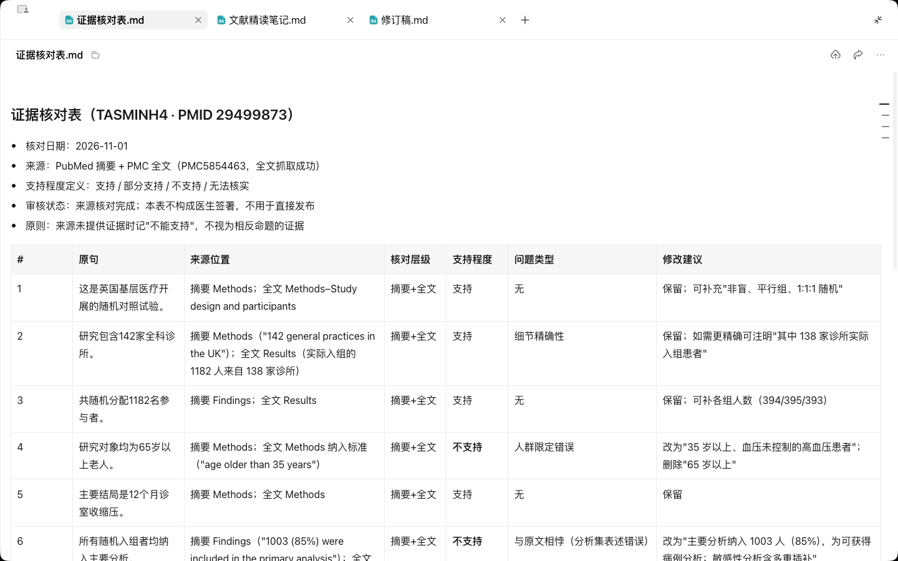
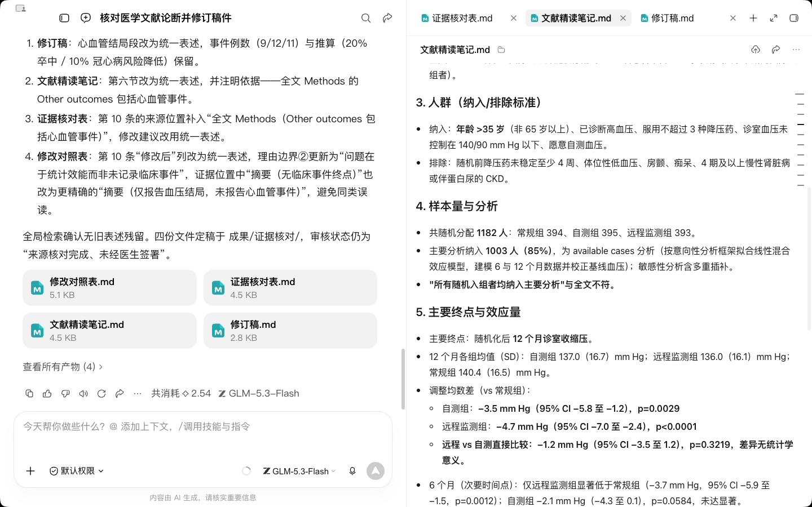
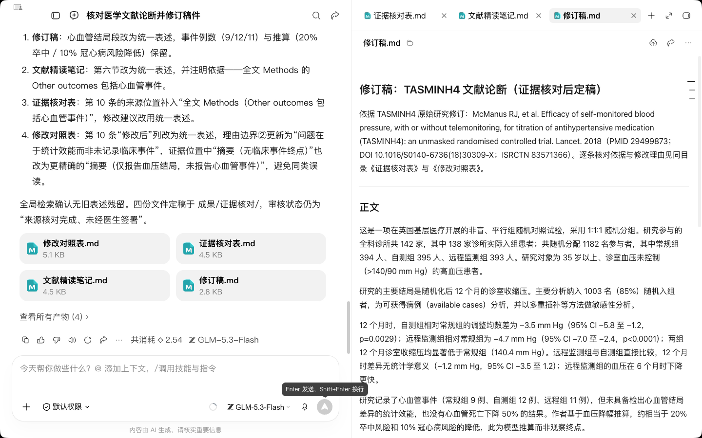
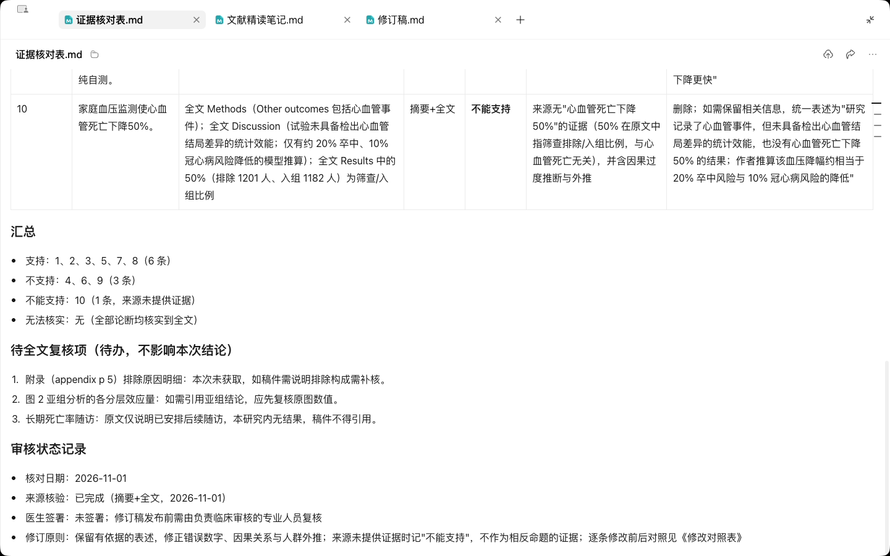

# R2 文献精读与证据核对

## 快速实操：照着提示词做一遍

本课重点：抓出错误外推、数字走样和没有依据的硬终点结论。先在“新建任务”中选定课程工作空间。每个阶段完成后打开产物预览，再继续下一段提示词。

课前文件：

- [文献论断.md](../资料/文献论断.md)
- [来源索引.md](../资料/来源索引.md)

### 实操 1

```text
请使用medical-evidence-check技能，核对资料/文献论断.md中的全部论断。访问对应PubMed记录和可获取的全文，提取研究设计、人群、主要终点、样本量和效应量，逐条给出支持程度、证据位置和修改建议。区分摘要与全文，保留无法核实的项目；保存文献精读笔记和证据核对表到成果/证据核对/。

依据核对结果完成完整修订稿：保留有依据的表述，修正错误数字、因果关系和人群外推，删除无法支持的结论。同时交付原句、修改后、理由、证据位置和待全文复核项的对照表。来源没有提供证据时写“不能支持”，不要把它当作相反命题的直接证据；页面只显示验证或拦截提示时不能算取得全文。所有文件保存到成果/证据核对/。
```

### 实操 2

```text
请精确修正两点：全文Results中有排除1201人（50%）、入组1182人（50%），所以不能写“全文无50%这一数字”；应写“没有心血管死亡下降50%的证据”。原文Discussion说试验未具备检出心血管结局差异的统计效能，不能改写成完全未记录临床事件；同步修正4份文件。再把修订稿整理为完整可读正文，核对日期、审核状态、修订原则、修改说明与待办集中放在核对表和修改对照里。
```

### 实操 3

```text
最后统一一个表述：全文Methods的Other outcomes包括心血管事件，因此修订稿中的“未以心血管死亡等临床结局为终点”仍过宽。请改为“研究记录了心血管事件，但未具备检出心血管结局差异的统计效能，也没有心血管死亡下降50%的结果”。同步核对其余三份文件，只修改这一处相关含义，保留已核实的数字和完整正文。
```

## 完整方法：理解每一步，迁移到自己的课题

这一课解决科研写作里最危险的问题：你引用的文献，到底有没有说过你写的那句话。学完后，你会用 Agent 产出带页码的精读笔记，并把一份稿件的引用逐条核一遍。

| 项目 | 内容 |
| --- | --- |
| 难度 | 1-2 |
| 时长 | 40 分钟 |
| 前置 | 01 入门课、R1（有文献清单） |
| 产出 | 1 份精读笔记 + 1 张引用核对表 |
| 后续会用到 | R5 写作、R6 基金、P3 事实卡（核对方法完全一致） |

## 1. 为什么要核对引用

引用出错通常不是“引错了文献”，而是下面四种更隐蔽的情况，这也是 AI 改稿后最容易出现的：

| 类型 | 例子 |
| --- | --- |
| 夸大 | 原文“与……相关”，稿件写成“导致”或“显著改善” |
| 外推 | 原文人群是中年人，稿件用来支持老年人的结论 |
| 数字走样 | 原文 OR=1.32，稿件写成 1.23；或少了置信区间 |
| 二手引用 | 引了一篇综述，但那句话其实是综述转述别人的原始研究 |

## 2. 课前准备

- 从 R1 文献清单里挑 1 篇开放获取的原始研究，下载全文 PDF。
- 一段带 8–10 条引用的稿件（自己的引言或讨论即可），以及被引文献的 PDF。
- 检查稿件里的每个数字、人群限定与结论强度，并保留对应原句。

## 3. 第一部分：结构化精读

### 第 1 步：上传全文并要求标页码

```text
请精读我上传的这篇论文全文（不是只看摘要），按下表输出笔记：
| 栏目 | 内容 | 原文位置（页码+段落/表格号） |
栏目包括：研究问题、研究设计、研究对象与纳排标准、样本量、干预/暴露、主要结局及测量方法、主要结果（效应量、置信区间、P 值）、作者自述的局限、你认为未提及的局限、对我的研究可借鉴之处。
规则：数字一律照抄原文；原文没有的写“原文未提及”；“你认为的局限”一栏要和作者自述分开。
```

**检查点**：挑“主要结果”一行，按它给的页码去原文对数字。数字对得上、页码也对得上，这份笔记才能用。


### 第 2 步：用对应的清单做质量评价

| 研究类型 | 报告规范 | 偏倚风险工具 |
| --- | --- | --- |
| RCT | CONSORT | RoB 2 |
| 观察性研究 | STROBE | 按设计选择；ROBINS-I 用于非随机干预研究，不能通用于所有横断面研究 |
| 系统综述 / Meta 分析 | PRISMA | AMSTAR 2 评价综述方法质量；结合适合纳入研究的偏倚工具 |
| 诊断准确性研究 | STARD | QUADAS-2 |

```text
请判断这篇论文的研究类型，选择对应的偏倚风险工具逐项评价。每一项给出判定和原文依据（页码）。原文信息不足以判断的，判为“不清楚”，不要推测。
```

可选：装了 K-Dense 的 scientific-critical-thinking 或 scholar-evaluation 技能后，可以在提示词里点名调用，它们会额外检查统计方法和结论是否与数据匹配。

## 4. 第二部分：引用核对

### 第 3 步：上传稿件和所有被引文献

把稿件（Word 或粘贴文字）和全部被引 PDF 一起上传。文件多的话，放进 当前工作空间的资料文件夹更稳定。

```text
请对稿件中的每一条引用做核对，按下表输出：
| 序号 | 稿件中的论断（原句） | 引用文献 | 原文中最相关的内容（一句摘录 + 页码） | 判定 | 问题类型 | 修改建议 |
判定只能是：支持 / 部分支持 / 不支持 / 无法核实（未上传全文或找不到相关内容）。
问题类型从“夸大、外推、数字走样、二手引用、其他”中选。
不要为了让结果好看而判“支持”，拿不准就判“部分支持”并说明原因。
```

### 第 4 步：人工复核

Agent 的判定是初筛，不是结论。复核规则：

1. 所有“不支持”和“无法核实”：逐条打开原文看。
2. 所有“部分支持”：看修改建议是否合理。
3. “支持”：随机抽 2 条看。如果抽查发现错误，全部“支持”都要重新看。


### 第 5 步：按建议改稿

```text
请只修改判定为“部分支持”和“不支持”的句子，其他句子一字不动。用 Word 修订模式输出，每处修改加批注说明依据哪篇文献第几页。
```

## 5. 示例：一条被抓出的夸大引用

| 字段 | 内容 |
| --- | --- |
| 稿件原句 | 家庭血压监测可显著降低老年患者心血管事件风险 [12] |
| 原文内容 | 文献 [12] 为横断面研究，只报告了家庭血压监测与血压达标率相关 |
| 判定 | 不支持 |
| 问题类型 | 夸大（把相关写成因果，把替代终点写成硬终点） |
| 修改建议 | 改为“家庭血压监测与老年患者更高的血压达标率相关 [12]”；如需事件终点证据，另找队列或 RCT |

（以上为教学虚构示例。）

## 6. 自查清单

- [ ] 精读笔记每一行都有页码，且抽查过主要结果的数字
- [ ] 用了与研究类型匹配的偏倚风险工具
- [ ] 核对表覆盖稿件中每一条引用
- [ ] “不支持 / 无法核实”全部人工看过原文
- [ ] 修改稿只动了有问题的句子

## 7. 常见问题

**PDF 很长，Agent 好像漏读了后半部分？** 让它先列出论文的章节和表格清单，确认读全了再做笔记；或者分段提问。

**扫描版 PDF 怎么办？** 先让 Agent 用 OCR 提取文字并输出一页给你看，识别质量可以再继续。表格里的数字尤其要人工对。

**没有全文，只有摘要？** 明确写“仅摘要核对”；摘要能直接支持的窄结论可标支持，但不能冒称已经完成全文及页码核验。可以用 PubMed 检索工具（官网或已核验的连接器）尝试获取 PMC 全文。

## 8. 练习

1. 用你上一篇已发表论文的引言做一次核对，看看有没有“夸大”。
2. 进阶：故意在稿件中加入一条数字走样的引用，测试 Agent 的检出能力。

## 下一课

R3 会把 R1 的选题和本课精读得到的方法学信息（样本量、效应量、结局指标）用来起草研究方案。精读笔记里的效应量，就是 R3 算样本量的参数来源。

## 本次实操复盘

本次取得 PubMed 摘要与 PMC 全文，逐条核对 10 条论断。其中 6 条支持，3 条与研究人群、分析集或组间比较不符，1 条没有对应证据。复核时进一步纠正了两处表述：全文的“50%”指筛查和入组比例，没有心血管死亡下降 50% 的证据；试验未具备检出心血管结局差异的统计效能，同时记录了描述性事件例数，不能写成完全未记录临床事件。

最终交付四份文件。修订稿为完整正文，来源位置、修改理由与尚需复核的附录和亚组图数值保存在核对文件中。网页全文使用章节及表格定位，不虚构 PDF 页码。

## 配套结果文件

- [文献精读笔记](../成果/证据核对/文献精读笔记.md)
- [证据核对表](../成果/证据核对/证据核对表.md)
- [完整修订稿](../成果/证据核对/修订稿.md)
- [修改对照表](../成果/证据核对/修改对照表.md)

## 操作画面


核对任务。



全文来源与范围。



精读笔记与效应量。



完整修订稿。



最终核对与待办。

录屏带讲解旁白和字幕，展示输入、等待、查看结果与纠正的完整过程，较长生成等待已加速。完整提示词见上文；章节按钮可跳到对应步骤。

[观看R2实操录屏](../录屏/R2-WorkBuddy实操.mp4) · [操作阶段字幕](../录屏/R2-WorkBuddy实操.vtt)
