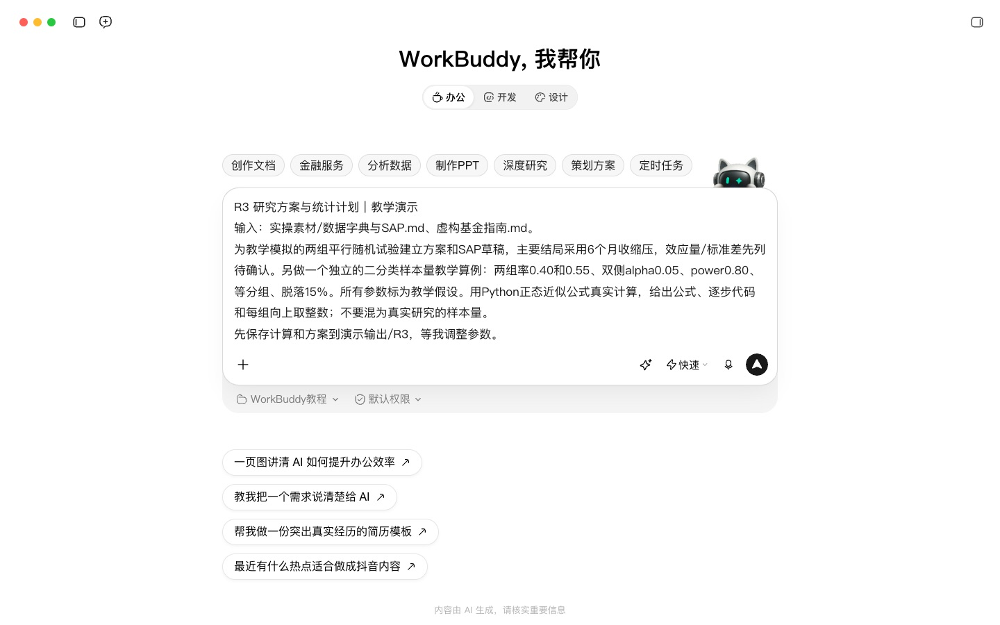
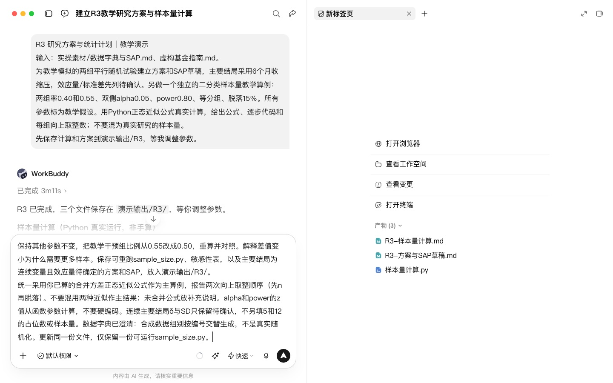
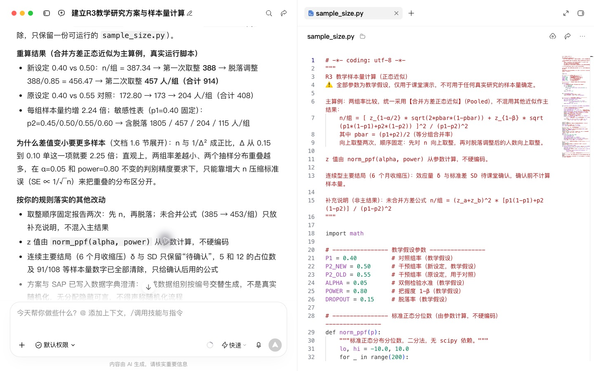
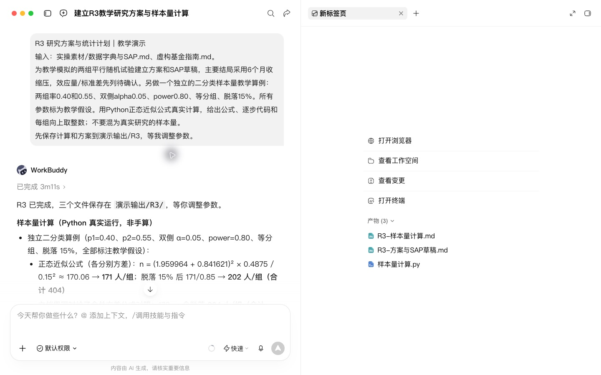

# R3 研究方案与统计分析计划草拟

## 快速实操：照着提示词做一遍

本课重点：用可执行代码计算样本量并观察参数变化。先在“新建任务”中选定课程工作空间。每个阶段完成后打开产物预览，再继续下一段提示词。

课前文件：

- [数据字典与SAP.md](../实操素材/数据字典与SAP.md)
- [虚构基金指南.md](../实操素材/虚构基金指南.md)

### 实操 1

```text
当前工作空间：WorkBuddy教程。
请为社区老年高血压患者家庭血压监测项目起草研究方案和统计分析计划。两家社区，总周期12个月，拟采用个体1:1随机分组、常规管理对照，主要结局为6个月收缩压，次要结局与变量定义见实操素材/数据字典与SAP.md。结合演示输出/R1/的选题简报和演示输出/R2/的证据核对结果，写清研究目的、纳排标准、干预与对照、随机化、测量时间点、分析人群、主模型、缺失处理、质量控制、伦理与数据管理。区分计划与已经具备的条件，缺少的机构信息和证据列待确认，输出方案与SAP到演示输出/R3/。
```

### 实操 2

```text
当前工作空间：WorkBuddy教程。
请完成样本量与招募可行性分析。主要结局仍为6个月收缩压，双侧alpha=0.05、power=0.80、1:1分组、预计脱落15%。先从已核对文献中提取组间差和标准差并注明出处；资料不足时，为资源预算计算组间差3、4、5 mmHg与标准差12、15、18 mmHg的敏感性矩阵，参数状态记为待确认，不冒称文献结论。用Python实际计算两独立样本均数比较所需人数，固定算法与取整顺序，并说明与调整基线主模型的关系。结合6个月随访和12个月总周期评估招募窗口、每月入组需求与执行风险。交付可重跑sample_size.py、参数来源表、敏感性表、可行性结论，以及整合后的研究方案与SAP Word文档；重跑核对后保存到演示输出/R3/。
```

## 完整方法：理解每一步，迁移到自己的课题

这一课把 R1 的选题简报变成一份能拿去和统计师、伦理委员会讨论的方案初稿，并在看到任何数据之前写定统计分析计划（SAP）。Agent 负责搭框架、算样本量、查漏项，你负责每一个参数的来源。

| 项目 | 内容 |
| --- | --- |
| 难度 | 1-2 |
| 时长 | 40 分钟 |
| 前置 | R1（选题简报、文献清单）、R2（精读笔记中的效应量） |
| 产出 | 方案初稿（Word）+ SAP 草稿 + 样本量计算代码 |
| 用到的 Skill | clinical-trial-protocol-skill（干预性研究）、K-Dense statistical-analysis（可选）、docx |

## 1. 先懂三个关键概念

**方案规范**：干预性试验的方案按 SPIRIT 条目写，观察性研究可以反过来用 STROBE 条目检查自己是否想清楚了需要报告的东西。规范是“查漏清单”，不是写作模板。

**样本量的四个输入**：显著性水平 α（通常 0.05）、把握度 1-β（通常 0.8 或 0.9）、预期效应量、脱落率。其中效应量最关键，必须有文献或预试验来源。

**SAP 为什么要先写**：先看数据再决定怎么分析，很容易不自觉地挑选结果好看的方法。提前写定主分析，是对自己的保护。

## 2. 课前准备

- 在“高血压家庭血压监测”工作空间 里上传 R1 选题简报、文献清单、R2 精读笔记。
- 想清楚：你能招募的人群、每月能入组多少人、随访方式、有没有统计师合作。
- 干预性研究请安装 clinical-trial-protocol-skill（见 01 入门课的安装方法）。

## 3. 操作步骤

### 第 1 步：选定研究设计

```text
基于项目中的选题简报，请列出 2–3 种可行的研究设计（例如随机对照试验、前瞻性队列、回顾性队列），用表格比较：能回答的问题、证据等级、所需样本量量级、周期、伦理难度、主要偏倚风险、对我的资源而言是否可行。最后给出推荐和理由，但由我决定。
```

**检查点**：你做出选择并告诉 Agent。下面以“社区老年高血压患者远程家庭血压监测的随机对照试验”为例。

### 第 2 步：用 Skill 搭方案框架

```text
请使用 clinical-trial-protocol-skill，为我选定的设计起草方案。
先按 SPIRIT 条目列出目录，并标出哪些条目你需要我提供信息。
然后逐节填写，每写完一节停下来让我确认。任何你不确定的信息用【待确认】标出，不要自行填写。
```

观察性研究不必用这个 Skill，把提示词中的 SPIRIT 换成“按 STROBE 条目检查需要在方案中提前规定的内容”即可。


### 第 3 步：算样本量（参数必须有来源）

```text
主要结局是6个月收缩压。请从项目文献清单与精读笔记中提取组间均数差、标准差及其来源，找不到就列待确认。
采用双侧alpha=0.05、power=0.80、1:1分组、脱落15%。用Python计算两独立样本均数比较的样本量，说明与调整基线主模型的关系、计算方法和取整顺序。
参数不足时，先计算组间差3、4、5 mmHg与标准差12、15、18 mmHg的预算敏感性矩阵；这些是待确认的规划参数，不能写成文献估计。
保存参数来源表、样本量表和可重跑代码，结合招募窗口评估可行性；暂不把未确认参数对应的人数作为立项结论。
```

可使用 [statsmodels 的两独立样本功效计算](https://www.statsmodels.org/stable/generated/statsmodels.stats.power.TTestIndPower.solve_power.html)。输入的标准化效应量为组间差除以标准差，每组人数与总人数应分别列明。

**检查点**：固定标准差比较不同组间差，再固定组间差比较不同标准差。核对参数出处、脱落调整、取整方式，以及12个月总周期是否容纳招募和6个月随访。


### 第 4 步：写 SAP 草稿

```text
请为本研究起草统计分析计划，包括：
1. 主要终点和次要终点，分别注明变量类型和测量时间点；
2. 分析人群定义（ITT、符合方案集）；
3. 主分析方法（一个，写具体模型和调整变量）；
4. 缺失值处理；
5. 预先规定的亚组分析（不超过 3 个，说明理由）；
6. 多重比较的处理；
7. 敏感性分析；
8. 将使用的软件。
请只写针对本研究的内容，不要列教科书式的方法大全。
```

可选：点名调用 K-Dense statistical-analysis 技能，让它审一遍 SAP，重点问“统计方法是否与终点类型和设计匹配”。

### 第 5 步：伦理与数据管理查漏

```text
请列出本方案提交伦理委员会前需要补齐的内容清单：知情同意要点、风险与受益、不良事件处理、数据脱敏与存储、谁可以访问数据、试验注册计划。用勾选清单格式。
```

### 第 6 步：导出 Word

```text
请把方案和 SAP 合并导出为一个 Word 文档，所有【待确认】项用黄色高亮，样本量计算代码作为附录。
```

## 4. 方案初稿目录（参考）

```markdown
1. 标题与注册信息
2. 研究背景与理由（引用 R1 文献）
3. 研究目的与假设
4. 研究设计
5. 研究对象：纳入、排除、招募方式
6. 干预措施与对照
7. 结局指标与测量
8. 样本量计算
9. 随机化与盲法
10. 数据收集与管理
11. 统计分析计划（SAP）
12. 安全性与不良事件
13. 伦理与知情同意
14. 时间安排
```

## 5. 自查清单

- [ ] 样本量的每个参数都有文献编号或标注“预试验”
- [ ] 统计方法和终点类型匹配（二分类终点不用 t 检验）
- [ ] 主分析只有一个，其余都标为次要或探索性
- [ ] 亚组分析已预先规定且数量有限
- [ ] 所有【待确认】项都有负责人

## 6. 常见问题

**Agent 给了一个“合理”的效应量，但没有来源？** 这是本课最常见的错误。删掉重做，提示词里明确“只能从我的文献中取值”。

**SAP 写得太泛？** 追问“如果明天就拿到数据，你第一个运行的模型是什么，写出公式和调整变量”。

**没有统计师，可以只靠 Agent 吗？** 草稿可以，定稿不行。干预性研究尤其要有统计专业人员审阅。

## 7. 练习

1. 固定预期组间差，比较不同标准差或把握度下的样本量，并核对招募计划能否完成。
2. 让 Agent 从伦理委员角度提出 5 个尖锐问题，并在方案里逐一回应。

## 下一课

R4 将用一份模拟数据，按本课写好的 SAP 做清洗、统计和绘图。

## 补充：两组率的计算记录

以下配套结果与录屏使用二分类结局，与上面的连续收缩压方案采用不同的样本量方法。

两组比例算例从 0.40 对 0.55 改为 0.40 对 0.50。使用同一合并方差正态近似，并先对基础样本量向上取整、再除以 0.85 向上取整，每组人数从 204 增至 457；合计从 408 增至 914。配套 Python 脚本已独立重跑，参数改变后的结果一致。这些假设不能代替连续型血压主结局的效应量依据。


## 配套结果文件

- [R3-方案与SAP草稿.md](../演示输出/R3/R3-方案与SAP草稿.md)
- [R3-样本量计算.md](../演示输出/R3/R3-样本量计算.md)
- [sample_size.py](../演示输出/R3/sample_size.py)


## 操作画面



参数计算任务。



调整参数。



重算结果与代码。



首次计算。

录屏为无旁白的实际操作节选，保留输入、选择与查看结果的片段，较长生成等待已剪去。完整提示词见上文；操作阶段字幕和时间点可辅助定位。

[观看R3实操录屏](../录屏/R3-WorkBuddy实操.mp4) · [操作阶段字幕](../录屏/R3-WorkBuddy实操.vtt)
