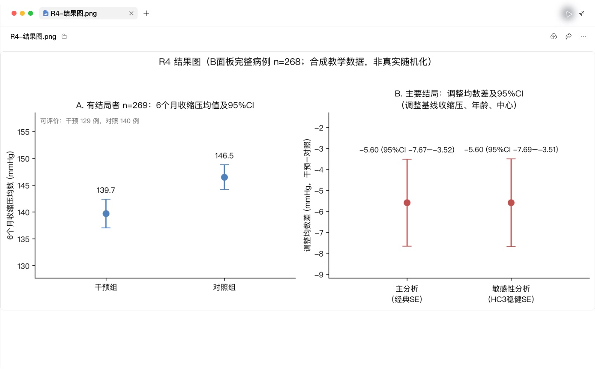
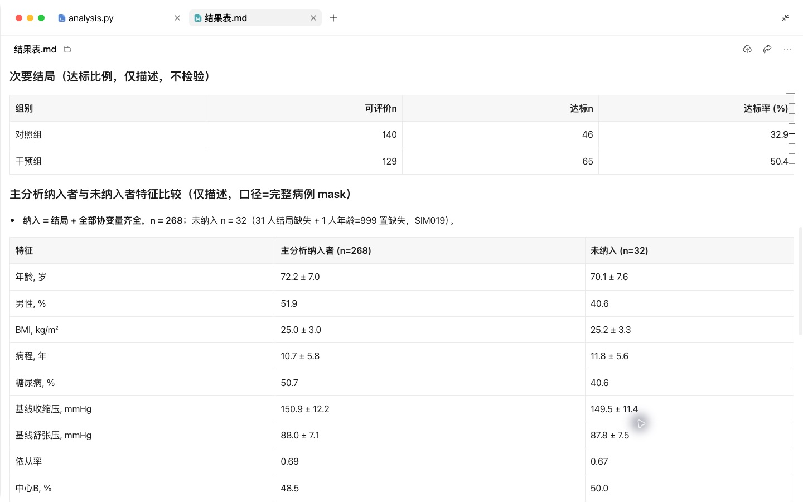
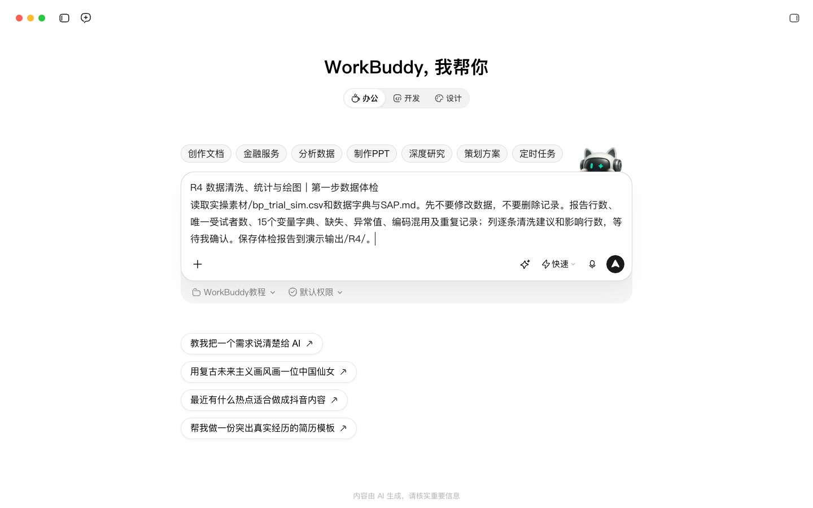
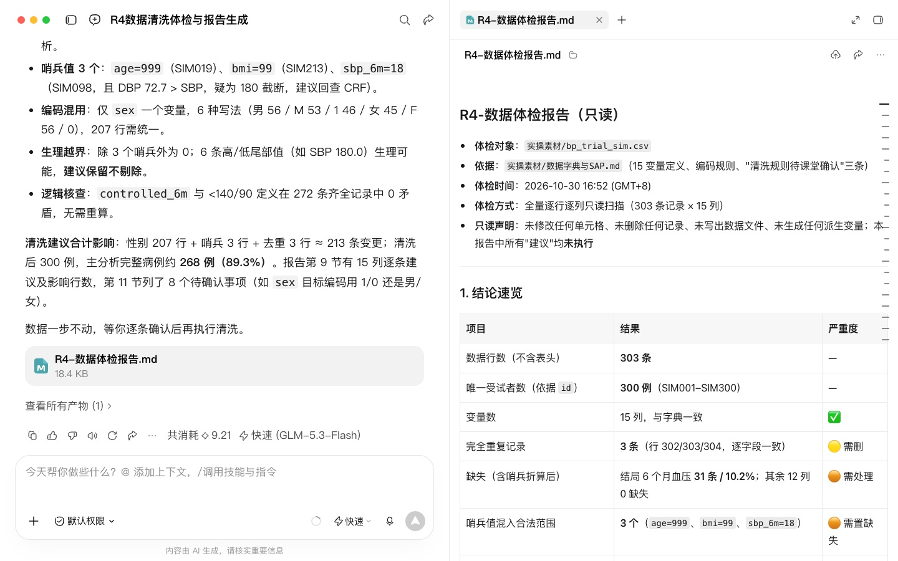
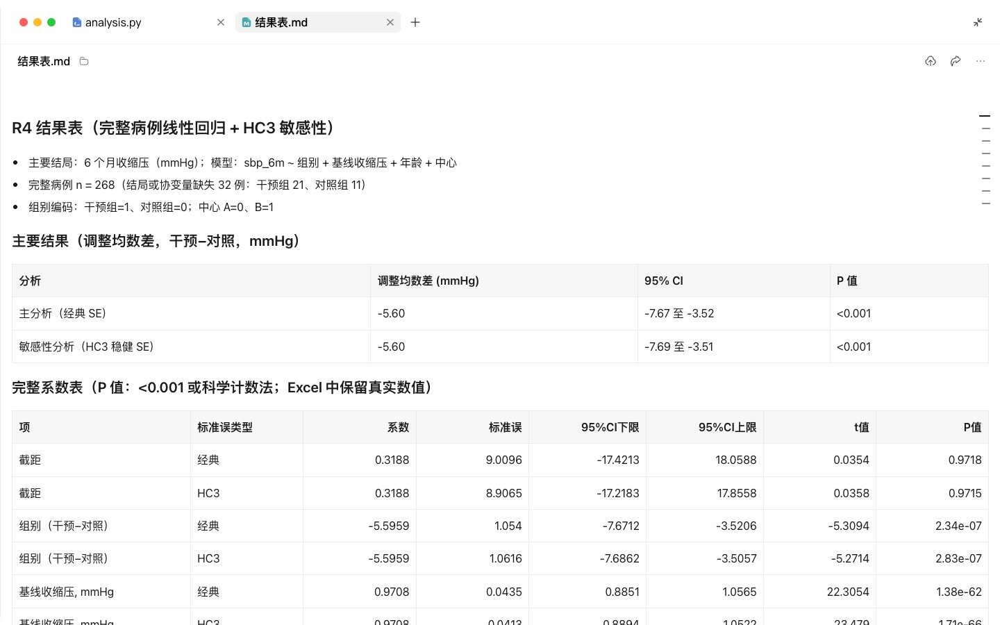
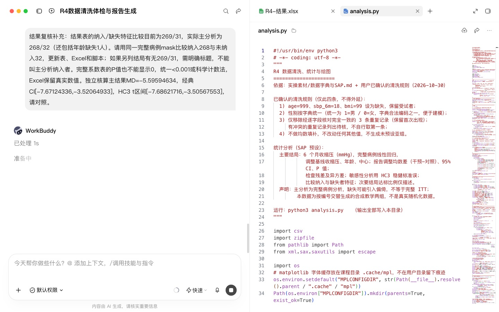

# R4 数据清洗、统计与绘图

## 快速实操：照着提示词做一遍

本课重点：先体检后清洗，保留原始数据并重跑验证。先在“新建任务”中选定课程工作空间。每个阶段完成后打开产物预览，再继续下一段提示词。

课前文件：

- [bp_trial_sim.csv](../实操素材/bp_trial_sim.csv)
- [数据字典与SAP.md](../实操素材/数据字典与SAP.md)

### 实操 1

```text
当前工作空间：WorkBuddy教程。
读取实操素材/bp_trial_sim.csv和数据字典与SAP.md。先不要修改数据，不要删除记录。报告行数、唯一受试者数、15个变量字典、缺失、异常值、编码混用及重复记录；列逐条清洗建议和影响行数，等待我确认。保存体检报告到演示输出/R4/。
```

### 实操 2

```text
当前工作空间：WorkBuddy教程。
清洗规则确认：999岁、6个月收缩压18、BMI99设为缺失，保留该受试者；性别按字典统一；只移除逐字段完全一致的3条重复记录，冲突记录不得自行选择；不均数填补。按SAP做完整病例线性回归并明确不等于完整ITT；调整基线收缩压、年龄和中心，报告组别均数差、95%CI、P值及HC3敏感性分析。不生成未预设亚组。输出clean.csv、逐条日志、Table1（不做基线P值检验）、结果表、带单位和CI的图、analysis.py及结果Excel到演示输出/R4/。重跑脚本核对结果。
```

## 完整方法：理解每一步，迁移到自己的课题

这一课让 Agent 替你写代码、跑统计、出图，但每一个会改变数据的动作都先经过你确认。学完后，你会得到一套可以重跑、可以交给统计师和审稿人检查的分析结果。

| 项目 | 内容 |
| --- | --- |
| 难度 | 1-2 |
| 时长 | 45 分钟 |
| 前置 | 01 入门课（代码执行已开启）、R3（SAP） |
| 产出 | 清洗后数据 + 清洗日志 + 分析脚本 + Table 1 + 主要结果表 + 1–2 张图 |
| 用到的 Skill | xlsx；K-Dense statistical-analysis、scientific-visualization（可选） |
| 环境 | WorkBuddy 代码执行；数据较大或需要用 R 时用 WorkBuddy 在本地运行 |

## 1. 红线先说

- 只用模拟数据或已完全脱敏、且所在机构允许上传的数据。姓名、住院号、身份证号、电话、精确到日的出生日期都不能出现。
- Agent 不得在你不知情的情况下删除任何一行。
- 先按 SAP 做主分析，不要“换个检验试试”。

## 2. 课前准备

示范数据是一份模拟的试验数据 `bp_trial_sim.csv`（约 300 行、15 个变量），故意埋了四类问题：

| 问题 | 示例 |
| --- | --- |
| 缺失值 | 6 个月收缩压有约 10% 缺失 |
| 异常值 | 年龄 999，收缩压 18 |
| 编码不一致 | 性别同时出现“男 / M / 1” |
| 重复记录 | 同一受试者编号出现两次 |

你练习时可以让 Agent 先生成一份类似的模拟数据：

```text
请生成一份模拟的随机对照试验数据 CSV：300 例老年高血压患者，分干预组和对照组，变量包括编号、组别、年龄、性别、BMI、病程、糖尿病史、基线收缩压/舒张压、6 个月收缩压/舒张压、6 个月是否达标等。请故意埋入约 10% 缺失、几个明显异常值、性别编码不一致和 3 条重复记录，但不要告诉我埋在哪里。
```

## 3. 操作步骤

### 第 1 步：数据体检（只看不改）

```text
这是我的数据和 SAP。先不要修改数据。请输出：
1. 变量字典：变量名、推测含义、类型、取值范围或类别；
2. 每个变量的缺失率；
3. 可疑异常值（列出行号和值，并说明判断依据）；
4. 编码不一致；
5. 重复记录；
6. 你对变量含义不确定的地方，请列出来问我。
```

**检查点**：体检报告应该把四类问题都找出来。没找全就追问“请检查生理上不可能的值”。


### 第 2 步：确认清洗规则，再执行

```text
请根据体检结果列出清洗规则清单，每条写：问题、处理方式、影响行数、理由。等我逐条确认后再执行。
```

你逐条回复，例如：

| 问题 | Agent 建议 | 你的决定 |
| --- | --- | --- |
| 年龄 999 | 视为缺失 | 同意 |
| 收缩压 18 | 删除该行 | 不同意：只把该值设为缺失，保留该受试者 |
| 性别编码 | 统一为 男/女 | 同意 |
| 重复记录 | 保留第一条 | 修改：先对比两条是否完全一致，不一致列出来给我 |

```text
按我确认的规则执行清洗。输出：清洗后数据（另存新文件，原文件不动）；清洗日志（每条规则影响了哪些行）；清洗前后各组样本量对照。
```

**为什么这么慢**：清洗决定往往比统计方法更影响结论。审稿人问“为什么排除了这 12 例”时，清洗日志就是你的答案。


### 第 3 步：描述统计 Table 1

```text
请生成 Table 1：按组别展示基线特征。连续变量先检查分布，近似正态用均数±标准差，偏态用中位数（四分位数）；分类变量用例数（%）。标注每个变量的缺失例数。随机对照试验的基线表不做组间 P 值检验。
```

**知识点**：随机化的组间基线差异本身就是偶然的，CONSORT 不建议对基线做显著性检验。观察性研究是否报告基线检验要按研究目的和报告规范决定；基线 P 值不能代替混杂控制。

### 第 4 步：按 SAP 做主分析

```text
请严格按 SAP 的主分析执行：
1. 先检查模型前提假设并报告结果；
2. 报告效应量（本课为调整均数差）、95% 置信区间和 P 值；
3. 再做 SAP 中规定的敏感性分析；
4. 如果你认为 SAP 的方法不适合这份数据，先说明原因并停下来问我，不要自行更换。
```

可选：点名调用 K-Dense statistical-analysis 技能做一遍方法复核。

**检查点**：结果里必须有置信区间。只给 P 值的结果不合格。

### 第 5 步：期刊级绘图

```text
请画两张图：
图 1：两组基线与 6 个月收缩压的变化（均数及 95% CI）；
图 2：若 SAP 预先规定了亚组，可画对应森林图；本课程模拟 SAP 未预设亚组，因此改为缺失情况图。
要求：300 dpi，色盲友好配色，字体统一，坐标轴带单位，图例不覆盖数据，导出 PNG 和 SVG。
```

可选：点名调用 K-Dense scientific-visualization 技能，它内置了期刊配图的常见要求。


### 第 6 步：打包并验证可重复

```text
请把本次所有分析整理成一个完整的 Python 脚本（从读取原始数据开始，包含清洗、统计、出图），注释写清楚每一步对应清洗日志的哪条规则。再把结果表导出到一个 Excel（Table 1、主分析、敏感性分析、清洗日志各一个工作表）。
```

然后新开一个对话，只上传原始数据和脚本，让 Agent 运行。结果和刚才一致，才算完成。

## 4. 交付物清单

```markdown
analysis/
├── data_raw.csv          # 原始数据，不动
├── data_clean.csv        # 清洗后数据
├── analysis.py           # 一键重跑脚本
├── results.xlsx          # Table 1 / 主分析 / 敏感性分析 / 清洗日志
└── figures/
    ├── R4-结果图.png
    └── R4-结果图.svg
```

## 5. 自查清单

- [ ] 原始数据未被覆盖
- [ ] 每一条清洗规则都经我确认，并在日志中可追溯
- [ ] 清洗前后的样本量变化能对得上
- [ ] 主分析与 SAP 一致，结果含效应量和 95% CI
- [ ] 新会话重跑脚本结果一致

## 6. 常见问题

**Agent 自作主张删掉了异常行？** 对比清洗前后样本量就能发现。让它列出被删的行，按你确认的规则重做。

**结果不显著，可以让 Agent 换个方法吗？** 不可以。阴性结果按 SAP 如实报告，探索性分析可以做，但必须标明“探索性”。

**网页版跑不动大数据或想用 R？** 换成 WorkBuddy 在本机运行，流程和提示词完全一样，应另外核对模型请求、连接器与产物回传的数据流；本地运行不等于数据完全不外传。

## 7. 练习

1. 用多重插补处理缺失值作为敏感性分析，对比主分析结论是否稳健。
2. 让 Agent 写一段“统计方法”段落，对照脚本检查是否一致。

## 下一课

R5 会用本课的结果表和图写论文的结果和方法部分，并学习润色和回复审稿。

## 本次实操复盘

原始表有 303 行、300 个唯一受试者和 3 条完全重复记录。清洗后，主模型完整病例为 268 人，结局可得者为 269 人，两者分母不同。重新运行脚本得到调整均数差 −5.60 mmHg，经典 95% CI −7.67 至 −3.52；HC3 区间为 −7.69 至 −3.51。HC3 仅检查方差设定的稳健性，不能替代缺失数据敏感性分析。数据按编号交替分组，属于合成教学数据。


## 配套结果文件

- [R4-数据体检报告.md](../演示输出/R4/R4-数据体检报告.md)
- [R4-结果.xlsx](../演示输出/R4/R4-结果.xlsx)
- [R4-结果图.png](../演示输出/R4/R4-结果图.png)
- [R4-结果图.svg](../演示输出/R4/R4-结果图.svg)
- [Table1.csv](../演示输出/R4/Table1.csv)
- [analysis.py](../演示输出/R4/analysis.py)
- [clean.csv](../演示输出/R4/clean.csv)
- [主分析简报.md](../演示输出/R4/主分析简报.md)
- [主分析结果.csv](../演示输出/R4/主分析结果.csv)
- [清洗日志.csv](../演示输出/R4/清洗日志.csv)
- [结果表.md](../演示输出/R4/结果表.md)


## 操作画面



均数置信区间与完整病例结果。



完整病例及未纳入比较。



数据体检任务。



数据体检报告。



最终模型与置信区间。



核对分析人数。


确认清洗规则。

录屏为无旁白的实际操作节选，保留输入、选择与查看结果的片段，较长生成等待已剪去。完整提示词见上文；操作阶段字幕和时间点可辅助定位。

[观看R4实操录屏](../录屏/R4-WorkBuddy实操.mp4) · [操作阶段字幕](../录屏/R4-WorkBuddy实操.vtt)
