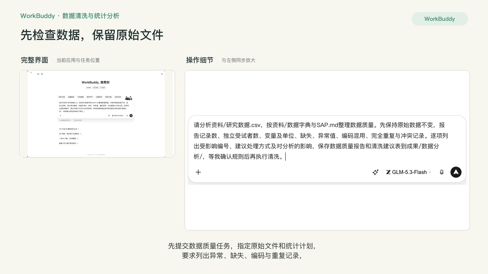
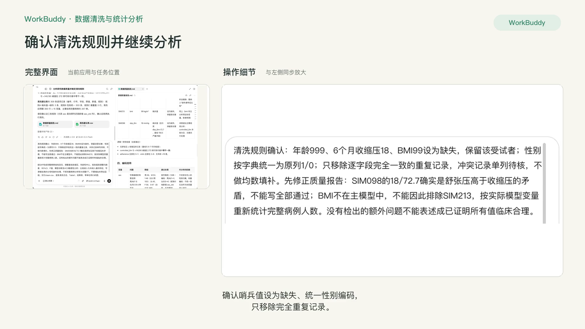
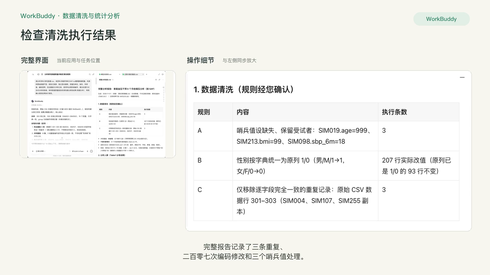
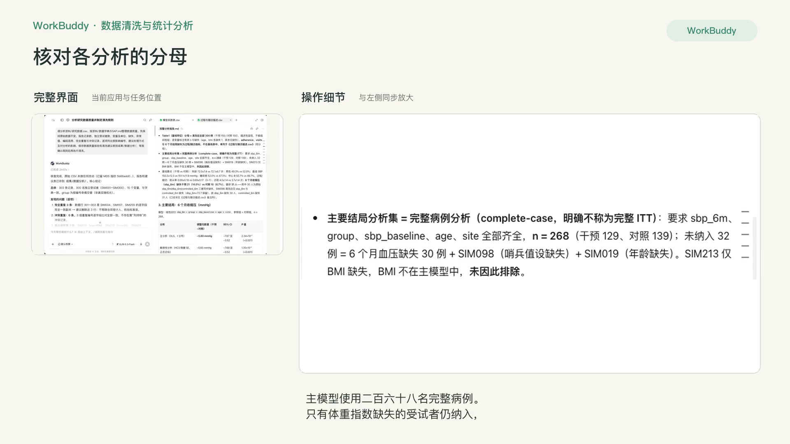
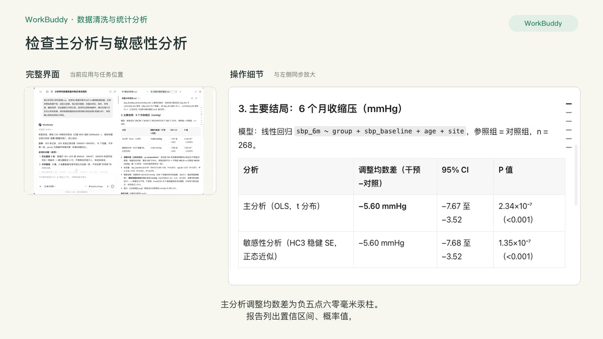
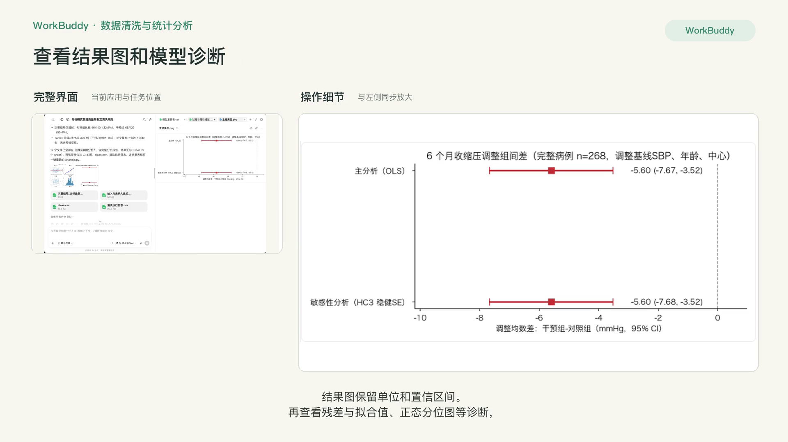
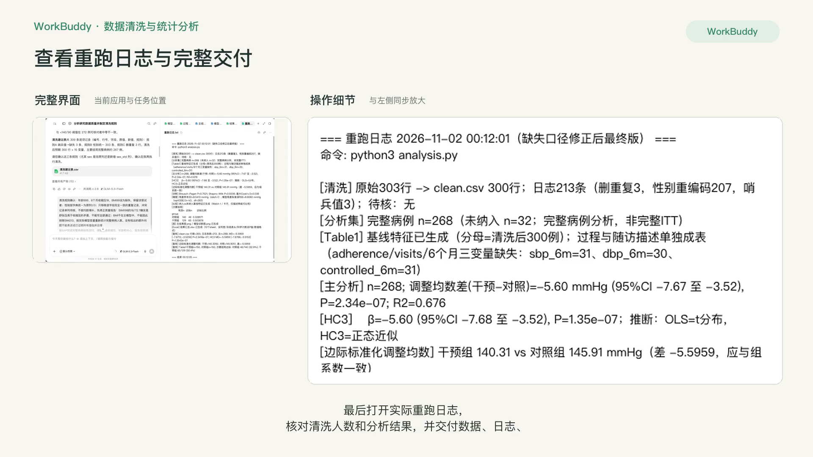

# R4 数据清洗、统计与绘图

## 快速实操：照着提示词做一遍

在“家庭血压项目”中先检查原始数据，确认清洗规则后完成分析，再复核数字与交付文件。

课前文件：

- [研究数据.csv](../资料/研究数据.csv)
- [数据字典与SAP.md](../资料/数据字典与SAP.md)

### 实操 1

```text
请分析资料/研究数据.csv，按资料/数据字典与SAP.md整理数据质量。先保持原始数据不变，报告记录数、独立受试者数、变量及单位、缺失、异常值、编码混用、完全重复与冲突记录。逐项列出受影响编号、建议处理方式及对分析的影响，保存数据质量报告和清洗建议表到成果/数据分析/，等我确认规则后再执行清洗。
```

### 实操 2

```text
清洗规则确认：年龄999、6个月收缩压18、BMI99设为缺失，保留该受试者；性别按字典统一为原列1/0；只移除逐字段完全一致的重复记录，冲突记录单列待核，不做均数填补。先修正质量报告：SIM098的18/72.7确实是舒张压高于收缩压的矛盾，不能写全部通过；BMI不在主模型中，不能因此排除SIM213，按实际模型变量重新统计完整病例人数。没有检出的额外问题不能表述成已证明所有值临床合理。

按SAP完成完整病例线性回归，调整基线收缩压、年龄和中心，报告组别调整均数差、95%CI、P值、模型诊断及HC3敏感性分析；比较纳入与未纳入者的特征，写清每张表的分母和缺失处理，不把完整病例分析称为完整ITT。不要增加未预设亚组。交付clean.csv、逐条清洗日志、Table1、结果表、带单位和CI的图、analysis.py、结果Excel及完整分析报告到成果/数据分析/。重跑脚本，并逐项核对报告、表格与图中的数字。
```

### 实操 3

```text
交付前请修正并重跑：
1. Excel的HC3敏感性表、模型系数CSV把小P值四舍五入成0了。保留底层数值精度，Excel用科学计数法显示，CSV保留足够有效位；不要把P写成0。注明OLS使用t分布、HC3当前使用正态近似。
2. adj_mean目前把所有人中心设成多数A，并非代码注释声称的边际标准化。改为分别将全部268名完整病例的group设为干预、对照，保留各自年龄、基线血压和中心，预测后分别取平均，同步报告与Excel。组间差应不变。
3. 数据质量报告第三节仍有“除此之外所有数值均在临床合理范围内，无其他离群值”，删除这一残留断言。
4. Table1中的adherence、visits和6个月结局缺失并非基线特征，单列为过程与随访描述；补齐单位和统计口径，清除空白占位列。报告明确残差样本SD与模型残差标准误的定义，避免混称。
5. Excel各表设置可读列宽、必要换行、合适数字格式和清楚表头，长表冻结表头；表头、变量名、单位和置信区间不能截断。保留数值类型，不把结果全转文本。请实际检查各工作表、图和报告，并将重跑日志保存到同目录。
```

### 实操 4

```text
最后请修正一个缺失口径：过程与随访描述中“sbp_6m/dbp_6m/controlled_6m同步缺失”不准确。原始30人三者缺失，另SIM098清洗后仅sbp_6m及controlled_6m缺失，dbp_6m仍有72.7。请写清31是6个月收缩压缺失人数，同步修正脚本、CSV、Excel及报告中的相关备注。次要结局的达标人数按整数显示。重跑并核对后保留当前文件名。
```

## 完整方法：理解每一步，迁移到自己的课题

这一课让 Agent 替你写代码、跑统计、出图，但每一个会改变数据的动作都先经过你确认。学完后，你会得到一套可以重跑、可以交给统计师和审稿人检查的分析结果。

| 项目 | 内容 |
| --- | --- |
| 难度 | 1-2 |
| 时长 | 45 分钟 |
| 前置 | 01 入门课（代码执行已开启）、R3（SAP） |
| 产出 | 清洗后数据 + 清洗日志 + 分析脚本 + Table 1 + 主要结果表 + 1–2 张图 |
| 用到的 Skill | xlsx；K-Dense statistical-analysis、scientific-visualization（可选） |
| 环境 | WorkBuddy 代码执行；数据较大或需要用 R 时用 WorkBuddy 在本地运行 |

## 1. 红线先说

- 只用模拟数据或已完全脱敏、且所在机构允许上传的数据。姓名、住院号、身份证号、电话、精确到日的出生日期都不能出现。
- Agent 不得在你不知情的情况下删除任何一行。
- 先按 SAP 做主分析，不要“换个检验试试”。

## 2. 课前准备

示范数据是一份模拟的试验数据 `研究数据.csv`（约 300 行、15 个变量），故意埋了四类问题：

| 问题 | 示例 |
| --- | --- |
| 缺失值 | 6 个月收缩压有约 10% 缺失 |
| 异常值 | 年龄 999，收缩压 18 |
| 编码不一致 | 性别同时出现“男 / M / 1” |
| 重复记录 | 同一受试者编号出现两次 |

你练习时可以让 Agent 先生成一份类似的模拟数据：

```text
请生成一份模拟的随机对照试验数据 CSV：300 例老年高血压患者，分干预组和对照组，变量包括编号、组别、年龄、性别、BMI、病程、糖尿病史、基线收缩压/舒张压、6 个月收缩压/舒张压、6 个月是否达标等。请故意埋入约 10% 缺失、几个明显异常值、性别编码不一致和 3 条重复记录，但不要告诉我埋在哪里。
```

## 3. 操作步骤

### 第 1 步：数据体检（只看不改）

```text
这是我的数据和 SAP。先不要修改数据。请输出：
1. 变量字典：变量名、推测含义、类型、取值范围或类别；
2. 每个变量的缺失率；
3. 可疑异常值（列出行号和值，并说明判断依据）；
4. 编码不一致；
5. 重复记录；
6. 你对变量含义不确定的地方，请列出来问我。
```

**检查点**：体检报告应该把四类问题都找出来。没找全就追问“请检查生理上不可能的值”。


### 第 2 步：确认清洗规则，再执行

```text
请根据体检结果列出清洗规则清单，每条写：问题、处理方式、影响行数、理由。等我逐条确认后再执行。
```

你逐条回复，例如：

| 问题 | Agent 建议 | 你的决定 |
| --- | --- | --- |
| 年龄 999 | 视为缺失 | 同意 |
| 收缩压 18 | 删除该行 | 不同意：只把该值设为缺失，保留该受试者 |
| 性别编码 | 统一为 男/女 | 同意 |
| 重复记录 | 保留第一条 | 修改：先对比两条是否完全一致，不一致列出来给我 |

```text
按我确认的规则执行清洗。输出：清洗后数据（另存新文件，原文件不动）；清洗日志（每条规则影响了哪些行）；清洗前后各组样本量对照。
```

**为什么这么慢**：清洗决定往往比统计方法更影响结论。审稿人问“为什么排除了这 12 例”时，清洗日志就是你的答案。


### 第 3 步：描述统计 Table 1

```text
请生成 Table 1：按组别展示基线特征。连续变量先检查分布，近似正态用均数±标准差，偏态用中位数（四分位数）；分类变量用例数（%）。标注每个变量的缺失例数。随机对照试验的基线表不做组间 P 值检验。
```

**知识点**：随机化的组间基线差异本身就是偶然的，CONSORT 不建议对基线做显著性检验。观察性研究是否报告基线检验要按研究目的和报告规范决定；基线 P 值不能代替混杂控制。

### 第 4 步：按 SAP 做主分析

```text
请严格按 SAP 的主分析执行：
1. 先检查模型前提假设并报告结果；
2. 报告效应量（本课为调整均数差）、95% 置信区间和 P 值；
3. 再做 SAP 中规定的敏感性分析；
4. 如果你认为 SAP 的方法不适合这份数据，先说明原因并停下来问我，不要自行更换。
```

可选：点名调用 K-Dense statistical-analysis 技能做一遍方法复核。

**检查点**：结果里必须有置信区间。只给 P 值的结果不合格。

### 第 5 步：期刊级绘图

```text
请画两张图：
图 1：两组基线与 6 个月收缩压的变化（均数及 95% CI）；
图 2：若 SAP 预先规定了亚组，可画对应森林图；本课程模拟 SAP 未预设亚组，因此改为缺失情况图。
要求：300 dpi，色盲友好配色，字体统一，坐标轴带单位，图例不覆盖数据，导出 PNG 和 SVG。
```

可选：点名调用 K-Dense scientific-visualization 技能，它内置了期刊配图的常见要求。


### 第 6 步：打包并验证可重复

```text
请把本次所有分析整理成一个完整的 Python 脚本（从读取原始数据开始，包含清洗、统计、出图），注释写清楚每一步对应清洗日志的哪条规则。再把结果表导出到一个 Excel（Table 1、主分析、敏感性分析、清洗日志各一个工作表）。
```

然后新开一个对话，只上传原始数据和脚本，让 Agent 运行。结果和刚才一致，才算完成。

## 4. 交付物清单

```markdown
analysis/
├── data_raw.csv          # 原始数据，不动
├── data_clean.csv        # 清洗后数据
├── analysis.py           # 一键重跑脚本
├── results.xlsx          # Table 1 / 主分析 / 敏感性分析 / 清洗日志
└── figures/
    ├── R4-结果图.png
    └── R4-结果图.svg
```

## 5. 自查清单

- [ ] 原始数据未被覆盖
- [ ] 每一条清洗规则都经我确认，并在日志中可追溯
- [ ] 清洗前后的样本量变化能对得上
- [ ] 主分析与 SAP 一致，结果含效应量和 95% CI
- [ ] 新会话重跑脚本结果一致

## 6. 常见问题

**Agent 自作主张删掉了异常行？** 对比清洗前后样本量就能发现。让它列出被删的行，按你确认的规则重做。

**结果不显著，可以让 Agent 换个方法吗？** 不可以。阴性结果按 SAP 如实报告，探索性分析可以做，但必须标明“探索性”。

**网页版跑不动大数据或想用 R？** 换成 WorkBuddy 在本机运行，流程和提示词完全一样，应另外核对模型请求、连接器与产物回传的数据流；本地运行不等于数据完全不外传。

## 7. 练习

1. 用多重插补处理缺失值作为敏感性分析，对比主分析结论是否稳健。
2. 让 Agent 写一段“统计方法”段落，对照脚本检查是否一致。

## 下一课

R5 会用本课的结果表和图写论文的结果和方法部分，并学习润色和回复审稿。

## 本次任务结果与核对

原始 CSV 保留 303 行，清洗后 300 名独立受试者。移除 3 条逐字段完全一致的重复记录，统一 207 处性别编码，将 3 个哨兵值设为缺失并保留受试者，逐条记录于清洗执行日志。

主模型完整病例 n=268（干预 129、对照 139），调整基线收缩压、年龄和中心。干预减对照的调整均数差为 −5.60 mmHg（95% CI −7.67 至 −3.52，P=2.34×10⁻⁷）。HC3 稳健标准误分析采用正态近似，95% CI 为 −7.68 至 −3.52。它检验标准误估计方式的影响，不能称为缺失数据敏感性分析。

基线特征分母为清洗后 300 人；次要结局仅描述有记录者：对照 46/140（32.9%）、干预 65/129（50.4%）。收缩压、舒张压和达标状态的缺失人数分别为 31、30、31，不能笼统称为三者同步缺失。

独立副本重跑后，7 份结果 CSV 与交付文件一致，原始数据哈希保持不变。数据为合成数据，结果不代表临床疗效。完整病例分析及组间缺失不平衡的局限保留在报告中。

交付文件：

- [Table1.csv](../成果/数据分析/Table1.csv)
- [analysis.py](../成果/数据分析/analysis.py)
- [clean.csv](../成果/数据分析/clean.csv)
- [主结果图.png](../成果/数据分析/主结果图.png)
- [完整分析报告.md](../成果/数据分析/完整分析报告.md)
- [数据质量报告.md](../成果/数据分析/数据质量报告.md)
- [模型系数表.csv](../成果/数据分析/模型系数表.csv)
- [模型诊断图.png](../成果/数据分析/模型诊断图.png)
- [次要结局_达标比例.csv](../成果/数据分析/次要结局_达标比例.csv)
- [清洗建议表.csv](../成果/数据分析/清洗建议表.csv)
- [清洗执行日志.csv](../成果/数据分析/清洗执行日志.csv)
- [纳入与未纳入比较.csv](../成果/数据分析/纳入与未纳入比较.csv)
- [结果汇总.xlsx](../成果/数据分析/结果汇总.xlsx)
- [过程与随访描述.csv](../成果/数据分析/过程与随访描述.csv)
- [重跑日志.txt](../成果/数据分析/重跑日志.txt)

## 操作画面















[观看 R4 实操录屏](../录屏/R4-WorkBuddy实操.mp4) · [字幕](../录屏/R4-WorkBuddy实操.vtt)
