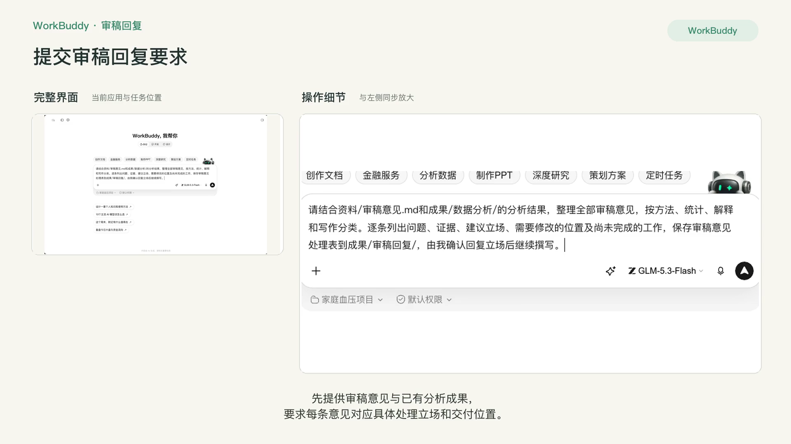
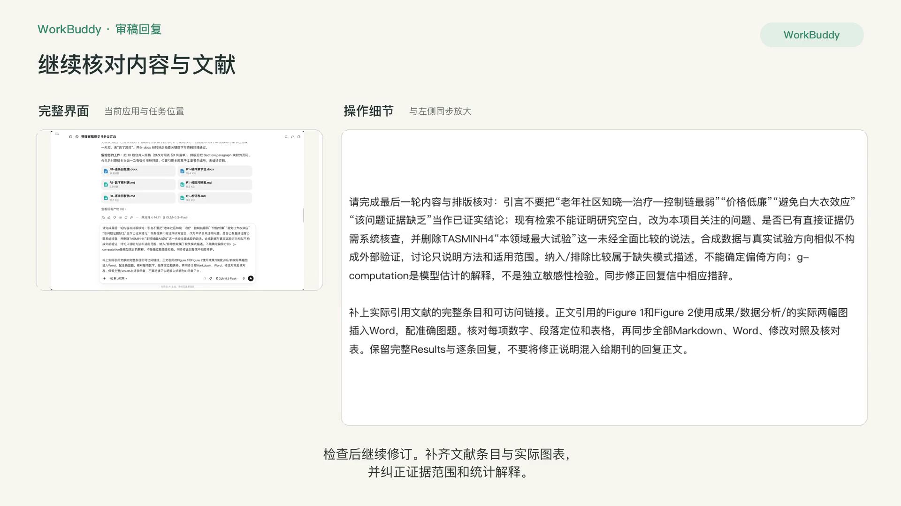
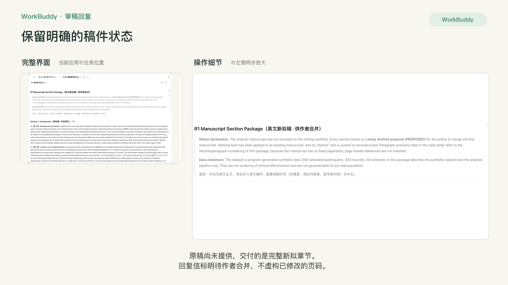
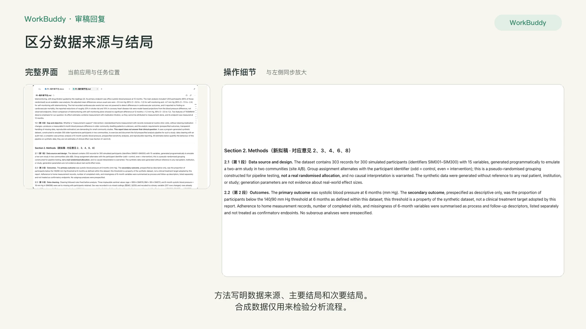
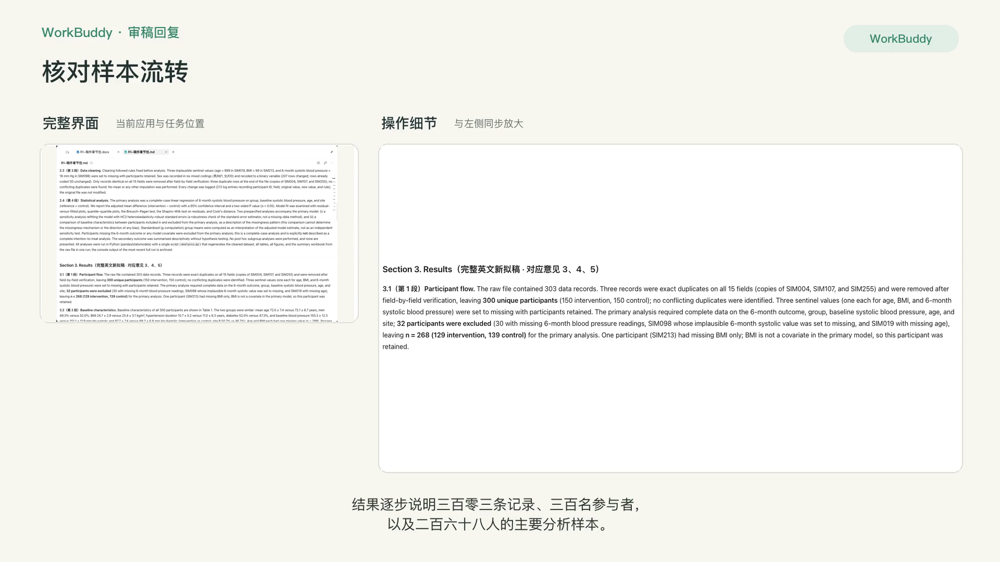
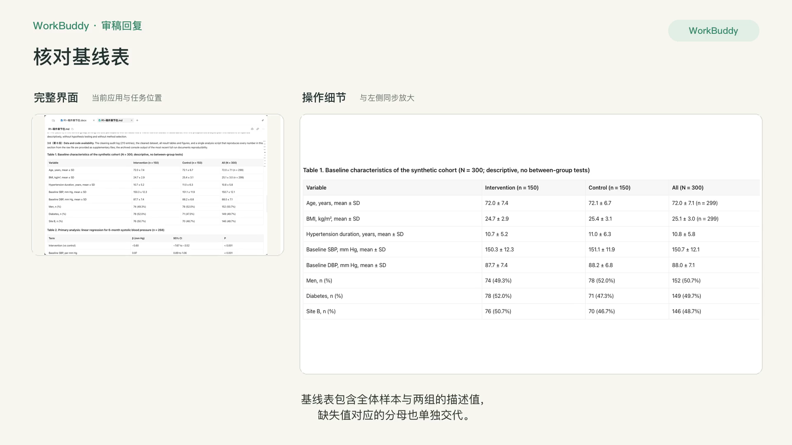
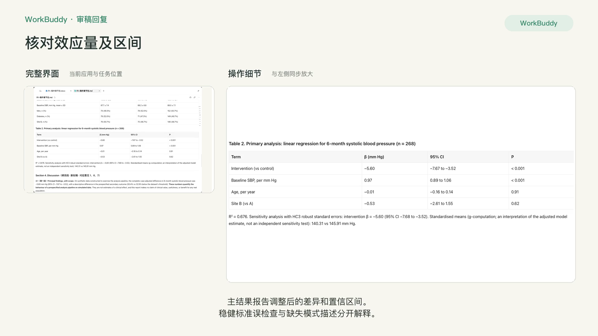
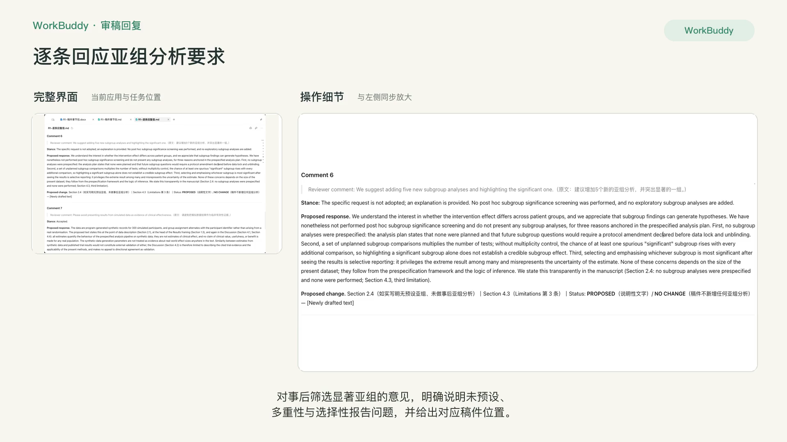
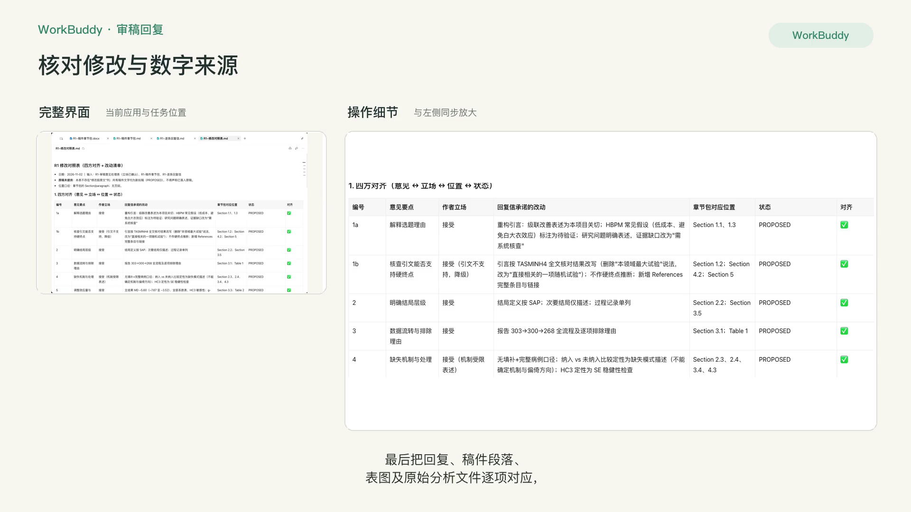

# R5 写作润色与审稿回复

## 快速实操：照着提示词做一遍

根据统计结果与审稿意见，完成英文稿件章节、逐条回复信和修改对照表。

课前文件：[审稿意见](../资料/审稿意见.md)；使用R4任务生成的完整统计结果。

### 实操 1

```text
请结合资料/审稿意见.md和成果/数据分析/的分析结果，整理全部审稿意见，按方法、统计、解释和写作分类。逐条列出问题、证据、建议立场、需要修改的位置及尚未完成的工作，保存审稿意见处理表到成果/审稿回复/，由我确认回复立场后继续撰写。
```

### 实操 2

```text
我的回复立场：接受第1–5、7、8条；第6条说明不进行事后亚组显著性筛选，也不新增探索性亚组。先核对处理表：立场栏统一为“作者立场”；TASMINH4已在成果/证据核对/获得全文核对结果，请使用当前精读笔记和证据表，不要继续写仅有摘要。未做功效计算，不能只凭n=268断言不足以做任何亚组分析，解释未预设、多重比较和选择性报告即可。

请结合成果/研究方案/、成果/证据核对/和成果/数据分析/，撰写完整英文Results，并补齐回应意见所需的引言、方法和讨论修改段，合并为可编辑稿件章节包。没有提供原稿的章节标为新拟稿，不能编造修改前原文或声称已经修改未提供的稿件。逐条回复信区分已完成的分析及新拟稿、待作者合并的工作；每个数字对应实际文件、表或单元格，位置使用本次章节包的章节和段落。交付Results、回复信、术语表、修改对照、数字核对表和Word文档到成果/审稿回复/。保持合成数据的适用说明，不写成临床有效性证据；核实全部文件的数字、段落引用和当前状态。
```

### 实操 3

```text
请完成最后一轮内容与排版核对：引言不要把“老年社区知晓—治疗—控制链最弱”“价格低廉”“避免白大衣效应”“该问题证据缺乏”当作已证实结论；现有检索不能证明研究空白，改为本项目关注的问题、是否已有直接证据仍需系统核查，并删除TASMINH4“本领域最大试验”这一未经全面比较的说法。合成数据与真实试验方向相似不构成外部验证，讨论只说明方法和适用范围。纳入/排除比较属于缺失模式描述，不能确定偏倚方向；g-computation是模型估计的解释，不是独立敏感性检验。同步修正回复信中相应措辞。

补上实际引用文献的完整条目和可访问链接。正文引用的Figure 1和Figure 2使用成果/数据分析/的实际两幅图插入Word，配准确图题。核对每项数字、段落定位和表格，再同步全部Markdown、Word、修改对照及核对表。保留完整Results与逐条回复，不要将修正说明混入给期刊的回复正文。
```

## 完整方法：理解每一步，迁移到自己的课题

这一课包含三个独立模块：写初稿、润色翻译、回复审稿。现场任选一个做完，其余两个课后练习。三个模块共用一个原则：Agent 只能改“怎么说”，不能改“说了什么”。

| 项目 | 内容 |
| --- | --- |
| 难度 | 1 |
| 时长 | 每个模块 20–30 分钟 |
| 前置 | R2（引用核对方法）、R4（结果表和图） |
| 产出 | 初稿段落 / 带修订痕迹的润色稿 / 逐条回复信 |
| 用到的 Skill | docx；K-Dense scientific-writing（可选）；Humanizer-zh（中文稿） |

## 1. 开始前：建一份术语表

三个模块都会用到。术语表是防止“同一个概念全文三种说法”的最简单办法。

```text
请从我上传的方案和结果表中提取本研究的专业术语，生成一张术语表：中文 | 英文 | 缩写 | 首次出现时的全称写法 | 备注。同一概念有多种说法的，列出来让我选一个。
```

把确认后的术语表放进 当前工作空间的资料文件夹。

## 2. 模块 A：写初稿

**顺序**：结果 → 方法 → 讨论 → 引言 → 摘要。先写最确定的部分，最后写最需要提炼的部分。

### 第 1 步：结果

```text
请根据我上传的结果 Excel 和图片，写论文的 Results 部分（英文）。
规则：
1. 所有数字只能来自我的结果表，照抄不换算；
2. 先写入组和基线，再写主要结局，再写次要结局和敏感性分析；
3. 只描述结果，不解释原因；
4. 每个数字后用方括号标出它在结果表中的位置（如 [Table2-B4]），我核对后会删除。
```

**检查点**：顺着方括号位置逐个核对数字。这个“位置标记”的技巧和 R2 的页码、P3 的事实卡编号是同一个思路。

### 第 2 步：方法

```text
请根据方案、SAP 和分析脚本写 Methods 部分。统计方法段落必须与脚本实际运行的内容一致，脚本里没做的不要写。按 CONSORT（或 STROBE）条目检查是否有遗漏，遗漏项列在文末。
```

### 第 3 步：讨论

```text
请写 Discussion，结构：主要发现一段 → 与既往研究比较（一致与不一致各自的可能原因）→ 临床意义 → 局限性 → 结论。
引用只能使用我项目中文献清单里的文献，并标出编号。清单里找不到合适文献的地方写【需补充文献】，不要自己补。
结论的强度要与研究设计匹配：观察性研究不用“导致”“证明”。
```

写完用 R2 的引用核对表自查一遍。


## 3. 模块 B：翻译与润色

### 第 1 步：确定目标风格

上传目标期刊的作者须知，以及该刊一篇与你研究类型相同的已发表文章作为风格参考。

### 第 2 步：翻译或润色

```text
请把我上传的 Word 稿件润色为符合目标期刊风格的学术英语。
规则：
1. 严格使用术语表；
2. 不改变任何数字、引用编号和结论强度（may / might / suggest 不得改成 demonstrate / prove）；
3. 在 Word 里用修订模式输出，每处实质性修改加批注说明理由（语法 / 用词 / 逻辑 / 期刊风格）；
4. 最后单独列出你认为可能改变了原意的句子，让我确认。
```

**检查点**：在 Word 里打开修订稿，用“审阅 → 下一处修订”逐条接受或拒绝。重点看第 4 条列出的句子。

### 第 3 步：中文稿去 AI 味（中文论文或中文摘要适用）

```text
请使用 humanizer-zh 技能处理下面的中文段落。保留所有专业术语、数字和引用编号，只清理套话、重复和翻译腔。
```


## 4. 模块 C：回复审稿意见

### 第 1 步：拆分和分类

```text
这是审稿意见和我的稿件。请：
1. 把每位审稿人的意见拆成独立条目并编号（R1-1、R1-2……），一条意见里包含多个要求的要拆开；
2. 对每条标注：类型（方法 / 统计 / 解释 / 写作 / 补充实验）、工作量（小 / 中 / 大）、你建议的立场（同意修改 / 部分同意 / 礼貌解释不修改）及理由；
3. 暂时不要写回复。
```

### 第 2 步：你定立场

这一步必须由你（和合作者）决定。特别注意“补充实验”类：不要让 Agent 替你承诺做不到的事。把每条的最终立场和要点告诉 Agent。

### 第 3 步：生成回复信和修改稿

```text
按我确定的立场和要点，写 point-by-point 回复信（英文）。格式：
- 先引用审稿意见原文（斜体）；
- Response：先致谢，再回应；部分同意和不修改的，给出依据（文献或数据）；
- Changes：写明修改后的原句和位置（页码、行号）。
同时在稿件 Word 里用修订模式做出对应修改。
语气要求：礼貌、具体、不卑不亢；不要堆叠道歉。
```

### 第 4 步：交叉检查

```text
请检查：回复信里每条“已修改”是否在稿件修订中都能找到；稿件里的修订是否都在回复信中提到；页码行号是否对应。输出不一致清单。
```


## 5. 回复信片段示例

```markdown
**Reviewer 1, Comment 2**
*The authors should clarify how missing blood pressure readings were handled.*

**Response:** We thank the reviewer for this helpful comment. As pre-specified
in the statistical analysis plan, the primary analysis was a complete-case
analysis; 32 participants (10.7%) were not included in the primary model. We now
report the number excluded from each analysis, compare baseline characteristics
of included and excluded participants, and acknowledge in the Limitations that
the results rely on a missing-at-random assumption.

**Changes:** Methods, Statistical analysis, paragraph 3; Table S3; Discussion,
Limitations, paragraph 2.
```

（数字来自本项目 R4 结果；回复只写真实做过的分析。SAP 没有预设多重插补，就不能写“按 SAP 做了多重插补”。）

## 6. 自查清单

- [ ] 稿件中没有结果表以外的数字
- [ ] 没有文献清单以外的引用
- [ ] 润色前后结论强度一致
- [ ] 回复信每条都能在稿件中找到对应修改
- [ ] 没有承诺做不到的补充工作

## 7. 常见问题

**用 AI 润色需要向期刊声明吗？** 很多期刊要求声明 AI 辅助写作的情况，请查看目标期刊的作者须知并按要求在致谢或方法中说明。

**审稿人明显误解了？** 立场选“礼貌解释”，同时反思原文是否写得不够清楚，通常顺手改得更清楚最稳妥。

## 8. 练习

1. 把你最近一次收到的审稿意见按模块 C 重做一遍，对比当时的回复信。
2. 把模块 B 的润色规则记下来，它们就是 R8 要沉淀成 Skill 的原料。

## 下一课

R6 把研究往前推一步：用前面所有产出物写基金申请书。

## 本次任务结果与核对

已完成英文稿件章节包、逐条回复信、审稿意见处理表、修改对照表、数字核对表和术语表，并提供可编辑Word文件。稿件含方法、结果、讨论与结论、两张数据表及两张结果图；回复信逐条处理八项审稿意见，复合问题分别定位。

数字与R4实际分析结果逐项核对，完整病例为268例，干预组129例、对照组139例；调整后组间差为−5.60 mmHg，95%置信区间−7.67至−3.52。稿件与回复信共19页已逐页检查。

原始投稿稿件未提供，因此新增段落与改写内容保留PROPOSED标记，修改定位使用章节和表格，不虚构原稿页码、行号或已经完成的新增分析。当前文件是待作者合并及确认的修订稿。

交付文件：

- [R1-修改对照表.md](../成果/审稿回复/R1-修改对照表.md)
- [R1-审稿意见处理表.md](../成果/审稿回复/R1-审稿意见处理表.md)
- [R1-数字核对表.md](../成果/审稿回复/R1-数字核对表.md)
- [R1-术语表.md](../成果/审稿回复/R1-术语表.md)
- [R1-稿件章节包.docx](../成果/审稿回复/R1-稿件章节包.docx)
- [R1-稿件章节包.md](../成果/审稿回复/R1-稿件章节包.md)
- [R1-逐条回复信.docx](../成果/审稿回复/R1-逐条回复信.docx)
- [R1-逐条回复信.md](../成果/审稿回复/R1-逐条回复信.md)

## 操作画面



















[观看 R5 实操录屏](../录屏/R5-WorkBuddy实操.mp4) · [字幕](../录屏/R5-WorkBuddy实操.vtt)
