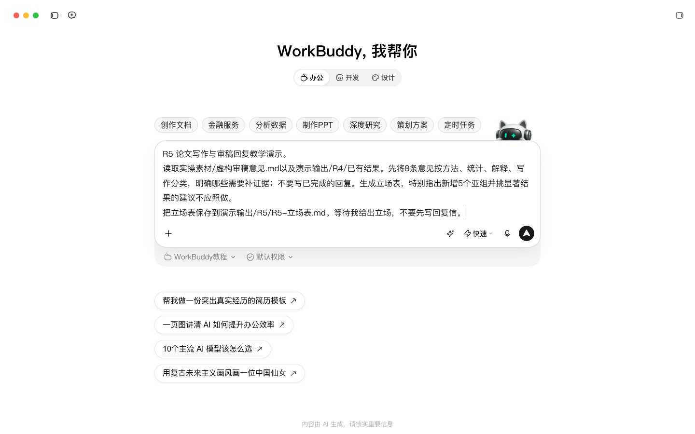
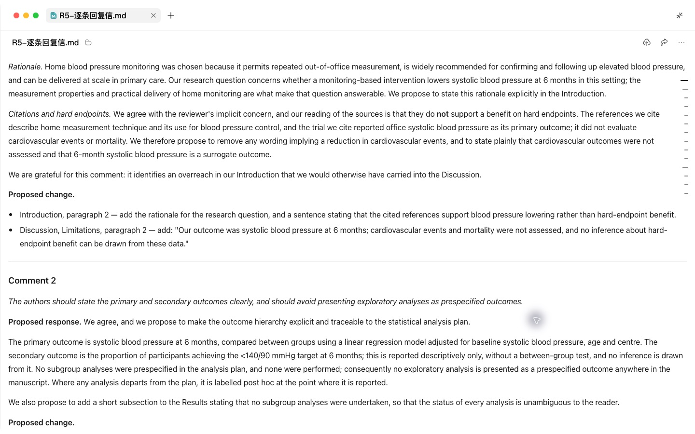
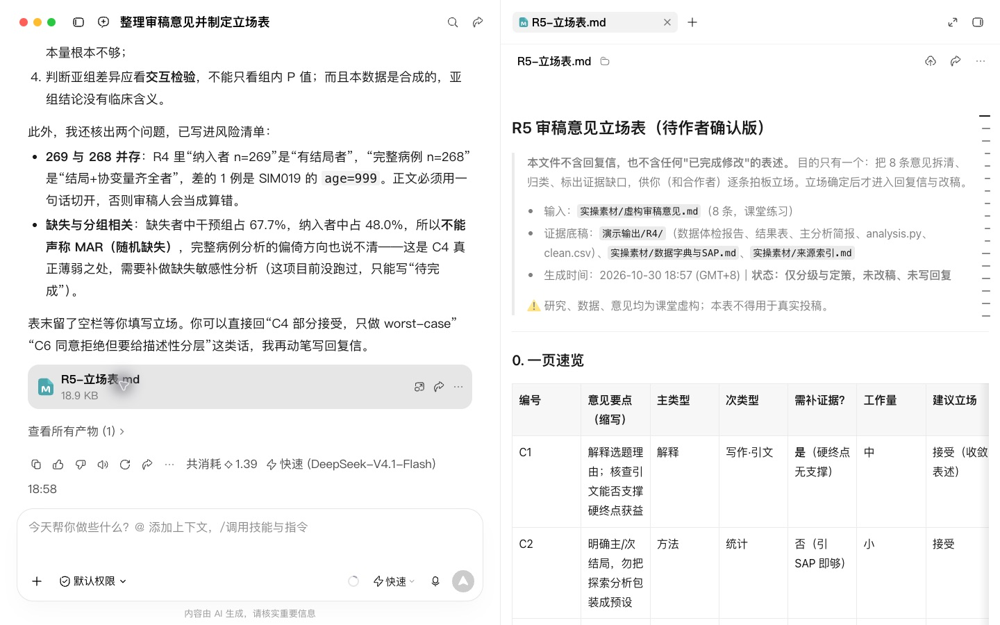
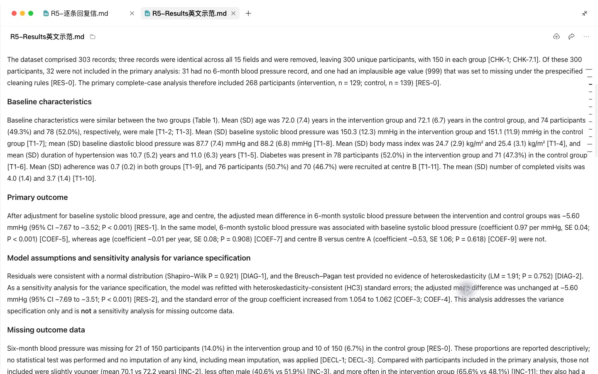
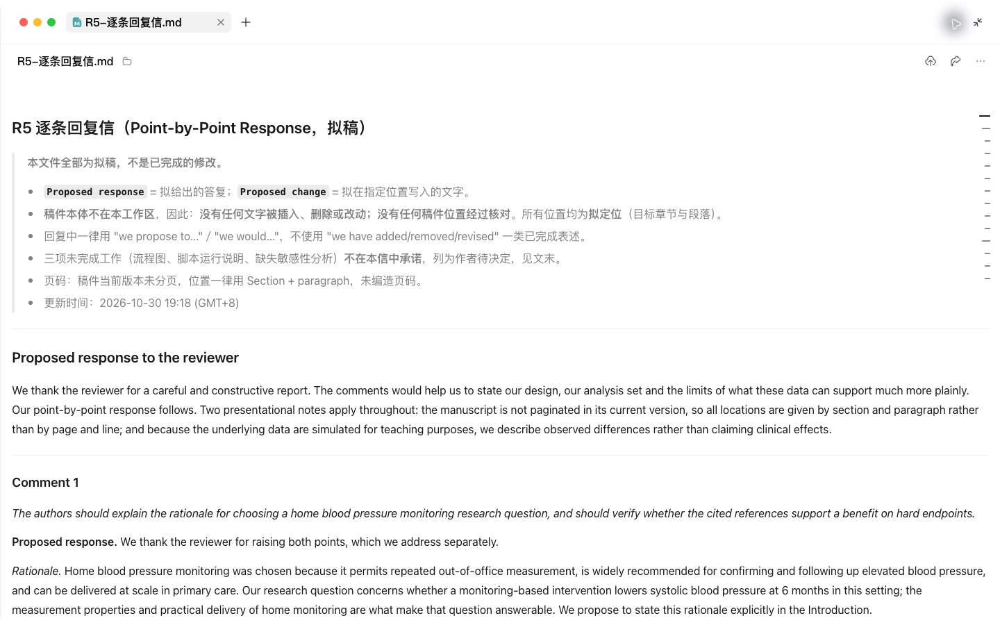

# R5 论文写作、翻译润色与回复审稿意见

## 快速实操：照着提示词做一遍

本课重点：先决定回复立场，再核对修改与数字。先在“新建任务”中选定课程工作空间。每个阶段完成后打开产物预览，再继续下一段提示词。

课前文件：

- [虚构审稿意见.md](../实操素材/虚构审稿意见.md)

### 实操 1

```text
当前工作空间：WorkBuddy教程。
读取实操素材/虚构审稿意见.md以及演示输出/R4/已有结果。先将8条意见按方法、统计、解释、写作分类，明确哪些需要补证据；不要写已完成的回复。生成立场表，特别指出新增5个亚组并挑显著结果的建议不应照做。
```

### 实操 2

```text
当前工作空间：WorkBuddy教程。
课堂立场已确定：接受1–5、7、8；对第6条礼貌解释不做事后显著性筛选。仅用实际结果写英文Results示范和回复信，每个数字标出来源表/单元格，未完成工作写待完成。没有固定分页就用章节段落。保存术语表、结果段落、逐条回复和交叉核对表到演示输出/R5/；如可生成DOCX，保留真实修订标记，做不到不要冒称。
```

## 完整方法：理解每一步，迁移到自己的课题

这一课包含三个独立模块：写初稿、润色翻译、回复审稿。现场任选一个做完，其余两个课后练习。三个模块共用一个原则：Agent 只能改“怎么说”，不能改“说了什么”。

| 项目 | 内容 |
| --- | --- |
| 难度 | 1 |
| 时长 | 每个模块 20–30 分钟 |
| 前置 | R2（引用核对方法）、R4（结果表和图） |
| 产出 | 初稿段落 / 带修订痕迹的润色稿 / 逐条回复信 |
| 用到的 Skill | docx；K-Dense scientific-writing（可选）；Humanizer-zh（中文稿） |

## 1. 开始前：建一份术语表

三个模块都会用到。术语表是防止“同一个概念全文三种说法”的最简单办法。

```text
请从我上传的方案和结果表中提取本研究的专业术语，生成一张术语表：中文 | 英文 | 缩写 | 首次出现时的全称写法 | 备注。同一概念有多种说法的，列出来让我选一个。
```

把确认后的术语表放进 当前工作空间的实操素材文件夹。

## 2. 模块 A：写初稿

**顺序**：结果 → 方法 → 讨论 → 引言 → 摘要。先写最确定的部分，最后写最需要提炼的部分。

### 第 1 步：结果

```text
请根据我上传的结果 Excel 和图片，写论文的 Results 部分（英文）。
规则：
1. 所有数字只能来自我的结果表，照抄不换算；
2. 先写入组和基线，再写主要结局，再写次要结局和敏感性分析；
3. 只描述结果，不解释原因；
4. 每个数字后用方括号标出它在结果表中的位置（如 [Table2-B4]），我核对后会删除。
```

**检查点**：顺着方括号位置逐个核对数字。这个“位置标记”的技巧和 R2 的页码、P3 的事实卡编号是同一个思路。

### 第 2 步：方法

```text
请根据方案、SAP 和分析脚本写 Methods 部分。统计方法段落必须与脚本实际运行的内容一致，脚本里没做的不要写。按 CONSORT（或 STROBE）条目检查是否有遗漏，遗漏项列在文末。
```

### 第 3 步：讨论

```text
请写 Discussion，结构：主要发现一段 → 与既往研究比较（一致与不一致各自的可能原因）→ 临床意义 → 局限性 → 结论。
引用只能使用我项目中文献清单里的文献，并标出编号。清单里找不到合适文献的地方写【需补充文献】，不要自己补。
结论的强度要与研究设计匹配：观察性研究不用“导致”“证明”。
```

写完用 R2 的引用核对表自查一遍。


## 3. 模块 B：翻译与润色

### 第 1 步：确定目标风格

上传目标期刊的作者须知，以及该刊一篇与你研究类型相同的已发表文章作为风格参考。

### 第 2 步：翻译或润色

```text
请把我上传的 Word 稿件润色为符合目标期刊风格的学术英语。
规则：
1. 严格使用术语表；
2. 不改变任何数字、引用编号和结论强度（may / might / suggest 不得改成 demonstrate / prove）；
3. 在 Word 里用修订模式输出，每处实质性修改加批注说明理由（语法 / 用词 / 逻辑 / 期刊风格）；
4. 最后单独列出你认为可能改变了原意的句子，让我确认。
```

**检查点**：在 Word 里打开修订稿，用“审阅 → 下一处修订”逐条接受或拒绝。重点看第 4 条列出的句子。

### 第 3 步：中文稿去 AI 味（中文论文或中文摘要适用）

```text
请使用 humanizer-zh 技能处理下面的中文段落。保留所有专业术语、数字和引用编号，只清理套话、重复和翻译腔。
```


## 4. 模块 C：回复审稿意见

### 第 1 步：拆分和分类

```text
这是审稿意见和我的稿件。请：
1. 把每位审稿人的意见拆成独立条目并编号（R1-1、R1-2……），一条意见里包含多个要求的要拆开；
2. 对每条标注：类型（方法 / 统计 / 解释 / 写作 / 补充实验）、工作量（小 / 中 / 大）、你建议的立场（同意修改 / 部分同意 / 礼貌解释不修改）及理由；
3. 暂时不要写回复。
```

### 第 2 步：你定立场

这一步必须由你（和合作者）决定。特别注意“补充实验”类：不要让 Agent 替你承诺做不到的事。把每条的最终立场和要点告诉 Agent。

### 第 3 步：生成回复信和修改稿

```text
按我确定的立场和要点，写 point-by-point 回复信（英文）。格式：
- 先引用审稿意见原文（斜体）；
- Response：先致谢，再回应；部分同意和不修改的，给出依据（文献或数据）；
- Changes：写明修改后的原句和位置（页码、行号）。
同时在稿件 Word 里用修订模式做出对应修改。
语气要求：礼貌、具体、不卑不亢；不要堆叠道歉。
```

### 第 4 步：交叉检查

```text
请检查：回复信里每条“已修改”是否在稿件修订中都能找到；稿件里的修订是否都在回复信中提到；页码行号是否对应。输出不一致清单。
```


## 5. 回复信片段示例

```markdown
**Reviewer 1, Comment 2**
*The authors should clarify how missing blood pressure readings were handled.*

**Response:** We thank the reviewer for this helpful comment. Missing 6-month
readings (n = 31, 10.3%) were handled by multiple imputation under a
missing-at-random assumption, as pre-specified in the statistical analysis plan.
A complete-case analysis yielded consistent results.

**Changes:** Methods, page 7, lines 152–158; Supplementary Table S3.
```

（数字为教学虚构。）

## 6. 自查清单

- [ ] 稿件中没有结果表以外的数字
- [ ] 没有文献清单以外的引用
- [ ] 润色前后结论强度一致
- [ ] 回复信每条都能在稿件中找到对应修改
- [ ] 没有承诺做不到的补充工作

## 7. 常见问题

**用 AI 润色需要向期刊声明吗？** 很多期刊要求声明 AI 辅助写作的情况，请查看目标期刊的作者须知并按要求在致谢或方法中说明。

**审稿人明显误解了？** 立场选“礼貌解释”，同时反思原文是否写得不够清楚，通常顺手改得更清楚最稳妥。

## 8. 练习

1. 把你最近一次收到的审稿意见按模块 C 重做一遍，对比当时的回复信。
2. 把模块 B 的润色规则记下来，它们就是 R8 要沉淀成 Skill 的原料。

## 下一课

R6 把研究往前推一步：用前面所有产出物写基金申请书。

## 本次实操复盘

实操先拆分 8 条审稿意见，再确定立场。最终回复全部使用 Proposed response / Proposed change：没有投稿稿件本体，不能声称已改正文，也不能编造页码。缺失数据敏感性分析未完成，不用 HC3 结果代替；英文 Results 与 R4 的样本量、效应量及区间逐项对应。


## 配套结果文件

- [R5-Results英文示范.md](../演示输出/R5/R5-Results英文示范.md)
- [R5-交叉核对表.md](../演示输出/R5/R5-交叉核对表.md)
- [R5-修改前后对照.md](../演示输出/R5/R5-修改前后对照.md)
- [R5-术语表.md](../演示输出/R5/R5-术语表.md)
- [R5-立场表.md](../演示输出/R5/R5-立场表.md)
- [R5-逐条回复信.md](../演示输出/R5/R5-逐条回复信.md)


## 操作画面



先确定回复立场。



建议修改与证据边界。



待作者确认立场表。



英文结果与统计输出核数。



逐条回复拟稿与完成状态。

录屏为无旁白的实际操作节选，保留输入、选择与查看结果的片段，较长生成等待已剪去。完整提示词见上文；操作阶段字幕和时间点可辅助定位。

[观看R5实操录屏](../录屏/R5-WorkBuddy实操.mp4) · [操作阶段字幕](../录屏/R5-WorkBuddy实操.vtt)
