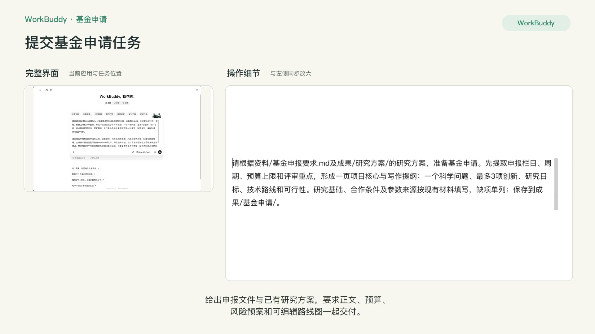
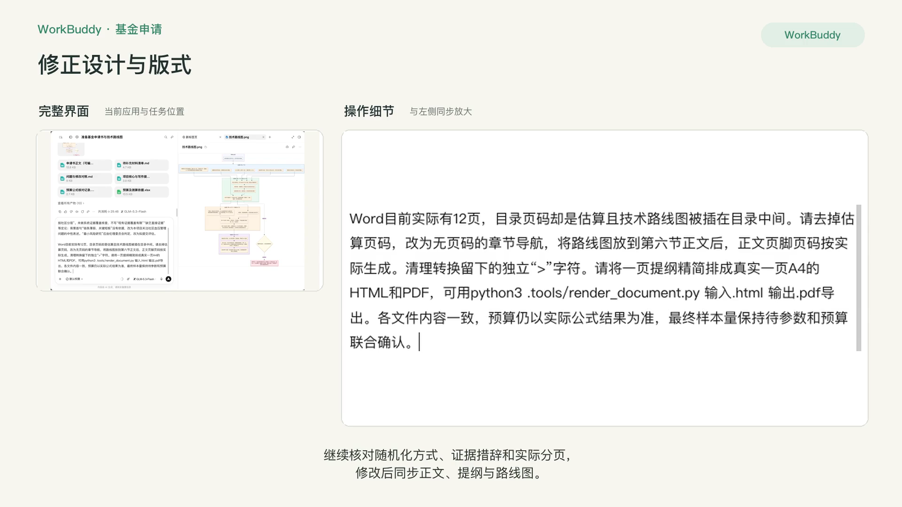
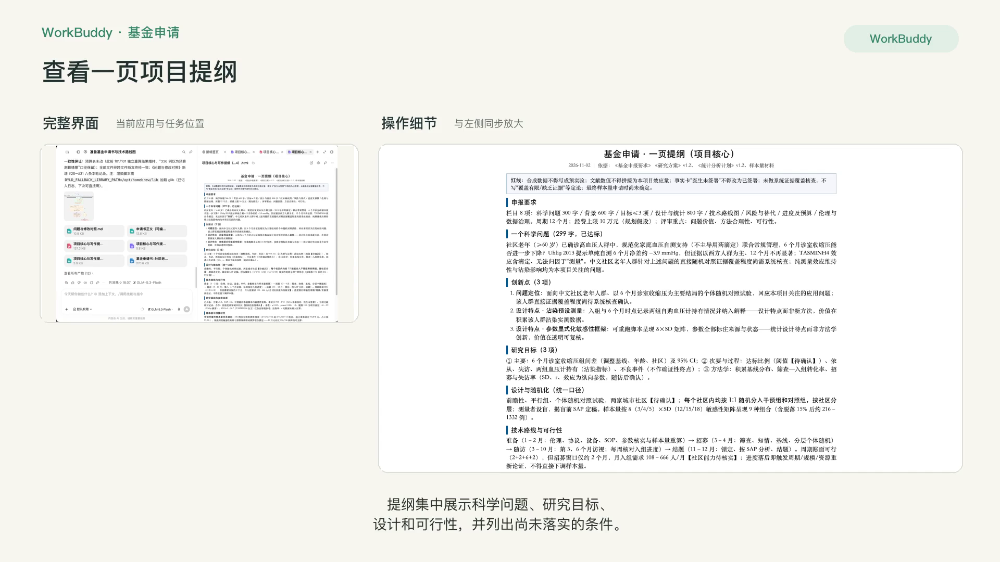
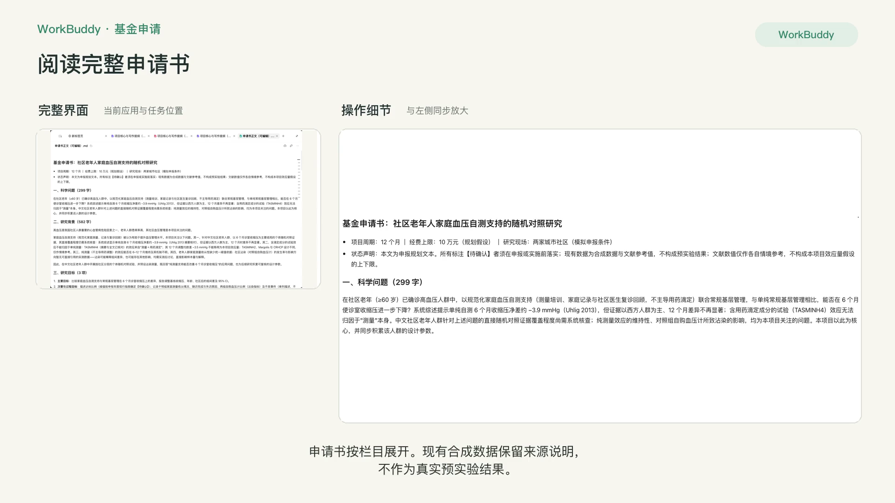
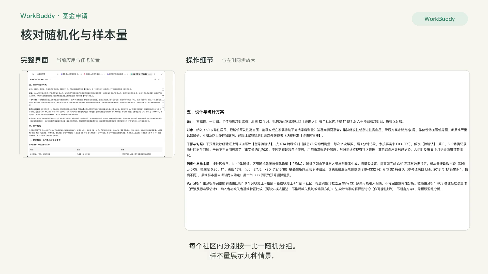
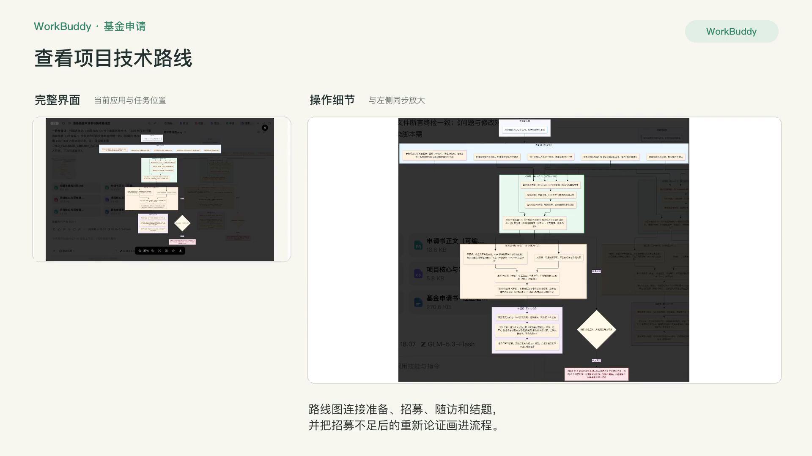
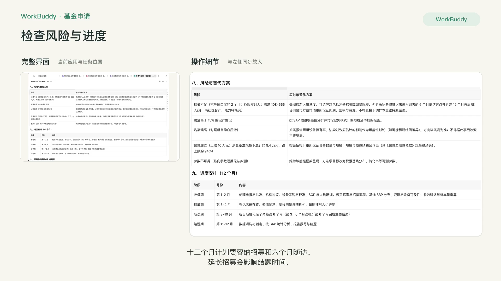
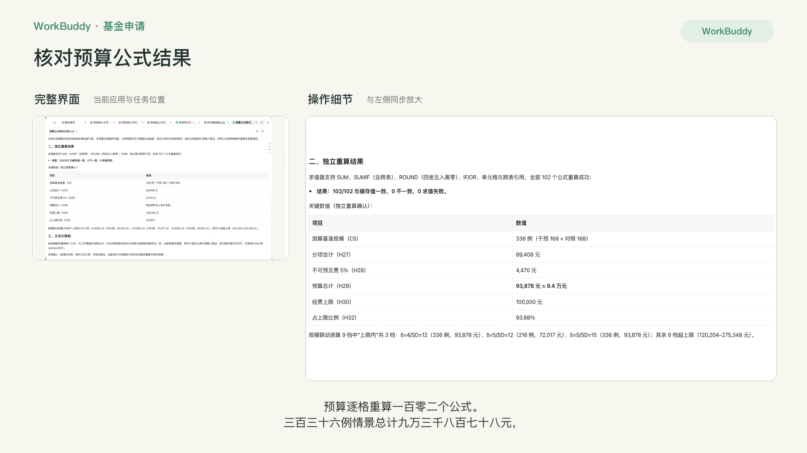
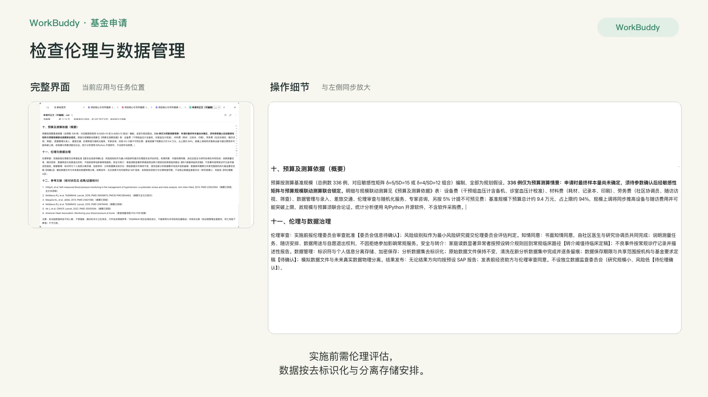
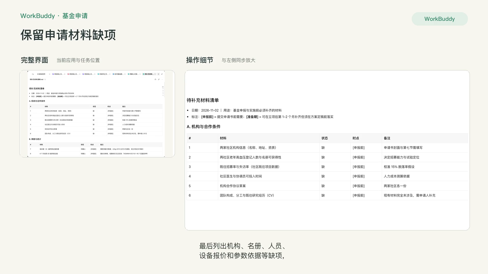

# R6 基金申请书

## 快速实操：照着提示词做一遍

根据基金申报要求和已有研究方案，完成申请书、技术路线图、预算表与待补材料清单。

课前文件：[基金申报要求](../资料/基金申报要求.md)；使用R3研究方案及已核对的文献与统计结果。

### 实操 1

```text
请根据资料/基金申报要求.md及成果/研究方案/的研究方案，准备基金申请。先提取申报栏目、周期、预算上限和评审重点，形成一页项目核心与写作提纲：一个科学问题、最多3项创新、研究目标、技术路线和可行性。研究基础、合作条件及参数来源按现有材料填写，缺项单列；保存到成果/基金申请/。

请完成各申报栏目的申请书正文、进度安排、预算及测算依据、风险与替代方案、伦理与数据管理，生成技术路线图及可编辑Mermaid源文件。再从临床价值、统计方法和创新性三个视角核查并修改，特别检查12个月总周期能否容纳招募与随访、样本量参数是否有依据、现有资料是否支持研究基础。交付申请书Word、路线图、预算表、问题与修改对照、待补充材料清单到成果/基金申请/。
```

### 实操 2

```text
请按申报要求完成最后核对并同步所有文件：现有几篇文献不能证明“中文社区老年人群证据缺乏”或“沾染几乎无报道”，删除这些断言，改为本项目关注的问题、直接证据覆盖程度仍需系统核查。参数敏感性矩阵和常规沾染记录是设计特点，不能直接宣称方法学创新。保留研究价值，但不要把未知写成已证实的空白。沾染影响方向也应作为可能性讨论，不能断言必然稀释。

纳入与排除者比较属于缺失模式描述，不能证明缺失机制或偏倚方向；HC3仅检验标准误估计。明确申请时最终样本量尚未确定，336例只是预算测算情景。核对各栏字数是否符合300/600/800字要求，摘要提纲压缩到真正一页，更新Word目录实际页码，图表完整可读。补齐问题与修改对照、待补材料清单、可编辑申请书和预算公式核对记录；采用独立计算核对公式结果。
```

### 实操 3

```text
还需修正以下实质问题并同步Word、正文、提纲和路线图：设计段“每臂各在一社区”与社区内个体随机冲突，统一为“每个社区内均按1:1随机分入干预组和对照组，按社区分层”。未做系统证据覆盖核查，不写“现有证据覆盖有限”“缺乏直接证据”等定论；背景首句“链条薄弱、关键短板”没有依据，改为本项目关注社区血压管理问题的中性表述。“最小风险研究”应由伦理委员会判定，改为拟提交评估。

Word目前实际有12页，目录页码却是估算且技术路线图被插在目录中间。请去掉估算页码，改为无页码的章节导航，将路线图放到第六节正文后，正文页脚页码按实际生成。清理转换留下的独立“>”字符。请将一页提纲精简排成真实一页A4的HTML和PDF。各文件内容一致，预算仍以实际公式结果为准，最终样本量保持待参数和预算联合确认。
```

## 完整方法：理解每一步，迁移到自己的课题

基金申请书是前面所有课的综合应用：R1 的选题、R2 的证据、R3 的方案都会被重新组织成一个“说服评审”的故事。这一课重点教你两件事：搭一条每句都有文献的论证链，以及用“模拟评审”提前发现硬伤。

| 项目 | 内容 |
| --- | --- |
| 难度 | 1-2 |
| 时长 | 60 分钟（可分两次完成） |
| 前置 | R1、R2、R3 |
| 产出 | 申请书初稿（Word）+ 技术路线图 + 一轮模拟评审记录 |
| 用到的 Skill | K-Dense research-grants（可选）、scientific-problem-selection、docx |

## 1. 先理解评审怎么读申请书

评审专家通常在有限时间内看很多份申请书，他们会先看标题、摘要、科学问题和创新点。所以申请书的核心是一条一眼能看懂的论证链：

```text
临床问题重要（数据）→ 现有研究做到了哪一步（文献）→ 还差什么（文献）→ 我的假说是什么 → 我有什么前期基础证明我能做成 → 做成了有什么用
```

每一个箭头都是评审可能提问的地方。

## 2. 课前准备

在 当前工作空间的资料文件夹里放入：

- 当年的申请指南和申请书撰写提纲（以最新版本为准）
- R1 选题简报与文献清单、R2 精读笔记、R3 方案
- 你的前期工作：代表性论文、预实验数据摘要、已有平台或队列
- （可选）一份已获资助的同类申请书，仅作结构参考

## 3. 操作步骤

### 第 1 步：从指南生成写作清单

```text
请阅读申请指南，输出：
1. 必写章节及各自的字数或篇幅要求；
2. 指南中的硬性规定（如限项、年龄、格式、禁止事项）；
3. 今年与往年相比的变化（如指南中有说明）。
只根据我上传的指南回答，指南里没有的不要补充。
```

### 第 2 步：先写“一页纸”，再写全文

```text
请先写一页纸的申请书核心：标题（3 个备选）、拟解决的关键科学问题（1 个）、科学假说（1 句）、研究内容（3 个，各一句）、创新点（不超过 3 条）、预期成果。
可以使用 scientific-problem-selection 技能检查科学问题是否聚焦、假说是否可检验。
```

**检查点**：这一页你自己先改满意。后面所有章节都围绕它展开，它不稳，后面写得再多也是散的。


### 第 3 步：立项依据（每句带文献）

```text
请按“问题重要性 → 研究现状 → 存在的不足 → 本项目的切入点与假说”的结构写立项依据。
规则：
1. 每一个事实性陈述后标文献编号，只用我的文献清单；
2. “存在的不足”只能表述为“在本次检索范围内，……的研究较少”“直接证据的覆盖程度待系统核查”这类有分寸的说法，不写“国内外尚无报道”“尚缺乏证据”这类定论；
3. 每个小节结尾用一句话引出下一小节，形成连贯的论证链；
4. 字数控制在指南要求以内。
```

写完后用 R2 的方法核对引用。立项依据是整份申请书里引用最密集的部分，也是最容易夸大的部分。

### 第 4 步：研究内容与技术路线

```text
基于我的方案，请：
1. 把研究内容写成 3 个相互关联的部分，说明它们之间的逻辑关系；
2. 用 Mermaid 代码画出技术路线图（从人群招募到结果产出，标出各研究内容和关键节点）；
3. 写出年度计划表。
```

Mermaid 代码可以粘贴到 mermaid.live 查看和导出图片，再交给美工或在 PPT 中美化。


### 第 5 步：可行性与研究基础

```text
请根据我的前期工作材料，写可行性分析和研究基础。每一条可行性理由都要对应到一项具体证据（论文、数据、平台、合作协议）。没有证据支撑的理由单独列出，提醒我补充。
```

### 第 6 步：模拟评审

```text
请分别扮演三位评审专家，独立评审这份申请书：
- 专家 A：本领域资深临床专家，关注临床价值和可行性；
- 专家 B：流行病学与统计方法学专家，关注设计和样本量；
- 专家 C：相邻方向的竞争者，关注创新性是否夸大。
每位专家按创新性、科学性、可行性、研究基础四项打分（1–5），写出最可能导致不资助的 3 个理由，并指出对应的原文位置。
最后汇总：三位都提到的问题是什么。
```

**如何用好模拟评审**：逐项核查证据与严重性；单个视角发现的真实方法学硬伤也应处理。模拟评审是参考，不是真实评审，不必全盘接受。


### 第 7 步：修改并保留修改依据

```text
针对我选定的问题逐一修改，用 Word 修订模式输出，并附一张“问题 → 修改位置 → 修改内容”对照表。将当前修改保存到同一个交付文件，保留修订和修改对照表。
```

## 4. 申请书各部分与前序课的对应

| 申请书部分 | 素材来源 |
| --- | --- |
| 立项依据 | R1 简报与文献清单、R2 精读笔记 |
| 研究内容、目标、关键科学问题 | R1 选题简报 + 本课一页纸 |
| 研究方案与技术路线 | R3 方案与 SAP |
| 可行性 | R1 可行性评估 + 前期工作 |
| 年度计划 | R3 + R7 进度表 |

## 5. 自查清单

- [ ] 一页纸里的科学问题只有一个，假说可以被检验
- [ ] 立项依据每个事实性陈述都有文献，并核对过
- [ ] 创新点不超过 3 条，每条说清“和已有研究的区别”
- [ ] 可行性每条都有具体证据
- [ ] 字数和格式符合指南

## 6. 常见问题

**可以让 Agent 参考别人的获资助申请书吗？** 可以参考结构和论证方式，但不能沿用其表述。提示词中明确“只学习结构，不得复用原文句子”。

**Agent 写的内容太“正确”但没有亮点？** 这通常是因为缺少你自己的临床观察。把“我在门诊里发现的现象”用大白话写几句给它，它会把这些编进立项依据。

## 7. 练习

1. 把你去年未获资助的申请书和评审意见上传，对比模拟评审和真实评审有多少重合。
2. 把立项依据压缩成 400 字，用于摘要。

## 下一课

R7 学习在项目获批后，用 Agent 管理进度和会议。

## 本次任务结果与核对

已交付12页申请书Word、可编辑正文、一页提纲及A4 PDF、技术路线图与Mermaid源文件、三张工作表的预算、问题修改对照及待补材料清单。申请书和提纲已逐页检查。

研究设计统一为每个社区内按1:1个体随机、按社区分层。最终样本量仍待参数及资源联合确认；336例只作为预算情景。预算102个公式独立重算与缓存全部一致，336例情景为93,878元，9 种参数组合中有 3 种在 10 万元上限内（336 例出现两次，实际是 8 种规模）。随附核对脚本，可安装openpyxl后在文件所在目录运行。

现有合成数据不作为真实预实验结果。机构合作、招募能力、伦理审批、设备报价和参数依据等缺项继续保留，未将未知条件或证据覆盖程度写成已经证实的事实。

交付文件：

- [基金申请书-社区老年高血压家庭血压自测支持RCT.docx](../成果/基金申请/基金申请书-社区老年高血压家庭血压自测支持RCT.docx)
- [待补充材料清单.md](../成果/基金申请/待补充材料清单.md)
- [技术路线图.mmd](../成果/基金申请/技术路线图.mmd)
- [技术路线图.png](../成果/基金申请/技术路线图.png)
- [技术路线图.svg](../成果/基金申请/技术路线图.svg)
- [核对预算公式.py](../成果/基金申请/核对预算公式.py)
- [申请书正文（可编辑）.md](../成果/基金申请/申请书正文（可编辑）.md)
- [问题与修改对照.md](../成果/基金申请/问题与修改对照.md)
- [项目核心与写作提纲（一页A4）.html](../成果/基金申请/项目核心与写作提纲（一页A4）.html)
- [项目核心与写作提纲（一页A4）.pdf](../成果/基金申请/项目核心与写作提纲（一页A4）.pdf)
- [项目核心与写作提纲（一页）.md](../成果/基金申请/项目核心与写作提纲（一页）.md)
- [预算公式核对记录.md](../成果/基金申请/预算公式核对记录.md)
- [预算及测算依据.xlsx](../成果/基金申请/预算及测算依据.xlsx)

## 操作画面





















[观看 R6 实操录屏](../录屏/R6-WorkBuddy实操.mp4) · [字幕](../录屏/R6-WorkBuddy实操.vtt)
