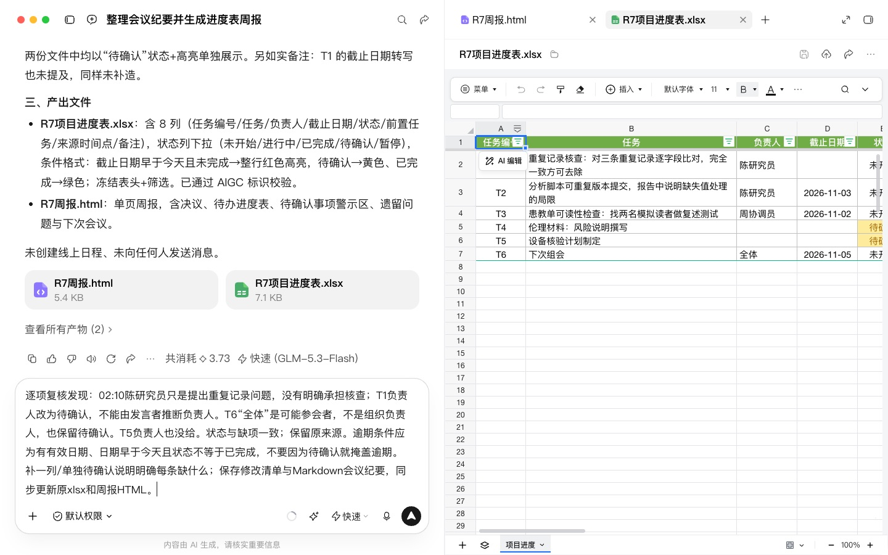
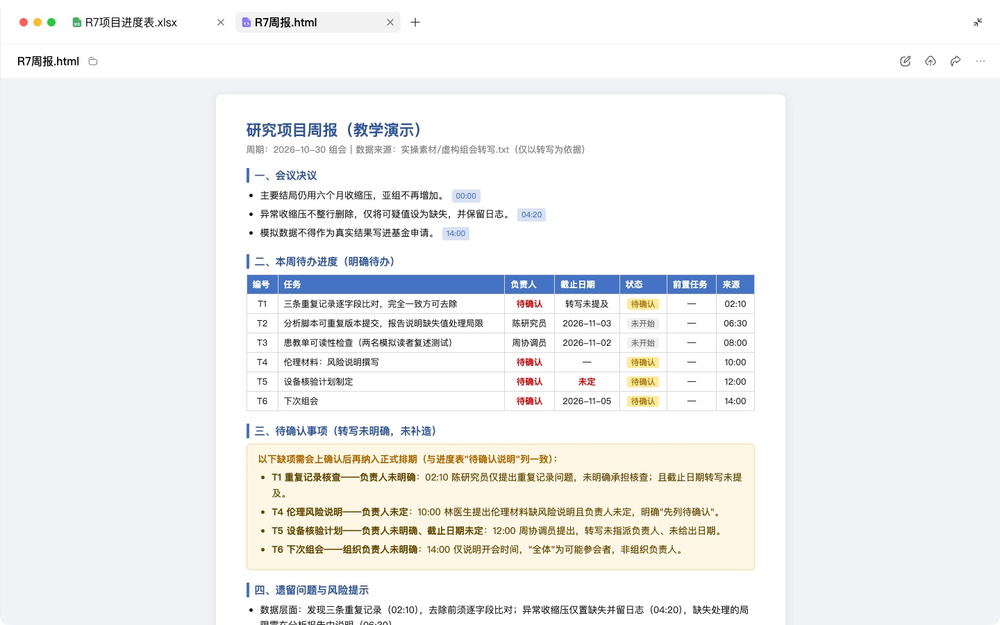
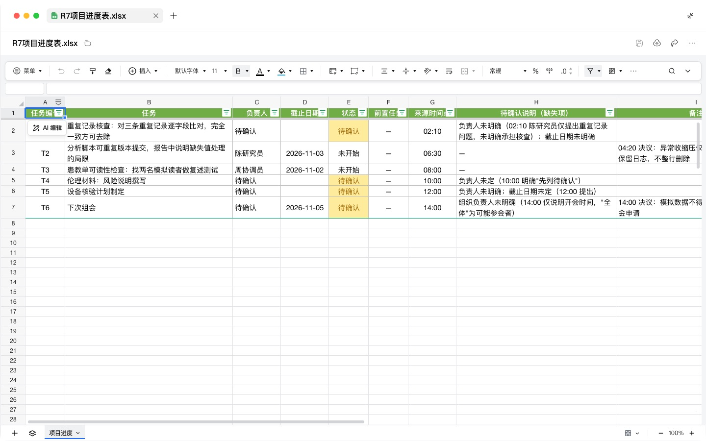

# R7 项目管理与会议纪要

## 快速实操：照着提示词做一遍

本课重点：缺负责人或日期的待办保持待确认。先在“新建任务”中选定课程工作空间。每个阶段完成后打开产物预览，再继续下一段提示词。

课前文件：

- [虚构组会转写.txt](../实操素材/虚构组会转写.txt)

### 实操 1

```text
当前工作空间：WorkBuddy教程。
请将实操素材/虚构组会转写.txt整理成会议纪要，区分讨论、已确定决议、待办和未解决问题。每项待办保留来源时间点，准确记录负责人、截止日期及依赖关系；转写未明确的信息列待确认，不把提问者自动当作负责人。保存会议纪要到演示输出/R7/。
```

### 实操 2

```text
当前工作空间：WorkBuddy教程。
请将确认的待办整理成项目进度Excel和一页周报，列任务编号、任务、负责人、截止日期、状态、前置任务和来源时间点。添加状态下拉及逾期未完成高亮，检查引用和日期计算。已有进度表则按任务编号更新并记录变更，避免重复新增；缺负责人或日期的任务单列待确认。保存全部文件到演示输出/R7/，本次交付范围为文件，不创建线上日程或发送消息。
```

## 完整方法：理解每一步，迁移到自己的课题

项目获批之后，真正消耗精力的是“谁在什么时候做什么”。这一课教你用 Agent 把方案拆成任务、生成可跟踪的进度表，并把组会录音转成纪要、把待办自动合并进进度表。

| 项目 | 内容 |
| --- | --- |
| 难度 | 1 |
| 时长 | 25 分钟 |
| 前置 | R3（研究方案） |
| 产出 | 进度表（Excel）+ 会议纪要 + 一页周报 |
| 用到的 Skill | xlsx；可选：日历、飞书、Notion 等连接器 |

## 1. 两个工具概念

**WBS（工作分解结构）**：把一个大目标逐层拆到“一个人一周内能完成”的任务。拆不到这个粒度的任务，就无法跟踪。

**关键路径**：一串前后依赖的任务，其中任何一个延迟都会拖延整个项目。临床研究里常见的关键路径是：伦理审批 → 试验注册 → 首例入组 → 入组完成 → 随访完成 → 锁库 → 分析 → 投稿。

## 2. 操作步骤

### 第 1 步：从方案拆任务

```text
请根据我的研究方案，生成项目的 WBS：
1. 一级按阶段（准备、入组、随访、数据管理、分析、成果产出）；
2. 二级拆到一个人一周内可完成的任务；
3. 标出里程碑和关键路径上的任务；
4. 标出你预估最可能延误的 3 个任务及原因。
课题组成员：我（负责人）、博士生小王、研究护士小李、合作社区医生张医生。
```

### 第 2 步：生成进度表 Excel

```text
请把 WBS 生成为 Excel 进度表，列：任务编号 | 阶段 | 任务 | 负责人 | 开始日期 | 截止日期 | 状态（下拉：未开始/进行中/已完成/受阻）| 前置任务 | 是否关键路径 | 风险 | 备注 | 来源。
要求：
- 截止日期早于今天且未完成的行自动标红（条件格式）；
- 关键路径任务加粗；
- 另加一个工作表做甘特图式的按周时间轴。
项目开始日期：（填写）。
```

**检查点**：打开 Excel，改一个任务的截止日期到过去，确认它会变红。检查前置任务日期是否合理（伦理未批不能入组）。


### 第 3 步：会议录音转纪要

先用你常用的工具（会议软件自带转写、飞书妙记、通义听悟等）得到转写文本，删去或替换掉患者信息后上传。

```text
这是课题组例会的转写文本。请整理为会议纪要：
1. 会议基本信息（日期、参会人）；
2. 决议：只写明确达成一致的事项；
3. 待办：事项 | 负责人 | 截止日期，没有明确负责人或日期的单独列在“待确认”中；
4. 遗留问题：讨论了但未解决的；
5. 下次会议议题建议。
去掉寒暄和重复。转写中疑似识别错误的人名、药名、术语，用【？】标出。
```

**检查点**：重点看【？】标记和“待确认”待办，这是转写纪要最容易出错的地方。

### 第 4 步：待办回写进度表

```text
请把纪要中的待办合并到进度表：已有任务则更新状态和备注，新任务则新增行；“来源”列写会议日期。输出更新后的 Excel 和一张变更清单。
```


### 第 5 步：生成周报

```text
请根据最新进度表，写一份给科室主任的一页周报：本周完成、下周计划、当前入组进度（实际 vs 计划）、风险与需要协调的事项。不超过 300 字。
```

## 3. 进阶：连上协作工具

如果你们课题组用飞书、Notion 或 Google 日历，可以在“专家·技能·连接器 → 连接器”里查找对应连接器。连上之后，可以直接说“把本周的待办加到课题组日历”。提交前核对收件人、内容和权限；不能假设每个工具都会自动询问。

## 4. 会议纪要模板

```markdown
# 课题组例会纪要（日期）
参会：
## 决议
1.
## 待办
| 事项 | 负责人 | 截止日期 |
## 待确认（缺负责人或日期）
## 遗留问题
## 下次议题
```

## 5. 自查清单

- [ ] 每个任务都拆到一人一周内可完成
- [ ] 前置依赖与日期不矛盾
- [ ] 纪要中每条待办都有负责人和日期，或已列入“待确认”
- [ ] 转写中的【？】已人工核对
- [ ] 上传前已去除患者信息

## 6. 常见问题

**转写里的药名错得厉害？** 把本项目的术语表（R5 中建的）一起上传，告诉 Agent “疑似识别错误时优先对照术语表”。

**进度表每周都要重新生成吗？** 不用。把进度表放在 工作空间 里，每次会后只做第 4 步“回写”。

## 7. 练习

用你科室最近一次例会的转写文本试一次，并比较和你手写纪要的差异。

## 下一课

R8 是科研线的收尾：把你在 R5 中形成的写作规范沉淀成一个永久可用的 Skill。

## 本次实操复盘

复核时发现“提出问题的人”被填成了负责人。最终表把重复记录核查负责人改为待确认，把“全体参会者”与会议组织负责人分开；只有转写明确认领的任务才填写姓名。截止日期、状态下拉及逾期规则保留在可编辑表格中。


## 配套结果文件

- [R7会议纪要.md](../演示输出/R7/R7会议纪要.md)
- [R7变更清单.md](../演示输出/R7/R7变更清单.md)
- [R7周报.html](../演示输出/R7/R7周报.html)
- [R7项目进度表.xlsx](../演示输出/R7/R7项目进度表.xlsx)


## 操作画面



人工核对缺项。



会议周报成品。



修订后负责人及待确认项。

录屏为无旁白的实际操作节选，保留输入、选择与查看结果的片段，较长生成等待已剪去。完整提示词见上文；操作阶段字幕和时间点可辅助定位。

[观看R7实操录屏](../录屏/R7-WorkBuddy实操.mp4) · [操作阶段字幕](../录屏/R7-WorkBuddy实操.vtt)
