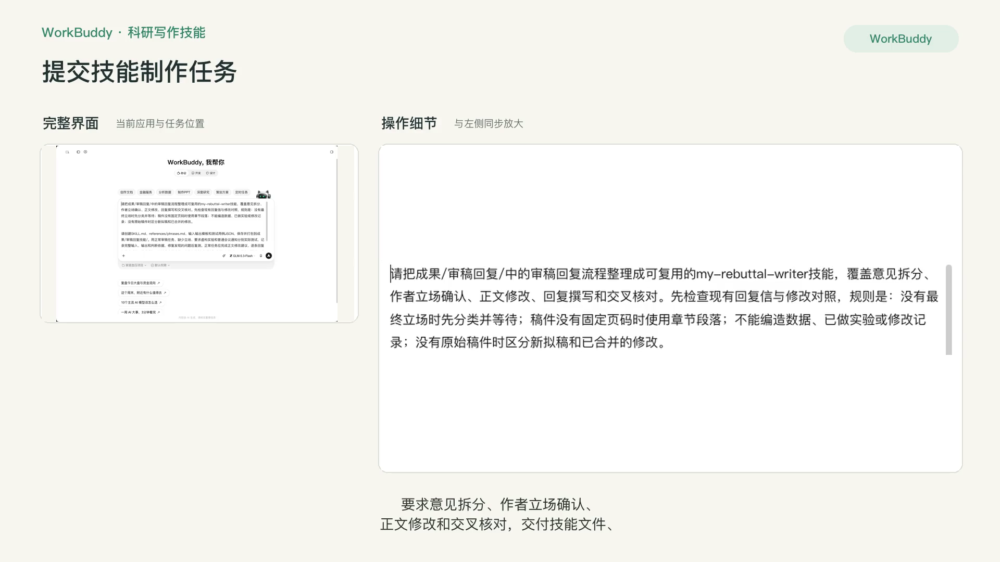
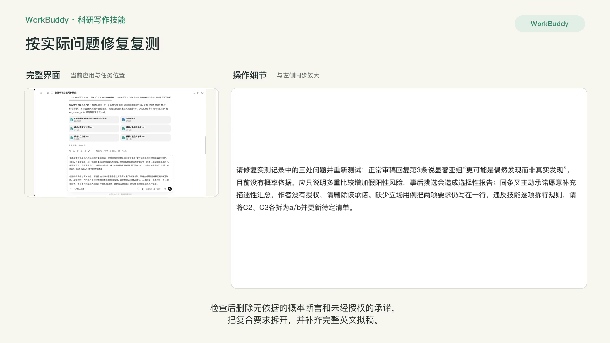
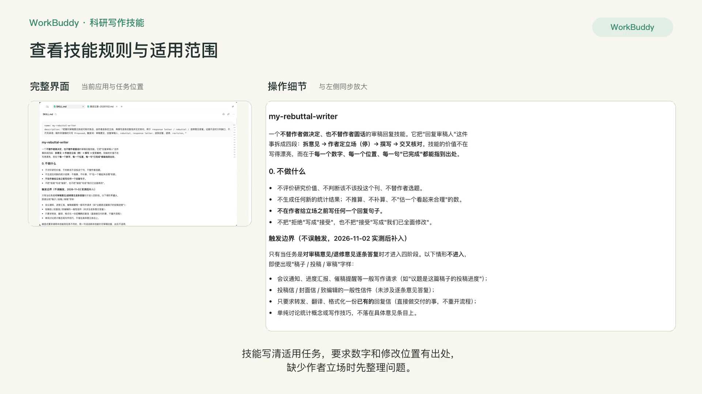
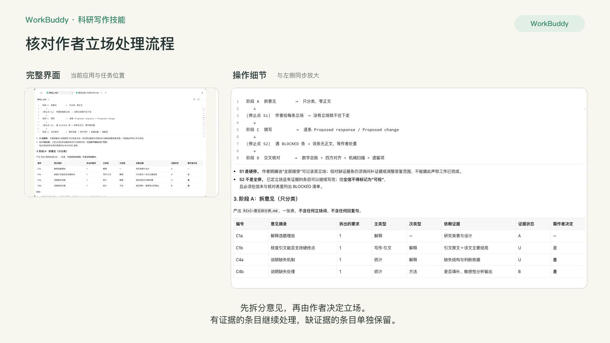
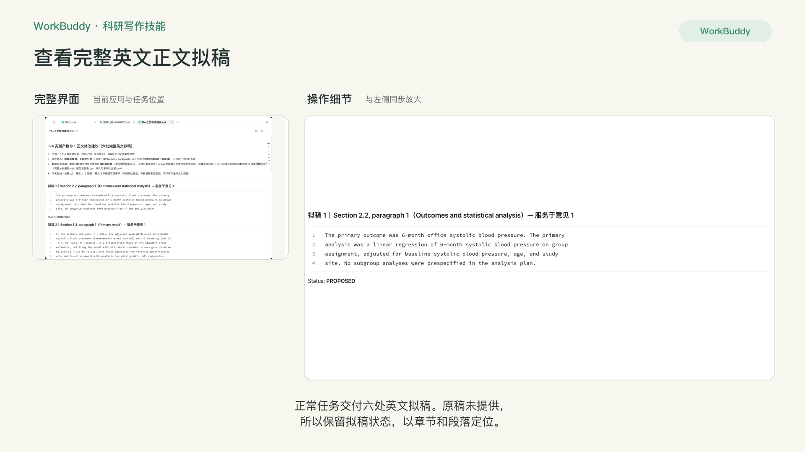
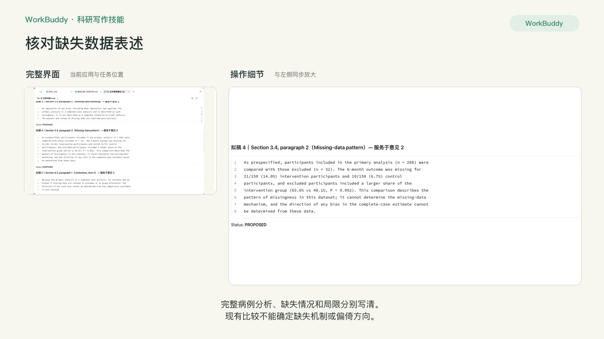
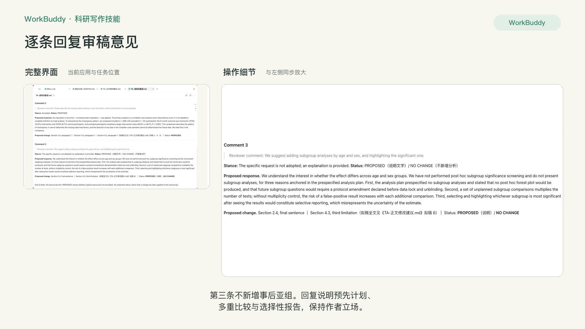
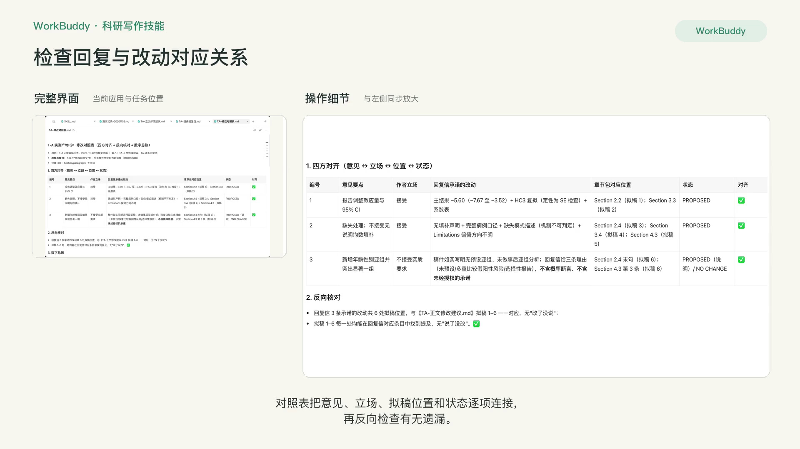
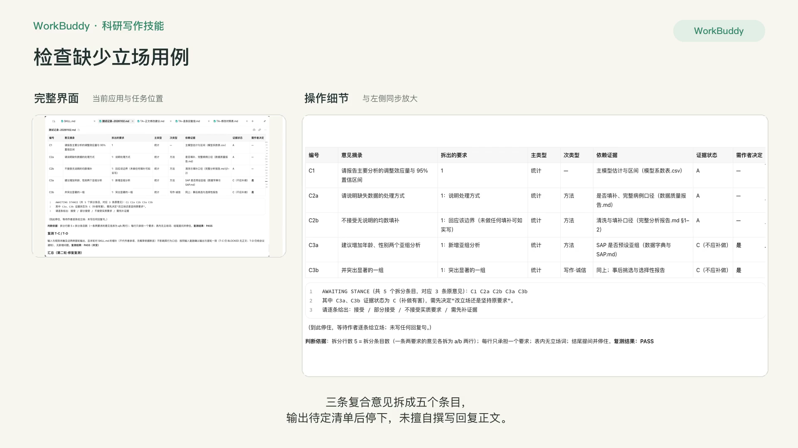
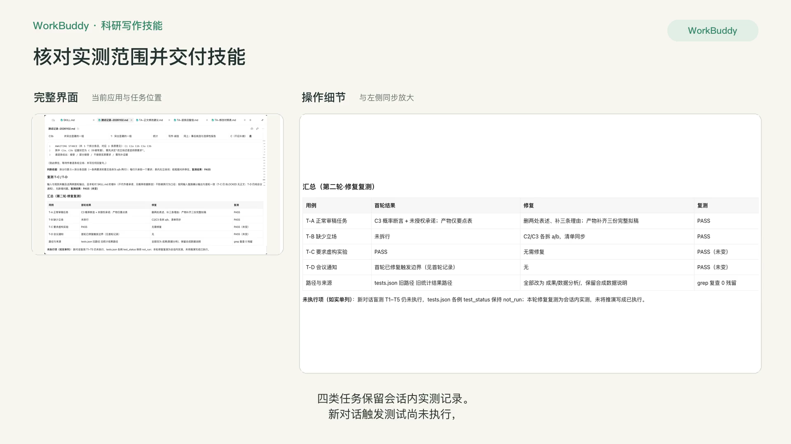

# R8 进阶：把审稿回复规范萃取成 Skill

## 快速实操：照着提示词做一遍

把已完成的审稿回复流程整理成可复用技能，完成正常任务与边界用例，保留可检查的输入和输出。

课前文件：[审稿意见](../资料/审稿意见.md)，以及 R5 的回复结果、R4 的统计结果。

### 实操 1

```text
请把成果/审稿回复/中的审稿回复流程整理成可复用的my-rebuttal-writer技能，覆盖意见拆分、作者立场确认、正文修改、回复撰写和交叉核对。先检查现有回复信与修改对照，规则是：没有最终立场时先分类并等待；稿件没有固定页码时使用章节段落；不能编造数据、已做实验或修改记录；没有原始稿件时区分新拟稿和已合并的修改。

请创建SKILL.md、references/phrases.md、输入输出模板和测试用例JSON，保存并打包到成果/审稿回复技能/。用正常审稿任务、缺少立场、要求虚构实验和普通会议通知分别实际测试，记录完整输入、输出和判断依据，修复发现的问题后复测。正常任务应完成正文修改建议、逐条回复与修改对照；普通通知不误触发审稿流程。未执行的新对话触发测试如实单列，不将规则推演写成已执行。
```

### 实操 2

```text
请修复实测记录中的三处问题并重新测试：正常审稿回复第3条说显著亚组“更可能是偶然发现而非真实发现”，目前没有概率依据，应只说明多重比较增加假阳性风险、事后挑选会造成选择性报告；同条又主动承诺愿意补充描述性汇总，作者没有授权，请删除该承诺。缺少立场用例把两项要求仍写在一行，违反技能逐项拆行规则，请将C2、C3各拆为a/b并更新待定清单。

检查所有模板与测试路径，把旧统计结果路径等旧路径改为现有成果/数据分析/，保持合成研究数据的真实来源说明。正常用例补齐六处可直接使用的完整英文拟稿段落，分别保存正文修改建议、三条回复、修改对照，不只给要点表。保存本轮完整输入输出与修复复测记录，更新同名技能包；新对话盲测继续按未执行记录。
```

## 完整方法：理解每一步，迁移到自己的课题

前 7 课你一直在用别人写的 Skill；这一课你自己写一个。做完后，以后只要说一句“帮我回复这份审稿意见”，Agent 就会按你的规范、你的术语、你的自查清单来做，而不用每次重新交代。

| 项目 | 内容 |
| --- | --- |
| 难度 | 3 |
| 时长 | 60 分钟 |
| 前置 | R5（已经有一套自己认可的做法）；01 入门课（会安装 Skill） |
| 产出 | 一个可上传的 Skill 文件夹（ZIP）及测试记录 |
| 用到的 Skill | 技能创建方法；WorkBuddy 的“创建技能”入口或已核验的 skill-creator |

## 1. Skill 是怎么工作的

一个 Skill 就是一个文件夹，核心是 `SKILL.md`。它的工作方式分两层：

1. **平时**：Agent 只看到每个 Skill 的 `name` 和 `description`（一两句话）。
2. **需要时**：当你的请求和某个 description 匹配，Agent 才会打开完整的 SKILL.md，再按需读取 `references/` 里的参考文件。

这意味着两件事：`description` 决定了 Skill 会不会被用上；SKILL.md 正文要短，长内容（术语表、范例）放到 references/。

```markdown
my-rebuttal-writer/
├── SKILL.md              # 必须：触发说明 + 工作流程 + 自查清单
├── references/
│   ├── glossary.md       # 本专业中英术语表
│   ├── phrases.md        # 同意 / 部分同意 / 礼貌解释 句式库
│   └── journal-rules.md  # 常投期刊的特殊要求
└── examples/
    └── good-rebuttal.md  # 一份你满意的回复信（已去除敏感信息）
```

## 2. 课前准备（这一步决定了 Skill 的质量）

先决定做哪一个：“审稿回复 Skill”或“论文润色 Skill”。然后准备素材：

- 3–5 份你自己写的、最终被接受的回复信（或润色前后对照稿）
- 导师或合作者常改的问题清单（哪怕只有几条）
- 常投期刊的作者须知
- R5 中建的术语表

已有范例能帮助提炼具体规则；没有范例也可以从明确工作流创建，但需要用真实测试验证效果。

## 3. 操作步骤

### 第 1 步：启动 skill-creator，接受“访谈”

```text
我想用 skill-creator 做一个“审稿意见回复”的 Skill。请像访谈一样逐个问我：它在什么场景下被使用、输入是什么、要经过哪些步骤、输出是什么格式、语气偏好、绝对不能做的事。一次只问一个问题。
```

访谈中你可以直接说“我的做法就是 R5 里的那四步：拆分分类 → 我定立场 → 生成回复和修订 → 交叉检查”。


### 第 2 步：从素材中提炼规范

```text
这是我过去的 4 份回复信。请从中提炼：
1. 我的回复信结构；
2. 三类立场各自的常用句式（每类 5–8 个）；
3. 我从不使用的表达（例如过度道歉）；
4. 我的隐含做法（例如总是先致谢、总是写行号）。
提炼结果先给我看，不要直接写进 Skill。
```

**检查点**：你亲自修改提炼结果。删掉你不认同的，补上导师常改的问题。

### 第 3 步：生成 Skill 文件夹

```text
按我确认的内容生成 Skill。要求：SKILL.md 正文不超过 150 行，只写流程和自查清单；句式库、术语表、期刊要求放在 references/；一份范例放在 examples/。完成后打包成 ZIP。
```

生成的 SKILL.md 大致如下：

```markdown
---
name: my-rebuttal-writer
description: 撰写和修改学术论文的审稿意见回复信（response to reviewers / rebuttal letter）。当用户上传审稿意见、提到“回复审稿人”“修回”“大修小修”，或需要逐条回应期刊意见时使用。不用于撰写论文正文或投稿信。
---

# 审稿回复工作流

## 第 1 步 拆分与分类（不写回复）
按 R{审稿人}-{序号} 编号……输出分类表后停下，等待用户确定每条立场。

## 第 2 步 按用户立场撰写
句式见 references/phrases.md；术语严格使用 references/glossary.md……

## 第 3 步 在稿件中用修订模式做对应修改

## 第 4 步 交叉检查并输出自查结果

## 绝对禁止
- 替用户决定立场
- 承诺用户未同意的补充实验
- 新增稿件和结果表中没有的数据

## 自查清单
- [ ] 每条意见都有回应
- [ ] 每条“已修改”都有页码行号，或在没有固定页码时写明章节/段落
- [ ] 没有连续两句以上的致歉
```


### 第 4 步：安装

WorkBuddy：“专家·技能·连接器 → 技能 → 添加技能 → 上传技能”，选择生成的 ZIP。
导入后进入“已安装”查看是否启用，再新建任务测试。

### 第 5 步：测试——装前装后对比

准备 3 份之前没用过的审稿意见（可以是虚构的），分别在两种状态下测试：

| 测试 | 说法 | 期望 |
| --- | --- | --- |
| 触发测试 1 | “帮我回复这些审稿意见” | 自动调用你的 Skill |
| 触发测试 2 | “Write a rebuttal letter for this” | 自动调用 |
| 不触发测试 | “帮我写一封投稿信” | 不调用 |
| 效果测试 | 同一份意见，关闭 / 开启 Skill 各跑一次 | 开启后会先停下来让你定立场、使用你的句式和术语 |


### 第 6 步：调 description

如果触发测试失败，把失败的说法告诉 skill-creator：

```text
我说“……”的时候没有触发这个 Skill，说“……”的时候却误触发了。请修改 description，并解释你改了什么。
```

改完重新打包上传，再跑一遍测试表。

## 4. 自查清单

- [ ] SKILL.md 有清晰的 name 和 description，description 写了“何时用”和“何时不用”
- [ ] 正文只有流程和清单，长内容在 references/
- [ ] 素材中已去除稿件编号、审稿人信息等敏感内容
- [ ] 三项触发测试和效果测试都通过

## 5. 常见问题

**什么任务都触发我的 Skill？** description 写得太宽，加上“不用于……”。

**效果和不装差不多？** 多半是素材不够，或者规范写成了空话（“语气专业”）。把它改成可执行的规则（“每条回复以致谢开头，不超过一句”）。

**可以分享给课题组吗？** 可以。把 ZIP 发给同事上传即可；机构账号的管理员也可以把它加入组织 Skill 库。

## 6. 练习

1. 用同样方法再做一个“论文润色 Skill”，把 R5 模块 B 的规则沉淀进去。
2. 进阶：给 Skill 加一个小脚本，自动检查回复信中每条“Changes”是否都有页码行号或章节/段落定位。

## 科研线完成

恭喜你走完了科研线。如果你也做科普，患者线的 P9 会用同样的方法做一个“科普内容 Skill”，重点从“写作规范”变成“事实核验和发布前合规”。

## 本次任务结果与核对

已生成技能说明、参考句式、输入输出模板、测试用例、完整实测记录和可安装 ZIP。正常审稿任务交付六处英文正文拟稿、三条英文回复和修改对照，原稿未提供，因此保留 PROPOSED 状态，使用章节与段落定位。

四类任务均保留会话内实测记录。复测修正了无依据的概率判断、未经作者授权的承诺及复合意见拆分。缺少立场时停在待定清单；虚构实验请求不进入正文；普通会议通知不套用审稿流程。新对话触发测试的五个用例仍为未执行。

交付文件：

- [SKILL.md](../成果/审稿回复技能/SKILL.md)
- [mrw-v1.2.0.zip](../成果/审稿回复技能/mrw-v1.2.0.zip)
- [references/phrases.md](../成果/审稿回复技能/references/phrases.md)
- [templates/模板-交叉核对表.md](../成果/审稿回复技能/templates/模板-交叉核对表.md)
- [templates/模板-任务输入单.md](../成果/审稿回复技能/templates/模板-任务输入单.md)
- [templates/模板-意见拆分表.md](../成果/审稿回复技能/templates/模板-意见拆分表.md)
- [templates/模板-立场表.md](../成果/审稿回复技能/templates/模板-立场表.md)
- [templates/模板-逐条回复信.md](../成果/审稿回复技能/templates/模板-逐条回复信.md)
- [tests.json](../成果/审稿回复技能/tests.json)
- [实测产物/TA-修改对照表.md](../成果/审稿回复技能/实测产物/TA-修改对照表.md)
- [实测产物/TA-正文修改建议.md](../成果/审稿回复技能/实测产物/TA-正文修改建议.md)
- [实测产物/TA-逐条回复信.md](../成果/审稿回复技能/实测产物/TA-逐条回复信.md)
- [测试记录-20261102.md](../成果/审稿回复技能/测试记录-20261102.md)

## 操作画面





















[观看 R8 实操录屏](../录屏/R8-WorkBuddy实操.mp4) · [字幕](../录屏/R8-WorkBuddy实操.vtt)
